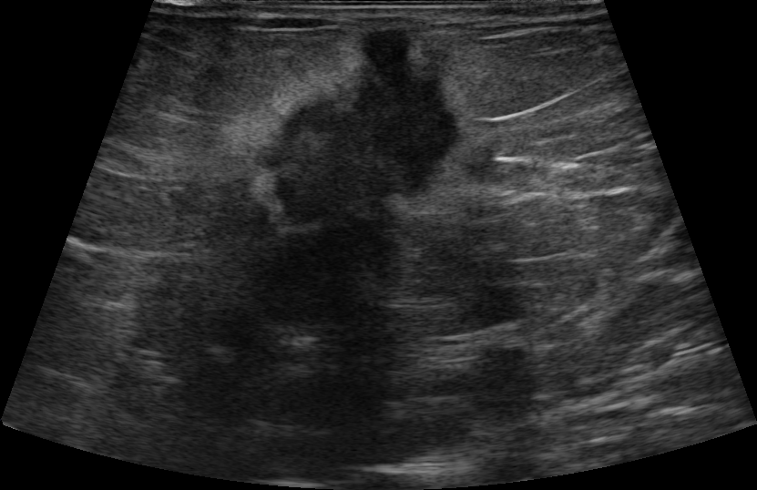

## 문제
53세 여자가 왼쪽 유방에 만져지는 멍울로 외래에 왔다. 2개월 전 샤워하다 처음 알았고 통증은 없다. 폐경은 50세였고 호르몬 치료를 받은 적이 없으며 유방암 가족력은 없다. 왼쪽 유방 위바깥쪽에 지름 약 2 cm 의 단단하고 경계가 불분명한 종괴가 만져지며, 피부 함몰이나 유두 분비물은 없다. 겨드랑이 림프절은 만져지지 않는다. 유방촬영술에서 같은 위치에 경계가 불분명한 고밀도 음영이 있다. 종괴 부위의 유방 초음파 영상은 그림과 같다. 다음 단계로 가장 적절한 것은?

- A. 미세침흡인 세포검사 후 음성이면 추적
- B. 유방 자기공명영상
- C. 변형 근치 유방절제술
- D. 초음파 유도 중심부 바늘생검
- E. 6개월 뒤 추적 초음파

_유방 초음파 회색조 영상, 원본 그대로 (TCIA, CC BY 4.0 — 자르기·보정 없음)_

## 정답 및 해설
> 정답: D

- **정답 핵심**: 초음파에서 종괴가 불규칙한 모양, 세로가 긴 비평행 방향, 불명확·각진 외곽을 보인다 — 모두 악성을 시사하는 소견이라 BI-RADS 4~5 이다. 조직 진단이 다음 단계이며, 표준은 영상 유도 중심부 바늘생검이다(조직형·호르몬수용체·HER2 까지 확인).
- **원리**: <b>모양이 말해 주는 성장 방식</b>: 양성 종괴(섬유샘종 등)는 주위 조직을 밀어내며 자라서 타원형·평행 방향·얇은 피막을 가진다. 침윤성 암은 조직면을 가로질러 <b>파고들어</b> 자라므로 외곽이 불명확하거나 각지고 가시 모양이 되고, 유방의 층(피부와 평행한 조직면)을 무시해 <b>세로가 가로보다 긴</b> 비평행 방향을 보인다. 섬유화 반응은 뒤쪽 음향 그림자를 만든다.  <b>BI-RADS 와 처치</b>: 3(양성 가능성 높음, 악성 ≤ 2 %)은 6개월 추적, 4(의심)·5(악성 강력 의심, ≥ 95 %)는 생검이다. 하나라도 의심 소견이 있으면 3으로 낮추지 않는다.  <b>왜 중심부 바늘생검인가</b>: 조직 구조를 보존해 침윤 여부와 조직형, 에스트로겐·프로게스테론 수용체와 HER2 를 수술 전에 정할 수 있어 수술 범위·선행 항암 여부를 결정한다. 미세침흡인은 세포만 얻어 침윤을 판정하지 못한다.
- **비교**: <table><thead><tr><th style="width:22%">구분</th><th style="width:39%">중심부 바늘생검(정답)</th><th>6개월 추적 초음파(가장 가까운 오답)</th></tr></thead><tbody> <tr><td>해당 BI-RADS</td><td><b>4~5 — 불규칙·비평행·불명확 외곽</b></td><td>3 — 타원형·평행·명확한 외곽</td></tr> <tr><td>악성 가능성</td><td>2 % 초과 ~ 95 % 이상</td><td>2 % 이하</td></tr> <tr><td>얻는 정보</td><td>침윤·조직형·수용체·HER2</td><td>크기·모양의 변화</td></tr> </tbody></table> 악성 소견이 하나라도 있으면 추적이 아니라 생검이다 — 촉진 소견(단단하고 경계 불분명)도 같은 방향이다.
- **오답 이유**:
  - ① 미세침흡인은 단순 낭종의 흡인이나 림프절 세포 확인에는 쓰이지만, 침윤 여부를 판정하지 못하고 음성이어도 의심 종괴를 배제하지 못한다.
  - ② 유방 MRI 는 암 진단이 확정된 뒤 병변 범위 평가나 BRCA 보인자 같은 고위험군 선별에 쓰며, 조직 진단을 대신하지 않는다.
  - ③ 유방절제술은 조직 진단과 병기, 수용체 상태를 확인한 뒤 환자와 수술 방식을 정할 때 고려하며, 진단 전에 하지 않는다.
  - ⑤ 6개월 추적은 타원형·평행·명확한 외곽의 BI-RADS 3 종괴(예: 젊은 여성의 전형적 섬유샘종)일 때 정답이 된다.
- **함정**: 유방촬영에서 덩어리가 확실하지 않으니 추적하려는 것 — 초음파의 불규칙·비평행·불명확 외곽은 그 자체로 생검 기준이다.
- **학습목표**: 유방 초음파에서 불규칙한 모양·비평행 방향·불명확한 외곽의 저에코 종괴를 악성 의심(BI-RADS 4~5)으로 읽고 초음파 유도 중심부 바늘생검을 고른다
- **근거·출처**: American College of Radiology. ACR BI-RADS Atlas, 5th ed. Ultrasound. Reston, VA: ACR; 2013 · NCCN Clinical Practice Guidelines in Oncology: Breast Cancer Screening and Diagnosis. Version 2.2024

## 출처
- BrEaST-Lesions-USG, The Cancer Imaging Archive (CC BY 4.0) · case013 · Creative Commons Attribution 4.0 International · https://www.cancerimagingarchive.net/data-usage-policies-and-restrictions/
