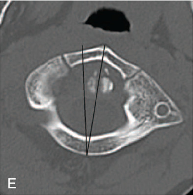

## 문제
A 7-year-old boy is brought to the emergency department 1 day after he fell from the monkey bars at a playground and landed on his head and right shoulder. Since then he has held his head tilted to the right with the chin rotated to the left, and he cries when anyone tries to turn his head back to the midline. He has had no recent fever or sore throat. His temperature is 36.8°C (98.2°F). The posterior neck is tender, and there is no mass in either sternocleidomastoid muscle. Strength, sensation, and deep tendon reflexes are normal in all extremities. An axial CT image of the cervical spine at the level of the atlas is shown. Which of the following is the most likely diagnosis?

- A. Jefferson burst fracture of the atlas
- B. Congenital muscular torticollis
- C. Atlanto-occipital dissociation
- D. Hangman fracture of the axis
- E. Atlantoaxial rotatory subluxation

_Axial CT at the level of the atlas, bone window — one panel cropped from a published case figure; the two black lines and the panel letter are the authors' original markings (PMC Open Access Subset, CC BY — no adjustment)_

## 정답 및 해설
> 정답: E

- **정답 핵심**: After minor trauma the child holds a 'cock-robin' posture (tilt to one side, chin rotated to the other) and cannot correct it. On the axial CT the ring of the atlas is rotated relative to the dens, with the right lateral mass displaced anteriorly — the atlas is locked in rotation on the axis. This is atlantoaxial rotatory subluxation (fixation).
- **원리**: <b>Why C1–C2 is the rotation joint</b>: about half of all cervical rotation occurs at the atlantoaxial joint, which has flat, horizontally oriented facets and is held mainly by ligaments (transverse and alar ligaments and the joint capsules), not by bony interlocking.  <b>Why children</b>: in children the facets are shallower, the ligaments and capsules more lax, and the head relatively large, so a minor fall or even pharyngeal inflammation (Grisel syndrome) can let the atlas rotate and stay locked; capsular swelling or muscle spasm then holds it there.  <b>Reading the axial CT</b>: in rotatory subluxation the C1 ring stays intact but is turned on the dens — one lateral mass moves forward and the other backward (here the right lateral mass is anterior, matching a chin turned to the left). The posture is the clue: the head tilts toward one side and the chin turns to the other.  <b>Pitfall</b>: in young children, unfused synchondroses of the atlas can look like fracture lines; a burst fracture needs separated ring fragments with lateral mass spreading.
- **비교**: <table><thead><tr><th style="width:22%">Feature</th><th style="width:39%">Rotatory subluxation (answer)</th><th>Jefferson burst fracture (closest distractor)</th></tr></thead><tbody> <tr><td>Mechanism</td><td><b>Minor fall or rotation; child</b></td><td>Axial load on the vertex (diving), adult</td></tr> <tr><td>Axial CT</td><td>Intact ring rotated on the dens; one lateral mass anterior</td><td>Ring broken in ≥ 2 places, fragments spread outward</td></tr> <tr><td>Posture</td><td>Cock-robin: tilt one way, chin the other</td><td>Neck pain; no fixed rotation</td></tr> </tbody></table> A rotated but continuous ring points to C1–C2 subluxation; a separated ring points to a burst fracture.
- **오답 이유**:
  - (A) A Jefferson fracture would be correct after a vertical axial load such as a dive into shallow water, with the C1 ring broken and the lateral masses spread outward.
  - (B) Congenital muscular torticollis presents in early infancy with a firm sternocleidomastoid mass or fibrosis; it would fit a 6-week-old, not an acute post-fall 7-year-old.
  - (C) Atlanto-occipital dissociation would show a widened occipital condyle–C1 joint after a high-energy injury, usually with severe neurologic deficits or death.
  - (D) A hangman fracture is a bilateral C2 pars interarticularis fracture from hyperextension, seen on lateral views below the atlas, not as C1 ring rotation.
- **함정**: Seeing a lucent line in a child's C1 ring and calling it a burst fracture — unfused synchondroses mimic fractures; the key finding is rotation of an intact ring on the dens.
- **학습목표**: 외상 뒤 고개를 한쪽으로 기울이고 반대쪽으로 돌린 아이의 C1 축상 CT 에서 환추가 치아돌기에 대해 돌아간 것을 읽어 환축추 회전 아탈구로 진단하고, 환추 파열골절과 구별한다
- **근거·출처**: Fielding JW, Hawkins RJ. Atlanto-axial rotatory fixation (fixed rotatory subluxation of the atlanto-axial joint). J Bone Joint Surg Am 1977;59:37-44 · Neal KM, Mohamed AS. Atlantoaxial rotatory subluxation in children. J Am Acad Orthop Surg 2015;23:382-392

## 출처
- Traumatic atlanto-axial rotatory subluxation and dens fracture with subaxial SCIWORA of Brown-Sequard syndrome: A case report. Medicine (Baltimore). 2021 Apr 23;100(16):e25588. doi: 10.1097/MD.0000000000025588 (CC BY) — Figure 1 · CC BY · https://creativecommons.org/licenses/
