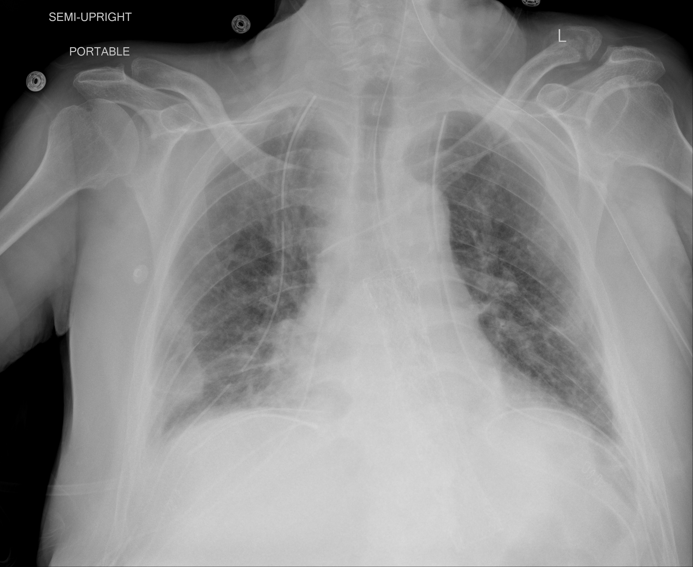

## 문제
64세 남자가 중환자실에서 기관삽관 3일째이다. 열과 기침으로 입원한 뒤 호흡곤란이 빠르게 악화되어 기관삽관하였다. 혈압 124/70 mmHg, 맥박 96회/분, 체온 37.8℃이다. 일회호흡량 6 mL/kg(예측체중), 호기말양압 10 cmH2O 로 환기 중이며, 흡입산소분율 0.6 에서 동맥혈 PaO2 62 mmHg, PaCO2 41 mmHg 였고, 흡입산소분율을 1.0 으로 올리고 20분 뒤 PaO2 는 68 mmHg 였다. 혈색소는 13.2 g/dL 이고, 심장초음파에서 좌심실 박출률은 58 % 이며 심방중격을 통한 흐름은 없다. 휴대용 흉부 X선 사진은 그림과 같다. 이 환자의 저산소혈증을 일으키는 주된 기전으로 가장 적절한 것은?

- A. 폐포 저환기
- B. 폐포-모세혈관 확산 장애
- C. 흡입 산소분압 저하
- D. 폐내 단락
- E. 환기-관류 불균형

_휴대용 반좌위 전후 흉부 X선, 위치·방향 글자는 원본의 것 (TCIA, CC BY 4.0 — DICOM 을 표준 창으로 변환, 크롭·보정 없음)_

## 정답 및 해설
> 정답: D

- **정답 핵심**: 양쪽 폐 하부·말초에 퍼진 간유리·경화 음영은 폐포가 액체로 차 있다는 뜻이다. 흡입산소분율을 0.6 에서 1.0 으로 올려도 PaO2 가 62 에서 68 mmHg 로 거의 오르지 않으므로, 환기되지 않는 폐포를 지나는 혈류(폐내 단락)가 주된 기전이다. PaCO2 가 정상이라 저환기는 아니고, 심방중격 흐름이 없어 심장 내 단락 가능성도 낮다.
- **원리**: <b>산소를 올려도 왜 안 오르나</b>: 단락 혈류는 공기가 전혀 들어가지 않는 폐포(액체·고름으로 찬 폐포, 무기폐)를 지난다. 그 폐포의 산소분압은 흡입산소를 아무리 올려도 혼합정맥혈 수준에 머물러, 그 혈액은 산소를 받지 못한 채 동맥으로 섞인다. 정상 폐포를 지난 혈액은 이미 혈색소가 거의 포화되어 있어 산소를 더 실을 여유가 적으니, 섞인 뒤의 PaO2 는 거의 오르지 않는다.  <b>환기-관류 불균형과의 차이</b>: 환기가 「적은」 폐포는 산소 농도를 올리면 결국 폐포 산소분압이 올라가 혈액이 포화된다 — 그래서 100 % 산소에 잘 반응한다.  <b>ARDS 의 처치 논리</b>: 단락은 산소 농도로는 못 고치고, 닫힌 폐포를 다시 여는 호기말양압·엎드린 자세로 줄인다.
- **비교**: <table><thead><tr><th style="width:22%">구분</th><th style="width:39%">폐내 단락(정답)</th><th>환기-관류 불균형(가장 가까운 오답)</th></tr></thead><tbody> <tr><td>폐포 상태</td><td><b>환기 0 — 액체로 찬 폐포·무기폐</b></td><td>환기가 줄었으나 남아 있음</td></tr> <tr><td>100 % 산소 반응</td><td>거의 없음(62 → 68 mmHg)</td><td>뚜렷이 오름</td></tr> <tr><td>PaCO2</td><td>보통 정상</td><td>보통 정상</td></tr> <tr><td>교정 수단</td><td>호기말양압·폐포 재개방</td><td>산소 투여</td></tr> </tbody></table> 둘 다 폐포-동맥 산소 차이가 크고 PaCO2 는 정상이다 — 가르는 것은 산소에 대한 반응이다.
- **오답 이유**:
  - ① 폐포 저환기는 PaCO2 가 오르고 폐포-동맥 산소 차이가 정상일 때(진정제 과량·신경근 질환) 정답이 되며, 이 환자의 PaCO2 는 41 mmHg 로 정상이다.
  - ② 확산 장애는 간질성 폐질환에서 운동 시 저산소혈증이 두드러질 때 정답이 되며, 산소 투여에 잘 반응하므로 이 환자의 소견과 맞지 않는다.
  - ③ 흡입 산소분압 저하는 고지대처럼 대기압이 낮을 때 정답이 되며, 기계환기로 흡입산소분율 1.0 을 주는 환자에게는 해당하지 않는다.
  - ⑤ 환기-관류 불균형은 COPD·천식 악화·폐색전처럼 환기가 줄었지만 남아 있는 폐포가 많아 산소 투여로 PaO2 가 뚜렷이 오를 때 정답이 된다.
- **함정**: 퍼진 폐 음영 = 환기-관류 불균형이라고 넘기는 것 — 100 % 산소에도 PaO2 가 6 mmHg 만 올랐다는 반응이 단락을 가리킨다.
- **학습목표**: 양쪽 폐포 음영이 있는 기계환기 환자에서 100 % 산소로도 PaO2 가 거의 오르지 않으면 저산소혈증의 주된 기전이 폐내 단락임을 안다
- **근거·출처**: West JB, Luks AM. West's Respiratory Physiology: The Essentials, 11th ed. Wolters Kluwer; 2020. Chapter 5: Gas transport / Chapter 9: Pulmonary gas exchange in disease · ARDS Definition Task Force. Acute respiratory distress syndrome: the Berlin Definition. JAMA 2012;307:2526-2533

## 출처
- COVID-19-AR, The Cancer Imaging Archive (CC BY 4.0) · series …27537080 · Creative Commons Attribution 4.0 International · https://www.cancerimagingarchive.net/data-usage-policies-and-restrictions/
