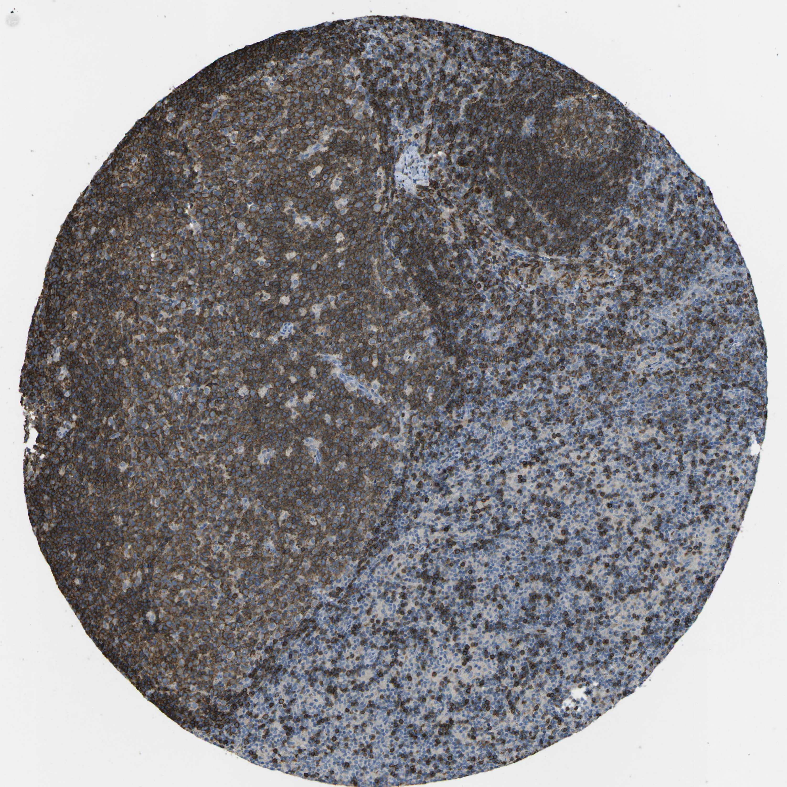

## 문제
A 55-year-old man undergoes right hemicolectomy for a cecal adenoma that could not be removed endoscopically. Pathologic examination of the specimen shows no carcinoma. One of the regional lymph nodes shows reactive changes without metastasis. A section of this lymph node is stained by immunohistochemistry for a lineage-specific surface marker; the brown-staining cells fill the rounded nodules of the cortex, while the zones between the nodules contain only scattered positive cells, as shown. A patient with a germline defect in which of the following genes would most likely have almost none of the cells that are stained in these nodules in the blood and lymph nodes, while T-cell numbers remain normal?

- A. AIRE (autoimmune regulator)
- B. BTK (Bruton tyrosine kinase)
- C. CD40LG (CD40 ligand)
- D. ADA (adenosine deaminase)
- E. IL2RG (common gamma chain)

_Immunohistochemical stain of a tissue microarray core (DAB brown chromogen, hematoxylin counterstain), original magnification (Human Protein Atlas, CC BY 4.0; no cropping or color adjustment)_

## 정답 및 해설
> 정답: B

- **정답 핵심**: The marker stains the cells that fill the cortical nodules (follicles with germinal centers and mantle zones) and only scattered cells in the interfollicular paracortex — a B-cell pattern, as with CD19 or CD20. Bruton tyrosine kinase transmits pre-B-cell receptor signals; without it, B-cell development arrests at the pre-B stage in the marrow, so mature B cells and lymphoid follicles are nearly absent while T cells are normal (X-linked agammaglobulinemia).
- **원리**: <b>Where each lineage lives in a node</b>: B cells home to the outer cortex and form follicles; antigen-stimulated follicles develop germinal centers surrounded by a mantle of naive B cells. T cells occupy the paracortex between and beneath the follicles. A lineage stain that fills the follicles and leaves the paracortex largely negative therefore marks B cells.  <b>Why BTK removes the cells, not just their function</b>: after heavy-chain rearrangement, the pre-B-cell receptor signals through BTK to drive proliferation and light-chain rearrangement. Without BTK the cells stall as pre-B cells in the marrow; circulating CD19+ B cells are usually below 1 % of lymphocytes, all immunoglobulin classes are low, and lymph nodes and tonsils are small with no follicles.  <b>Contrast with CD40L deficiency</b>: B cells are produced normally but cannot receive the T-cell help needed for germinal centers and class switching — follicles lack germinal centers, IgM is normal or high, and IgG/IgA/IgE are low.
- **비교**: <table><thead><tr><th style="width:22%">Feature</th><th style="width:39%">BTK deficiency (answer)</th><th>CD40L deficiency (closest distractor)</th></tr></thead><tbody> <tr><td>Circulating B cells</td><td><b>Nearly absent</b> — arrest at pre-B stage</td><td>Normal number</td></tr> <tr><td>Lymph node</td><td>No follicles at all</td><td>Primary follicles present, no germinal centers</td></tr> <tr><td>Immunoglobulins</td><td>All classes low</td><td>IgM normal/high; IgG, IgA, IgE low</td></tr> <tr><td>Typical infections</td><td>Encapsulated bacteria, enteroviruses after 6 months</td><td>Pneumocystis, Cryptosporidium (T-cell help also lost)</td></tr> </tbody></table> Ask "are the B cells missing, or only unable to switch?" — missing cells point to BTK; present cells with high IgM point to CD40L.
- **오답 이유**:
  - (A) AIRE defects are correct for autoimmune polyendocrinopathy with mucocutaneous candidiasis from failed thymic negative selection; lymphocyte numbers are normal.
  - (C) CD40LG defects are correct when B cells are present but cannot form germinal centers or class-switch (high IgM, low IgG); B-cell numbers stay normal.
  - (D) ADA deficiency would be correct if T cells, B cells, and NK cells were all markedly reduced by toxic deoxyadenosine metabolites; here T cells are normal.
  - (E) IL2RG defects cause X-linked SCID with absent T and NK cells but present (nonfunctional) B cells — correct only if T cells were missing.
- **함정**: Choosing CD40LG because the question is about follicles — CD40L loss removes germinal centers, but the stained B cells themselves are still there.
- **학습목표**: 림프절 면역염색에서 여포(피질의 둥근 결절)를 채우는 세포가 B세포임을 읽고, B세포 성숙이 멈추는 BTK 결함과 배중심만 없는 CD40L 결함을 구별한다
- **근거·출처**: Abbas AK, Lichtman AH, Pillai S. Cellular and Molecular Immunology, 10th ed. Elsevier; 2022. Chapter 21: Congenital and acquired immunodeficiencies · Kumar V, Abbas AK, Aster JC. Robbins and Cotran Pathologic Basis of Disease, 10th ed. Elsevier; 2021. Chapter 6: Diseases of the immune system

## 출처
- Human Protein Atlas, CD19 / Lymph node (CC BY 4.0), https://images.proteinatlas.org/16110/36120_A_7_8.jpg · Creative Commons Attribution 4.0 International · https://www.proteinatlas.org/about/licence
