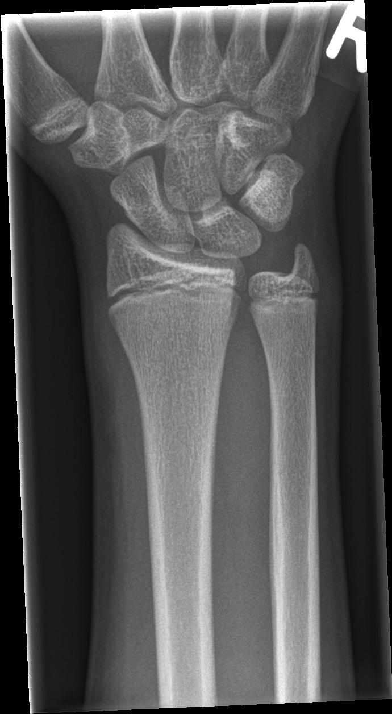

## 문제
13세 남자가 3시간 전 축구를 하다 오른손을 짚고 넘어진 뒤 생긴 손목 통증으로 응급실에 왔다. 활력징후는 정상이다. 오른쪽 손목은 약간 부어 있고, 해부학적 코담뱃갑에 뚜렷한 압통이 있으며, 엄지를 길이 방향으로 누르면 통증이 심해진다. 원위 요골 성장판 부위와 원위 척골에는 압통이 없고, 손가락의 감각과 모세혈관 재충혈은 정상이다. 오른쪽 손목 전후면 X선 사진은 그림과 같고, 측면 사진에서도 골절이나 전위는 보이지 않았다. 가장 적절한 처치는?

- A. 응급 관혈적 정복 및 나사 고정
- B. 팔걸이(삼각건)만 하고 조기 운동
- C. 엄지 포함 부목 고정 후 10~14일 뒤 재평가
- D. 탄력붕대 감고 귀가, 증상 있을 때만 재진
- E. 도수 정복 후 장상지 석고 고정

_오른쪽 손목·원위 전완 전후면 X선, 위치 표지는 원본의 것, 크기 조정만 (GRAZPEDWRI-DX, figshare, CC BY 4.0)_

## 정답 및 해설
> 정답: C

- **정답 핵심**: 넘어지며 손을 짚은 뒤 해부학적 코담뱃갑 압통과 엄지 축 압박 통증이 있으면 주상골 골절을 의심한다. 첫 X선은 주상골 골절의 일부를 놓치므로(잠복 골절), X선이 정상이어도 엄지 포함 부목으로 고정하고 10~14일 뒤 다시 진찰·촬영하거나 MRI 로 확인한다.
- **원리**: <b>왜 첫 X선을 믿지 않나</b>: 주상골은 비스듬히 놓인 작은 뼈라 금이 간 직후에는 골절선이 X선 방향과 어긋나 보이지 않을 수 있다. 1~2주가 지나 골절면의 뼈가 흡수되면 선이 넓어져 그제야 보인다.  <b>왜 놓치면 안 되나</b>: 주상골의 혈액은 원위부에서 들어와 근위부로 거꾸로 흐른다(역행성 혈류). 허리·근위부 골절을 고정하지 않으면 근위 조각으로 가는 혈류가 끊겨 불유합·무혈성 괴사가 생기고, 손목 관절염으로 이어진다.  <b>소아에서도</b>: 성장판이 열린 청소년에서는 원위 요골 성장판 손상과도 감별해야 하는데, 이 환자는 압통이 코담뱃갑에 국한되고 성장판 부위는 아프지 않다. 청소년기 손목뼈 골절 중 가장 흔한 것이 주상골이다.
- **비교**: <table><thead><tr><th style="width:22%">구분</th><th style="width:39%">엄지 포함 부목 + 재평가(정답)</th><th>붕대 후 귀가(가장 가까운 오답)</th></tr></thead><tbody> <tr><td>적응</td><td><b>코담뱃갑 압통 + X선 정상</b> — 잠복 주상골 골절 의심</td><td>압통이 없고 단순 염좌로 판단될 때</td></tr> <tr><td>위험 관리</td><td>골절이 있어도 고정되어 불유합 예방</td><td>골절을 놓치면 불유합·무혈성 괴사</td></tr> <tr><td>확인</td><td>10~14일 뒤 재촬영 또는 MRI</td><td>추적 없음</td></tr> </tbody></table> X선이 정상이어도 진찰 소견이 주상골을 가리키면 「골절로 보고 고정」이 원칙이다.
- **오답 이유**:
  - ① 관혈적 정복과 나사 고정은 전위가 1 mm 넘는 주상골 골절이나 근위부 골절이 영상으로 확인될 때 정답이 된다.
  - ② 삼각건과 조기 운동은 쇄골 골절이나 가벼운 연부조직 손상에 맞으며, 주상골 골절이 의심되는 손목은 고정해야 한다.
  - ④ 탄력붕대 후 귀가는 코담뱃갑 압통과 엄지 축 압박 통증이 없는 단순 손목 염좌일 때 정답이 되며, 이 환자에서는 잠복 골절을 놓친다.
  - ⑤ 도수 정복 후 석고 고정은 X선에서 전위된 원위 요골 골절이 확인될 때 정답이 되며, 이 환자의 X선에는 골절도 전위도 없다.
- **함정**: X선이 정상이니 염좌로 보고 돌려보내는 것 — 코담뱃갑 압통은 X선보다 앞서는 주상골 골절의 신호다.
- **학습목표**: 해부학적 코담뱃갑 압통이 있는데 첫 손목 X선이 정상이면 잠복 주상골 골절로 보고 엄지 포함 부목 고정 후 재평가함을 안다
- **근거·출처**: Rockwood and Wilkins' Fractures in Children, 9th ed. Wolters Kluwer; 2019. Chapter: Fractures and dislocations of the hand and carpal bones · Mallee WH, et al. Detecting scaphoid fractures in wrist injury: a clinical decision rule. Arch Orthop Trauma Surg 2020;140:575-581

## 출처
- GRAZPEDWRI-DX (figshare, CC BY 4.0) · Creative Commons Attribution 4.0 International · https://creativecommons.org/licenses/by/4.0/
