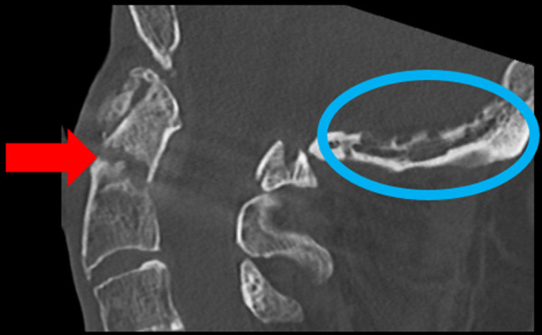

## 문제
A 70-year-old man is brought to the emergency department 2 hours after he tripped and fell forward at home, striking his forehead on the floor. He reports severe upper neck pain and holds his head with both hands. He takes amlodipine for hypertension. Blood pressure is 152/86 mm Hg and pulse is 84/min. There is a small abrasion on the forehead. He has tenderness over the upper posterior cervical spine. Strength, sensation, and reflexes are normal in all extremities. A cervical collar is placed. A sagittal CT image of the cervical spine is shown (the encircled occipital finding was judged incidental). Which of the following is the most likely diagnosis?

- A. Congenital separate ossicle above C2 (os odontoideum)
- B. Fracture through the base of the dens (type II odontoid fracture)
- C. Fracture extending into the C2 vertebral body (type III odontoid fracture)
- D. Bilateral C2 pars interarticularis fracture (hangman fracture)
- E. Burst fracture of the C1 ring (Jefferson fracture)

_Sagittal CT of the upper cervical spine and craniocervical junction, bone window — one panel cropped from a published case figure; the red arrow and blue ellipse are the authors' original markings (PMC Open Access Subset, CC BY — no adjustment)_

## 정답 및 해설
> 정답: B

- **정답 핵심**: The sagittal CT shows a fracture line crossing the base of the dens (arrow), at its junction with the C2 body, with slight displacement of the dens fragment; the line does not run down into the cancellous C2 body. In an older adult who falls forward onto the head, this is the typical type II odontoid fracture — the most common C2 fracture in the elderly.
- **원리**: <b>Why the base of the dens breaks in older adults</b>: with age, the dens becomes osteoporotic while the atlantoaxial joint stiffens. A low-energy fall onto the forehead hyperextends (or flexes) the head, and C1 levers the dens against the C2 body; the narrow waist at the base is where the force concentrates.  <b>Why the level matters (Anderson–D'Alonzo)</b>: type I is a tip avulsion; type II crosses the base, where the contact surface is small, mostly cortical, and the blood supply is a watershed — nonunion is common, especially with displacement, older age, and posterior angulation; type III runs into the broad cancellous C2 body and usually heals in an orthosis.  <b>Reading the image</b>: follow the fracture line — if it stays at the dens waist it is type II; if it dips into the body below the C2 superior articular facets it is type III.
- **비교**: <table><thead><tr><th style="width:22%">Feature</th><th style="width:39%">Type II odontoid (answer)</th><th>Type III odontoid (closest distractor)</th></tr></thead><tbody> <tr><td>Fracture line</td><td><b>Across the base/waist of the dens</b></td><td>Into the cancellous C2 body</td></tr> <tr><td>Bone contact</td><td>Small, mostly cortical</td><td>Broad, cancellous</td></tr> <tr><td>Nonunion risk</td><td>High — often fixed surgically in displaced cases</td><td>Low — usually heals in a collar or halo</td></tr> </tbody></table> Same mechanism, different level: the deeper the line goes into the body, the better the healing.
- **오답 이유**:
  - (A) Os odontoideum is correct when a rounded ossicle with smooth corticated margins sits above a short, rounded dens stump, without an acute fracture line.
  - (C) Type III fracture is correct when the line extends below the dens base into the C2 body, often involving the superior articular facets.
  - (D) Hangman fracture is correct when the fracture runs through both C2 pars (the neural arch) with anterior slip of C2 on C3, usually after hyperextension with axial load.
  - (E) Jefferson fracture is correct when an axial load splits the C1 ring at the anterior and posterior arches, seen best on axial CT with lateral mass spread.
- **함정**: Calling any dens fracture type III because the fragment looks attached to the body — trace whether the line stays at the waist or enters the cancellous body.
- **학습목표**: 고령자 낙상 뒤 시상 경추 CT 에서 치아돌기 기저부를 가로지르는 골절선을 읽어 II형 치아돌기 골절을 진단하고 III형·Hangman 골절과 구별한다
- **근거·출처**: Anderson LD, D'Alonzo RT. Fractures of the odontoid process of the axis. J Bone Joint Surg Am 1974;56:1663-1674 · Tintinalli's Emergency Medicine: A Comprehensive Study Guide, 9th ed. McGraw-Hill; 2020. Chapter 258: Spine trauma

## 출처
- Case report: Interdisciplinary treatment of complex C1/C2 fractures in a patient with concomitant three-vessel coronary artery disease requiring bypass surgery. Front Surg. 2023 May 16;10:1123947. doi: 10.3389/fsurg.2023.1123947 (CC BY) — Figure 1 · CC BY · https://creativecommons.org/licenses/
