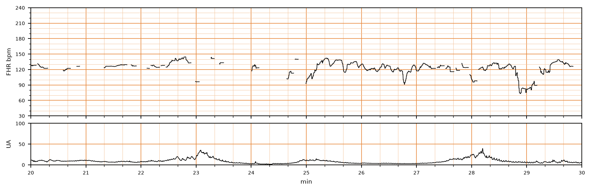

## 문제
39세 초산부가 임신 40주에 진통으로 입원하였다. 입원 2시간 전 양막이 저절로 터졌고 양수는 맑았다. 혈압 118/72 mmHg, 맥박 84회/분, 체온 36.9℃이다. 내진에서 자궁경부는 5 cm 열려 있고 태아 머리가 −1 위치에 있다. 산모는 체질량지수 36 kg/m²이고 자주 몸을 뒤척인다. 옥시토신은 쓰지 않고 있다. 복부에 붙인 외부 탐촉자로 기록한 태아심박동과 자궁수축 기록은 그림과 같다. 다음 조치로 가장 적절한 것은?

- A. 태아 두피 전극 부착
- B. 응급 제왕절개
- C. 흡입 분만
- D. 자궁수축억제제 투여
- E. 2시간 뒤 다시 기록

_분만 중 태아심박동(위)과 자궁활동(아래), 기록 시작 후 20~30분 구간, 굵은 세로선 = 1분 (PhysioNet CTU-UHB, ODC-BY 1.0 — 4 Hz 원자료, 평활화 없음)_

## 정답 및 해설
> 정답: A

- **정답 핵심**: 기록의 앞쪽 절반은 태아심박동 선이 수십 초마다 끊겨 기준선·변이도·감속을 판정할 수 없고, 끝 무렵에는 신호가 끊기는 사이에 75회/분까지 떨어지는 구간이 있다. 비만과 산모의 움직임으로 외부 탐촉자 신호가 불안정한 것이다. 양막이 터졌고 자궁경부가 열려 있으므로 태아 두피 전극으로 태아 심전도 R파를 직접 세어 믿을 수 있는 기록을 먼저 얻는 것이 다음 단계다.
- **원리**: <b>외부 감시가 끊기는 이유</b>: 복부 탐촉자는 도플러 초음파로 태아 심장벽·판막의 움직임을 잡는다. 산모 복벽이 두껍거나 산모·태아가 움직이면 초음파 빔이 심장을 벗어나 선이 끊기고, 때로는 산모 대동맥 박동(산모 맥박)을 잘못 잡는다.  <b>내부 감시의 원리</b>: 두피 전극은 태아 피부에 붙어 태아 심전도의 R-R 간격으로 심박수를 계산하므로, 박동마다 끊김 없는 기록과 정확한 변이도를 준다. 조건은 <b>양막 파열·자궁경부 개대·선진부가 머리</b>이고, 산모 HIV·B형간염 등 수직 감염 위험이나 태아 출혈 경향이 있으면 쓰지 않는다.  <b>순서</b>: 감속이 의심되는 구간이 있어도 그것이 진짜 태아 심박인지 확인하지 못하면 분만 방식을 정할 근거가 없다 — 「해석할 수 있는 기록」이 먼저다.
- **비교**: <table><thead><tr><th style="width:22%">구분</th><th style="width:39%">태아 두피 전극(정답)</th><th>응급 제왕절개(가장 가까운 오답)</th></tr></thead><tbody> <tr><td>전제</td><td><b>기록을 믿을 수 없다 — 먼저 확인</b></td><td>믿을 수 있는 기록이 3단계(비정상)임을 확인</td></tr> <tr><td>이 기록</td><td>신호 소실이 잦아 기준선·변이도 판정 불가</td><td>지속되는 서맥·변이도 소실이 확인되지 않음</td></tr> <tr><td>조건</td><td>양막 파열·경부 개대·두위</td><td>태아 상태가 나쁘다는 확인 + 질식분만이 곧 어려움</td></tr> </tbody></table> 「끊긴 선 사이의 낮은 값」은 태아 서맥일 수도, 신호 탐지 오류일 수도 있다 — 내부 감시로 가린 뒤에야 수술을 결정한다.
- **오답 이유**:
  - ② 응급 제왕절개는 믿을 수 있는 기록에서 지속되는 서맥·변이도 소실 같은 3단계 소견이 확인되고 질식분만이 곧 어려울 때 정답이 된다.
  - ③ 흡입 분만은 자궁경부가 완전히 열리고 머리가 충분히 내려온 분만 2기에 태아 곤란이 확인될 때 정답이 되며, 5 cm 개대에서는 할 수 없다.
  - ④ 자궁수축억제제는 과다수축(10분에 5회 초과)과 함께 태아심박동 이상이 있을 때 정답이 되며, 이 기록의 수축 빈도는 높지 않다.
  - ⑤ 2시간 뒤 재기록은 해석 가능한 1단계(정상) 기록이 이어질 때 적절하며, 판정할 수 없는 기록을 그대로 두면 태아 상태를 놓친다.
- **함정**: 끝 무렵의 낮은 값만 보고 바로 제왕절개를 고르는 것 — 신호가 끊긴 기록에서 먼저 할 일은 진짜 태아 심박을 확인하는 것이다.
- **학습목표**: 외부 태아심박동 감시에서 신호가 자주 끊겨 기록을 해석할 수 없으면 양막이 터진 산모에게 태아 두피 전극으로 내부 감시를 하는 것을 안다
- **근거·출처**: ACOG Practice Bulletin No. 106: Intrapartum fetal heart rate monitoring: nomenclature, interpretation, and general management principles. Obstet Gynecol 2009;114:192-202 · Cunningham FG, et al. Williams Obstetrics, 26th ed. McGraw-Hill; 2022. Chapter 24: Intrapartum assessment

## 출처
- CTU-UHB Intrapartum Cardiotocography Database (PhysioNet, ODC-BY 1.0) · record 1347 · Open Data Commons Attribution License v1.0 · https://opendatacommons.org/licenses/by/1-0/
