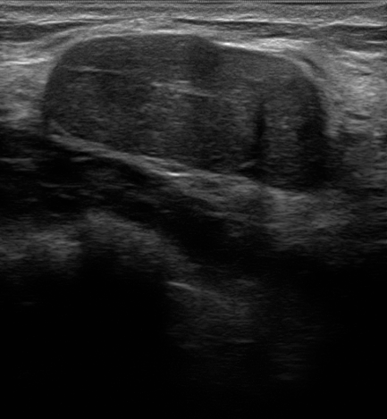

## 문제
23세 여자가 2개월 전 샤워하다 왼쪽 유방에서 만져지는 멍울을 발견하여 왔다. 통증은 없고 월경 주기에 따라 크기가 변하지 않았다. 유두 분비물은 없다. 출산력은 없고, 유방암·난소암 가족력은 없다. 진찰에서 왼쪽 유방 위바깥쪽에 지름 2.5 cm의 단단하고 잘 움직이는 경계가 매끈한 종괴가 만져지고, 피부 변화와 겨드랑이 림프절 비대는 없다. 유방 초음파 사진은 그림과 같고, 판독의는 BI-RADS 3 으로 분류하였다. 다음 조치로 가장 적절한 것은?

- A. 수술적 절제생검
- B. 타목시펜 투여
- C. 6개월 뒤 유방 초음파 추적
- D. 초음파 유도 중심부 바늘생검
- E. 유방촬영술

_유방 초음파 회색조 영상, 원본 그대로 (TCIA, CC BY 4.0 — 자르기·보정 없음)_

## 정답 및 해설
> 정답: C

- **정답 핵심**: 초음파에서 종괴는 타원형이고 외곽이 매끈하며 피부와 평행(가로가 세로보다 김)하고 얇은 피막이 있으며 후방 음향 그림자나 석회가 없다 — 섬유샘종의 전형적 소견으로 BI-RADS 3(악성 가능성 2 % 이하)이다. 젊고 위험인자가 없으며 진찰도 양성 소견과 일치하므로 6개월 뒤 초음파로 안정성을 확인하는 단기 추적이 원칙이다.
- **원리**: <b>BI-RADS 3 의 뜻</b>: 「아마도 양성」 — 악성 가능성이 2 % 이하라 조직검사 대신 영상 추적으로 안정성을 증명한다. 보통 6개월 뒤, 이후 6~12개월 간격으로 총 2년 변화가 없으면 양성(BI-RADS 2)으로 내린다.  <b>왜 이 모양이 양성인가</b>: 섬유샘종은 피막에 싸여 주변을 밀어내며 자라므로 외곽이 매끈하고, 조직면을 따라 옆으로 자라 피부와 평행(가로 > 세로)이 된다. 악성은 조직을 뚫고 수직으로 침윤해 「세로가 더 긴」 모양·각진 또는 침상 외곽·후방 그림자를 만든다.  <b>추적이 아니라 생검으로 바꾸는 신호</b>: 추적 중 크기가 20 % 넘게 커짐, 모양 변화, 환자의 강한 불안, 추적이 불가능한 상황, 그리고 고위험(BRCA 보인자 등).
- **비교**: <table><thead><tr><th style="width:24%">구분</th><th style="width:38%">6개월 추적(정답)</th><th>중심부 바늘생검(가장 가까운 오답)</th></tr></thead><tbody> <tr><td>BI-RADS</td><td><b>3 — 악성 가능성 ≤ 2 %</b></td><td>4 이상 — 2 % 초과(4A 2~10 %)</td></tr> <tr><td>초음파 모양</td><td>타원·외곽 명확·평행·얇은 피막</td><td>불규칙·각진/미세분엽 외곽·비평행·후방 그림자</td></tr> <tr><td>임상</td><td>젊고 위험인자 없음, 변화 없음</td><td>빠른 성장·고위험·추적 불가</td></tr> </tbody></table> 같은 섬유샘종이라도 「빠르게 커진다」면 엽상종양 가능성 때문에 생검 쪽으로 넘어간다.
- **오답 이유**:
  - ① 절제생검은 바늘생검 결과가 영상과 맞지 않거나 엽상종양이 의심되는 빠르게 커지는 큰 종괴일 때 정답이 된다.
  - ② 타목시펜은 고위험 여성의 유방암 위험 감소나 호르몬 수용체 양성 유방암 치료에 쓰며, 양성 종괴의 치료가 아니다.
  - ④ 중심부 바늘생검은 BI-RADS 4 이상이거나, BI-RADS 3 이라도 추적 중 크기가 뚜렷이 커지거나 고위험군·추적 불가일 때 정답이 된다.
  - ⑤ 유방촬영술은 30~40세 이상에서 만져지는 종괴를 평가할 때 초음파와 함께 쓰며, 23세의 치밀유방에서는 첫 검사로 권하지 않는다.
- **함정**: 만져지는 멍울은 무조건 조직검사라고 생각하는 것 — 초음파가 전형적 양성(BI-RADS 3)이고 위험인자가 없으면 단기 추적이 원칙이다.
- **학습목표**: 젊은 여성의 유방 종괴가 초음파에서 타원형·외곽 명확·피부와 평행한 전형적 양성 소견(BI-RADS 3)이면 6개월 단기 추적 초음파가 원칙임을 안다
- **근거·출처**: American College of Radiology. ACR BI-RADS Atlas, 5th ed. 2013 — Ultrasound: assessment category 3 · Townsend CM, et al. Sabiston Textbook of Surgery, 21st ed. Elsevier; 2022. Chapter: Diseases of the breast

## 출처
- BrEaST-Lesions-USG, The Cancer Imaging Archive (CC BY 4.0) · case185 · Creative Commons Attribution 4.0 International · https://www.cancerimagingarchive.net/data-usage-policies-and-restrictions/
