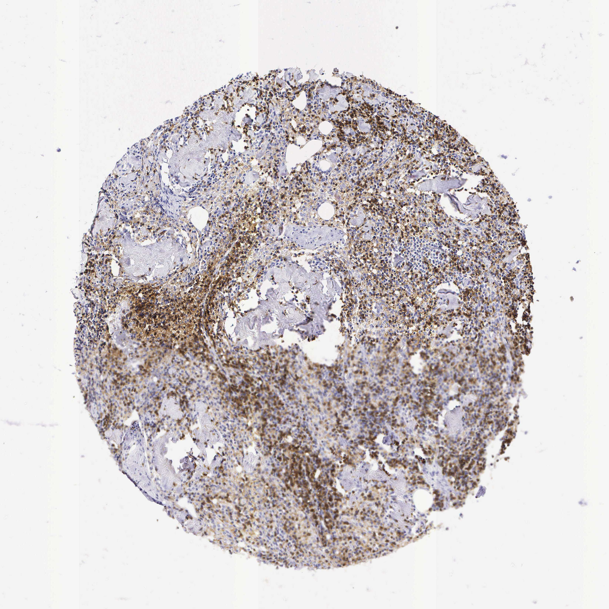

## 문제
A 67-year-old man undergoes radical cystectomy for muscle-invasive urothelial carcinoma of the bladder. A pelvic lymph node removed during the operation shows reactive changes without metastasis. A section of this lymph node is stained by immunohistochemistry for a lineage-specific marker that is part of the antigen-receptor signaling complex; the brown-staining lymphocytes diffusely fill the zones between and around the follicles (the paracortex), whereas the follicle centers are negative, as shown. A newborn with defective development of which of the following embryologic structures would most likely have markedly reduced numbers of the stained cells?

- A. Thyroglossal duct
- B. Third and fourth pharyngeal pouches
- C. First pharyngeal pouch
- D. Second pharyngeal arch
- E. First pharyngeal cleft

_Tissue microarray core, immunohistochemistry (brown DAB chromogen, hematoxylin counterstain), original magnification (Human Protein Atlas, CC BY 4.0 — no cropping or adjustment)_

## 정답 및 해설
> 정답: B

- **정답 핵심**: The marker stains lymphocytes that fill the interfollicular paracortex and spares the follicle centers — the T-cell zone pattern (CD3). T cells mature in the thymus, which arises from the endoderm of the third pharyngeal pouch, together with the inferior parathyroid glands; the superior parathyroids come from the fourth pouch. Defective development of the third and fourth pouches (22q11.2 deletion, DiGeorge syndrome) causes thymic hypoplasia, T-cell lymphopenia, and hypocalcemia.
- **원리**: <b>Reading the pattern</b>: in a lymph node, B cells gather into follicles (germinal centers with a mantle); T cells occupy the paracortex between and beneath the follicles, around high endothelial venules. A lineage marker that fills the paracortex and leaves germinal centers negative therefore marks T cells — CD3 is the invariant signaling part of the T-cell receptor complex.  <b>Why the thymus links to the pouches</b>: the third pharyngeal pouch endoderm forms the thymic epithelium, which provides the selection signals that turn bone-marrow precursors into mature T cells. Without that epithelium, precursors still exist but cannot mature, so the paracortex is empty while follicles are intact.  <b>Clinical package</b>: the third pouch also gives the inferior parathyroids and the fourth gives the superior parathyroids, so the same defect causes neonatal hypocalcemic tetany; neural-crest migration through the arches explains the conotruncal heart defects and facial features.
- **비교**: <table><thead><tr><th style="width:24%">Structure</th><th style="width:38%">3rd/4th pouches (answer)</th><th>1st pouch (closest distractor)</th></tr></thead><tbody> <tr><td>Derivatives</td><td><b>Thymus, inferior and superior parathyroids</b></td><td>Middle ear cavity, eustachian tube, mastoid air cells</td></tr> <tr><td>Defect</td><td>T-cell deficiency, hypocalcemia</td><td>Conductive hearing problems</td></tr> <tr><td>Lymph node</td><td>Empty paracortex, follicles present</td><td>Normal lymphocyte zones</td></tr> </tbody></table> If the stain had filled the follicles instead, the question would point to B-cell development (e.g., BTK), not the pharyngeal pouches.
- **오답 이유**:
  - (A) The thyroglossal duct would be correct for a midline neck cyst that moves with swallowing; the thyroid does not produce lymphocytes.
  - (C) The first pouch would be correct if the question asked about the middle ear cavity or eustachian tube; it does not form lymphoid organs.
  - (D) The second arch would be correct for derivatives such as the stapes, styloid process, and muscles of facial expression, none of which shape T-cell development.
  - (E) The first cleft would be correct for the external auditory meatus; its defects cause preauricular cysts or sinuses, not lymphopenia.
- **함정**: Reading any lymph node stain as B cells — here the follicle centers are negative and the paracortex is positive, which is the T-cell zone.
- **학습목표**: 림프절 면역염색에서 여포 사이·피질곁을 넓게 채우는 양성 세포가 T세포임을 읽고, T세포가 성숙하는 흉선이 제3·4 인두낭에서 발생함을 연결한다
- **근거·출처**: Sadler TW. Langman's Medical Embryology, 15th ed. Wolters Kluwer; 2023. Chapter 17: Head and neck · Abbas AK, Lichtman AH, Pillai S. Cellular and Molecular Immunology, 10th ed. Elsevier; 2022. Chapter 2: Cells and tissues of the immune system

## 출처
- Human Protein Atlas, CD3E / Lymph node (CC BY 4.0), https://images.proteinatlas.org/10/1628_A_9_8.jpg · Creative Commons Attribution 4.0 International · https://www.proteinatlas.org/about/licence
