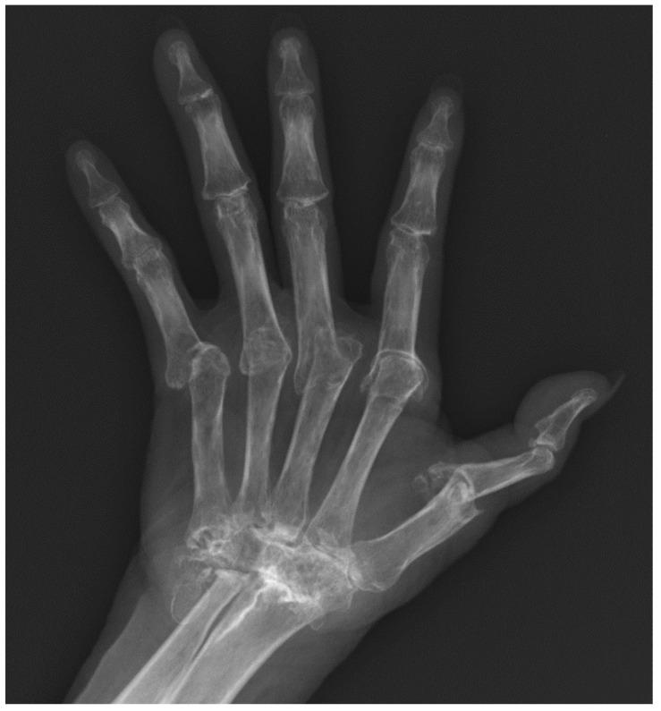

## 문제
A 59-year-old woman comes to the physician because of worsening deformity and weakness of both hands. She has had pain and swelling of the wrists and knuckles of both hands with morning stiffness lasting more than 1 hour for many years but did not seek regular care. She has no history of skin rash, nail changes, back pain, or diarrhea. Examination shows symmetric swelling of the wrists and metacarpophalangeal joints with ulnar deviation of the fingers; the distal interphalangeal joints are not swollen, and the nails are normal. A posteroanterior radiograph of the right hand is shown. Which of the following serum antibodies is most specific for this patient's condition?

- A. Anti-cyclic citrullinated peptide antibody
- B. Rheumatoid factor
- C. Antinuclear antibody
- D. Anti-double-stranded DNA antibody
- E. Anti-centromere antibody

_Posteroanterior radiograph of the hand and wrist — single published case figure, unaltered (PMC Open Access Subset, CC BY)_

## 정답 및 해설
> 정답: A

- **정답 핵심**: The radiograph shows collapse and fusion of the carpal bones, destruction of the radiocarpal joint, erosions and subluxation at the metacarpophalangeal joints, and periarticular osteopenia, while the distal interphalangeal joints are relatively spared. With long-standing symmetric wrist/MCP synovitis and no psoriasis or nail disease, this is advanced rheumatoid arthritis. Anti-CCP antibody is the most specific test (about 95 % specificity) and predicts erosive disease.
- **원리**: <b>Why erosions appear where they do</b>: rheumatoid synovitis forms a pannus that invades the "bare areas" of bone at the joint margin, where cartilage does not cover the bone. Wrists and MCP/PIP joints have the most synovium relative to joint size, so marginal erosions start there; inflammatory cytokines (TNF, IL-6, RANKL) cause periarticular osteopenia.  <b>Why anti-CCP is specific</b>: in RA, peptidyl-arginine deiminase converts arginine to citrulline in inflamed synovium (and in smokers' lungs), and loss of tolerance produces antibodies against citrullinated proteins. These antibodies are rare in other diseases, whereas rheumatoid factor (IgM against the Fc portion of IgG) also appears with chronic infections (hepatitis C, endocarditis), Sjögren syndrome, and aging.  <b>Psoriatic arthritis mimic</b>: arthritis mutilans can occur in both, but psoriatic arthritis favors DIP joints, shows "pencil-in-cup" change, fluffy periostitis, and preserved bone density.
- **비교**: <table><thead><tr><th style="width:24%">Test</th><th style="width:38%">Anti-CCP (answer)</th><th>Rheumatoid factor (closest distractor)</th></tr></thead><tbody> <tr><td>Sensitivity</td><td>~65–70 %</td><td>~70–80 %</td></tr> <tr><td>Specificity</td><td><b>~95 %</b></td><td>~80–85 %</td></tr> <tr><td>Other positives</td><td>Rare</td><td>Hepatitis C, endocarditis, Sjögren, elderly</td></tr> <tr><td>Prognosis</td><td>Predicts erosive disease, may precede symptoms</td><td>High titer also predicts severity</td></tr> </tbody></table> "Most sensitive" can be argued for RF in some series, but "most specific" belongs to anti-CCP.
- **오답 이유**:
  - (B) Rheumatoid factor would be correct if the question asked for the classic or more often positive antibody; it is less specific because chronic infections and Sjögren syndrome also produce it.
  - (C) Antinuclear antibody is correct as the most sensitive screen for systemic lupus erythematosus, which causes nonerosive, reducible deformities (Jaccoud arthropathy).
  - (D) Anti-dsDNA antibody would be correct for lupus with nephritis; lupus arthritis does not cause the carpal collapse and erosions seen here.
  - (E) Anti-centromere antibody would be correct for limited cutaneous systemic sclerosis with Raynaud phenomenon, sclerodactyly, and acro-osteolysis of the fingertips.
- **함정**: Choosing rheumatoid factor because of the disease name — the question asks for the most specific test, which is anti-CCP.
- **학습목표**: 손목·손허리손가락관절 중심의 미란과 관절 주위 골감소, 원위지관절 보존을 보이는 손 X선에서 류마티스관절염을 읽고 가장 특이한 자가항체가 항CCP 항체임을 안다
- **근거·출처**: Aletaha D, et al. 2010 Rheumatoid arthritis classification criteria: an ACR/EULAR collaborative initiative. Arthritis Rheum 2010;62:2569-2581 · Loscalzo J, et al. Harrison's Principles of Internal Medicine, 21st ed. McGraw-Hill; 2022. Chapter 358: Rheumatoid arthritis

## 출처
- Radiographic Findings of Inflammatory Arthritis and Mimics in the Hands. Diagnostics (Basel). 2022 Sep 2;12(9):2134. doi: 10.3390/diagnostics12092134 (CC BY) — Figure 5 · CC BY · https://creativecommons.org/licenses/
