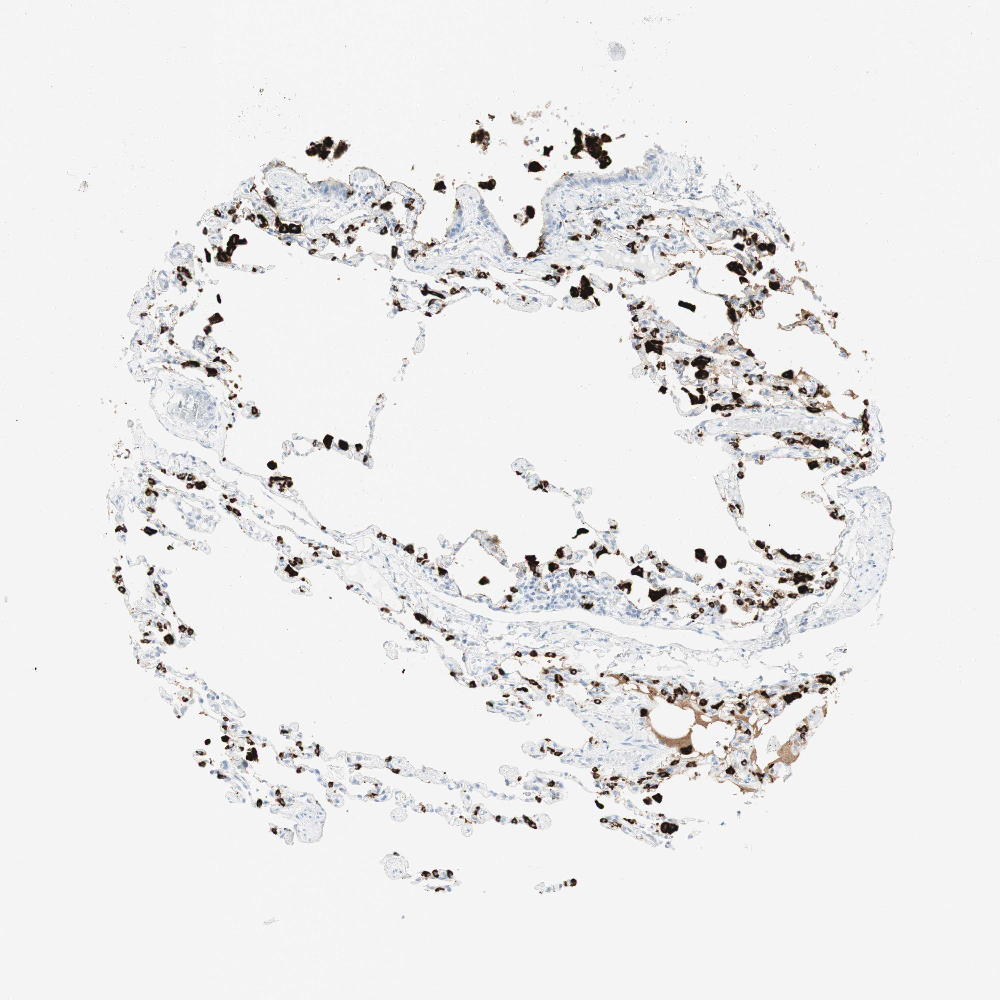

## 문제
21세 남자가 오토바이 사고로 가슴을 다쳐 응급실에 왔다. 오른쪽 폐 아래엽의 열상으로 공기 누출이 계속되어 쐐기절제술을 받았다. 과거력은 없고 담배는 피우지 않는다. 절제 검체 가운데 손상되지 않은 가장자리 폐 조직의 절편에 면역조직화학염색을 하였고, 사진은 그림과 같다. 폐포 공간 안에 떠 있는, 진하게 염색된 큰 세포의 기능이 자가항체로 억제될 때 생기는 질환은?

- A. 미만성 폐포출혈
- B. 폐랑게르한스세포조직구증
- C. 폐포단백증
- D. 과민폐렴
- E. 만성 호산구폐렴

_조직 마이크로어레이 코어의 면역조직화학염색(DAB 갈색 발색, 헤마톡실린 대조염색), 원 배율 (Human Protein Atlas, CC BY 4.0 — 크롭·보정 없음)_

## 정답 및 해설
> 정답: C

- **정답 핵심**: 갈색으로 진하게 염색된 세포는 폐포벽에서 떨어져 폐포 공간 안에 떠 있는 크고 둥근 세포 — 폐포 대식세포다(벽에 붙은 입방형 제2형 폐포세포는 더 옅다). 폐포 대식세포는 GM-CSF 신호로 성숙해 쓰고 남은 계면활성물질을 먹어 치운다. GM-CSF 에 대한 자가항체가 생기면 이 제거가 막혀 폐포 안에 PAS 양성 지단백 물질이 쌓이는 자가면역 폐포단백증이 된다.
- **원리**: <b>계면활성물질의 생애</b>: 제2형 폐포세포가 층판소체로 계면활성물질을 만들어 분비하고, 쓰고 난 물질의 일부는 제2형 세포가 다시 흡수하며 나머지는 <b>폐포 대식세포</b>가 먹어 분해한다. 이 염색 단백(napsin A)은 계면활성 단백 B 의 전구체를 자르는 효소라 두 세포 모두에 있다.  <b>GM-CSF 가 열쇠인 이유</b>: 폐포 대식세포는 GM-CSF → 전사인자 PU.1 신호로 성숙해야 계면활성물질을 분해할 수 있다. 성인 폐포단백증의 약 90 % 는 <b>항 GM-CSF 자가항체</b>가 이 신호를 막는 자가면역형이다. 대식세포는 거품 모양으로 부풀고, 폐포는 PAS 양성 과립성 물질로 찬다.  <b>임상 연결</b>: 서서히 진행하는 호흡곤란, CT 의 「미친 포장도로(crazy-paving)」 양상, 기관지폐포세척액이 우윳빛. 치료는 전폐 세척과 흡입 GM-CSF 다.
- **비교**: <table><thead><tr><th style="width:22%">구분</th><th style="width:39%">폐포단백증(정답)</th><th>미만성 폐포출혈(가장 가까운 오답)</th></tr></thead><tbody> <tr><td>자가항체의 표적</td><td><b>GM-CSF — 대식세포 성숙 신호</b></td><td>사구체·폐포 기저막(항 GBM), 호중구 효소(ANCA)</td></tr> <tr><td>대식세포의 모습</td><td>지단백 물질로 부푼 거품 세포</td><td>혈철소를 먹은 대식세포(철 염색 양성)</td></tr> <tr><td>폐포 안 물질</td><td>PAS 양성 지단백, 우윳빛 세척액</td><td>적혈구, 갈수록 붉어지는 세척액</td></tr> </tbody></table> 둘 다 폐포 안 대식세포가 주인공이지만, 대식세포 「기능」이 막히는 것은 폐포단백증이고 폐포출혈에서 대식세포는 피를 치우는 정상 기능을 한다.
- **오답 이유**:
  - ① 미만성 폐포출혈은 항 GBM 항체·ANCA 혈관염처럼 기저막이나 혈관을 표적으로 하는 자가항체가 객혈·빈혈과 함께 있을 때 정답이 된다.
  - ② 폐랑게르한스세포조직구증은 흡연 젊은 성인에서 CD1a·랑게린 양성 세포가 위쪽 폐에 결절·낭을 만들 때 정답이 되며 자가항체 질환이 아니다.
  - ④ 과민폐렴은 새 깃털·곰팡이 같은 흡입 항원에 대한 면역반응이 원인이며, 노출 뒤 반복되는 기침·열과 세기관지 주위 육아종이 있을 때 정답이 된다.
  - ⑤ 만성 호산구폐렴은 말초·기관지폐포세척액 호산구 증가와 폐 바깥쪽 음영(폐부종의 역상)이 있을 때 정답이 되며 대식세포 기능 억제와 무관하다.
- **함정**: 갈색 세포를 모두 제2형 폐포세포로 보고 「계면활성물질 결핍」만 떠올리는 것 — 폐포 안에 떠 있는 큰 세포는 대식세포이고, 그 기능이 막히면 물질이 「쌓이는」 질환이 된다.
- **학습목표**: 폐 조직 면역염색에서 폐포 공간 안에 떠 있는 큰 양성 세포를 폐포 대식세포로 읽고, GM-CSF 자가항체가 이 세포의 계면활성물질 제거를 막아 폐포단백증을 일으킴을 연결한다
- **근거·출처**: Trapnell BC, Nakata K, Bonella F, et al. Pulmonary alveolar proteinosis. Nat Rev Dis Primers 2019;5:16 · Kumar V, Abbas AK, Aster JC. Robbins and Cotran Pathologic Basis of Disease, 10th ed. Elsevier; 2021. Chapter 15: The Lung

## 출처
- Human Protein Atlas, NAPSA / Lung (CC BY 4.0), https://images.proteinatlas.org/9591/27119_A_1_4.jpg · Creative Commons Attribution 4.0 International · https://www.proteinatlas.org/about/licence
