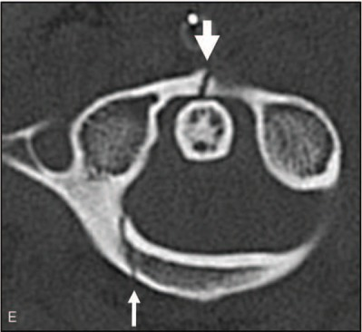

## 문제
A 31-year-old woman is brought to the emergency department 1 hour after a high-speed motor vehicle collision. She reports severe pain at the back of the upper neck and is unwilling to turn her head. She takes no medications. Her pulse is 96/min and blood pressure is 126/78 mm Hg. She is alert and oriented. A rigid cervical collar is in place. There is tenderness over the upper posterior cervical spine. Strength, sensation, and reflexes are normal in all extremities. An axial CT image of the cervical spine at the level of the first cervical vertebra (atlas) is shown. Integrity of which of the following structures is most important in determining whether this fracture is mechanically unstable?

- A. Transverse ligament of the atlas
- B. Alar ligaments
- C. Tectorial membrane
- D. Anterior longitudinal ligament
- E. Ligamentum flavum

_Axial CT of the upper cervical spine at the level of the atlas, bone window — one panel cropped from a published case figure; the arrows are the authors' original markings (PMC Open Access Subset, CC BY — no adjustment)_

## 정답 및 해설
> 정답: A

- **정답 핵심**: The axial CT shows two breaks in the ring of the atlas: one through the anterior arch near the midline and one through the posterior arch on the patient's right. A C1 ring fracture is stable only while the transverse ligament holds the dens against the anterior arch; if the ligament is torn (seen directly on MRI, or inferred when the lateral masses overhang C2 by more than about 7 mm in total), C1 can slide on C2 and the injury needs surgical stabilization or halo immobilization.
- **원리**: <b>Why the ring breaks in more than one place</b>: the atlas is a closed bony ring without a vertebral body. A force that spreads the lateral masses apart, or bends the ring, usually breaks it in two or more places — an isolated single break is uncommon.  <b>What holds C1 on C2</b>: the dens sits against the back of the anterior arch and is held there by the <b>transverse ligament</b>, the main stabilizer of the atlantoaxial joint. When the ring is broken, the ligament is what still keeps the two lateral masses and the dens in register.  <b>How stability is judged</b>: MRI shows the ligament (or a bony avulsion of its tubercle) directly. On an open-mouth view or coronal CT, a combined lateral-mass overhang beyond the C2 facets of more than about 7 mm (rule of Spence) suggests the ligament is torn. Intact ligament → rigid collar; disrupted ligament → halo or fusion.
- **비교**: <table><thead><tr><th style="width:22%">Structure</th><th style="width:39%">Transverse ligament (answer)</th><th>Alar ligaments (closest distractor)</th></tr></thead><tbody> <tr><td>Span</td><td><b>Between the lateral masses of C1, behind the dens</b></td><td>From the sides of the dens tip to the occipital condyles</td></tr> <tr><td>Main role</td><td>Keeps the dens against the anterior arch (C1–C2 translation)</td><td>Limits head rotation and occiput–C2 distraction</td></tr> <tr><td>Injury it decides</td><td>Stability of C1 ring fractures</td><td>Craniocervical (atlanto-occipital) dissociation, with the tectorial membrane</td></tr> </tbody></table> A C1 ring fracture raises the transverse-ligament question; a widened basion–dens interval raises the alar/tectorial question.
- **오답 이유**:
  - (B) Alar ligaments become the key structure when the basion–dens interval is widened, indicating craniocervical (atlanto-occipital) dissociation.
  - (C) The tectorial membrane matters most in craniocervical dissociation, where it and the alar ligaments are torn and the skull separates from C2.
  - (D) The anterior longitudinal ligament is critical in hyperextension injuries of the subaxial spine, such as widening of an anterior disc space.
  - (E) The ligamentum flavum is part of the posterior ligamentous complex judged in flexion-distraction injuries of the subaxial and thoracolumbar spine.
- **함정**: Choosing the alar ligaments because the injury is at the craniocervical junction — the stability of a C1 ring fracture depends on the transverse ligament holding the dens.
- **학습목표**: 환추 축상 CT 에서 앞고리와 뒤고리 두 곳의 골절(환추 고리 골절)을 읽고, 그 안정성을 가르는 구조가 환추 가로인대임을 안다
- **근거·출처**: Kandziora F, Chapman JR, Vaccaro AR, et al. Atlas fractures and atlas osteosynthesis: a comprehensive narrative review. J Orthop Trauma 2017;31 Suppl 4:S81-S89 · Dickman CA, Greene KA, Sonntag VK. Injuries involving the transverse atlantal ligament: classification and treatment guidelines based upon experience with 39 injuries. Neurosurgery 1996;38:44-50

## 출처
- Traumatic combined vertical atlanto-occipital and atlanto-axial dislocations with 2-part fracture of the atlas: Two case reports. Medicine (Baltimore). 2019 Nov 1;98(44):e17776. doi: 10.1097/MD.0000000000017776 (CC BY) — Figure 1 · CC BY · https://creativecommons.org/licenses/
