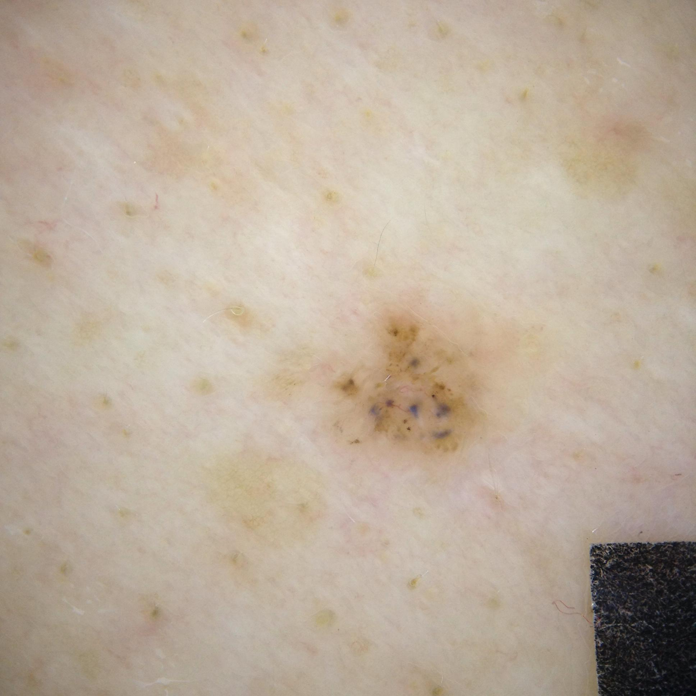

## 문제
60세 남자가 1년 전부터 등에 생긴 갈색 반점이 천천히 커져 피부과에 왔다. 가렵거나 아프지 않으나 샤워 뒤 가끔 얇은 딱지가 앉았다가 떨어진다고 한다. 젊었을 때 20년 동안 야외 건설 현장에서 일했다. 등 위쪽에 지름 약 1 cm 의 경계가 불규칙하고 납작한 갈색 판이 있으며 단단하게 만져지지 않는다. 다른 곳에 비슷한 병변은 없다. 병변의 더모스코피 사진은 그림과 같다. 이 병변을 조직검사하였을 때 예상되는 소견으로 가장 적절한 것은?

- A. 표피 안에 갇힌 각질 낭과 기저양 각질형성세포의 증식
- B. 표피 전층을 채운 비정형 각질형성세포와 이상각화
- C. 깊이 내려갈수록 작아지는 진피 내 멜라닌세포 둥지
- D. 표피 아래에 붙은 기저양세포 둥지와 가장자리 울타리 배열
- E. 표피-진피 경계를 따라 퍼진 비정형 멜라닌세포 둥지

_피부 병변의 더모스코피 사진, 원본 그대로 축소만 (ISIC Archive, CC0 — 크롭·보정 없음)_

## 정답 및 해설
> 정답: D

- **정답 핵심**: 더모스코피에서 색소 그물이 없고, 옅은 갈색 판 위에 작은 청회색 점·소구가 흩어져 있으며 가는 짧은 모세혈관확장이 보인다 — 비멜라닌세포성 병변 가운데 기저세포암의 소견이다. 몸통의 납작한 판과 반복되는 얇은 딱지(작은 미란)는 표재성 기저세포암에 맞는다. 조직에서는 표피 아래면에 매달린 기저양세포 둥지가 여러 곳에서 보이고, 둥지 가장자리 세포가 울타리처럼 늘어서며 주변 기질과 틈(수축 틈)이 생긴다.
- **원리**: <b>더모스코피의 첫 갈림길 — 색소 그물</b>: 색소 그물은 표피 능선을 따라 멜라닌세포·멜라닌이 놓인 모양이라 멜라닌세포 병변(모반·흑색종)의 표지다. 그물이 없으면 먼저 비멜라닌세포 병변(기저세포암·지루각화증·혈관 병변)을 생각한다.  <b>왜 「청회색」인가</b>: 멜라닌이 진피 쪽 깊이 있으면 빛의 산란(틴들 효과)으로 갈색이 아니라 청회색으로 보인다. 기저세포암의 색소는 진피로 내려간 종양 둥지 안에 있어 청회색 점·소구·난원형 둥지로 보인다. 가는 짧은 모세혈관확장은 종양 위로 늘어난 얕은 혈관이다.  <b>조직과의 대응</b>: 표재성 기저세포암은 표피 기저층에서 진피 쪽으로 매달린 작은 둥지가 여럿 떨어져 있는 형태라, 임상적으로는 납작한 판으로 넓게 퍼진다. 둥지 가장자리의 울타리 배열과 수축 틈이 기저세포암의 조직학적 표지다.
- **비교**: <table><thead><tr><th style="width:22%">구분</th><th style="width:39%">기저세포암(정답)</th><th>흑색종(가장 가까운 오답)</th></tr></thead><tbody> <tr><td>색소 그물</td><td><b>없음</b> — 멜라닌세포 병변이 아니다</td><td>있으면 불규칙하고 굵기·색이 고르지 않다</td></tr> <tr><td>청회색 구조</td><td>흩어진 점·소구·난원형 둥지</td><td>청백색 베일·불규칙 청회색 구역</td></tr> <tr><td>혈관</td><td>가는 짧은 또는 나뭇가지 모양 모세혈관확장</td><td>점·선 모양의 다형 혈관</td></tr> <tr><td>조직</td><td>기저양세포 둥지·울타리 배열·수축 틈</td><td>경계부를 따라 퍼진 비정형 멜라닌세포</td></tr> </tbody></table> 청회색만 보고 흑색종으로 가지 말고, 그물이 있는지부터 본다 — 그물 없는 청회색 소구는 기저세포암 쪽이다.
- **오답 이유**:
  - ① 각질 낭과 기저양 각질형성세포 증식은 지루각화증이며, 좁쌀 모양 낭·면포 모양 구멍·뇌이랑 모양 구조가 보일 때 정답이 된다.
  - ② 표피 전층의 비정형 각질형성세포는 보웬병(제자리 편평세포암)이며, 사구체 모양 혈관과 비늘 덮인 붉은 판이 보일 때 정답이 된다.
  - ③ 깊이에 따라 작아지는 진피 내 멜라닌세포 둥지는 진피내 모반의 성숙이며, 대칭적인 부드러운 돔 모양 병변일 때 정답이 된다.
  - ⑤ 경계부 비정형 멜라닌세포 둥지는 흑색종의 소견이며, 더모스코피에서 불규칙한 색소 그물·청백색 베일·비대칭이 보일 때 정답이 된다.
- **함정**: 청회색 구조를 보고 바로 흑색종을 고르는 것 — 색소 그물이 없고 청회색이 점·소구로 흩어져 있으면 기저세포암을 먼저 생각한다.
- **학습목표**: 더모스코피에서 색소 그물 없이 흩어진 청회색 점·소구와 가는 짧은 모세혈관확장을 기저세포암 소견으로 읽고, 그 조직 소견(표피에 붙은 기저양세포 둥지·가장자리 울타리 배열)을 예상한다
- **근거·출처**: Bolognia JL, Schaffer JV, Cerroni L. Dermatology, 4th ed. Elsevier; 2018. Chapter 108: Basal Cell Carcinoma · Lallas A, Apalla Z, Argenziano G, et al. The dermatoscopic universe of basal cell carcinoma. Dermatol Pract Concept 2014;4(3):11-24

## 출처
- ISIC Archive ISIC_0001149 (CC-0) · CC0 1.0 Universal · https://creativecommons.org/publicdomain/zero/1.0/
