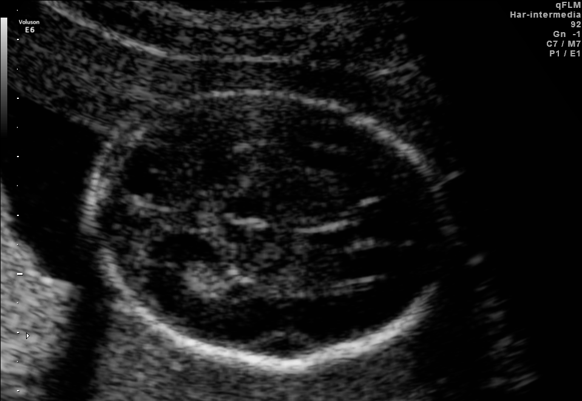

## 문제
임신 20주 임신부가 정기 산전진찰을 위해 외래에 왔다. 특별한 증상은 없고 지금까지 산전검사에서 이상 소견은 없었다. 혈압 116/72 mmHg 이고 자궁저부 높이는 배꼽 높이이다. 태아 정밀 초음파검사를 하였고, 태아 머리의 가로단면 초음파 사진은 그림과 같다. 이 단면을 표준으로 하여 측정하는 태아 계측치로 가장 적절한 것은?

- A. 목덜미 투명대 두께
- B. 머리엉덩길이
- C. 양두정경
- D. 소뇌 가로지름
- E. 측뇌실 뒤뿔 너비

_태아 초음파 정지 영상, 화면 오른쪽 위 문자는 기기 설정값 — 원본 그대로 축소만 (FETAL_PLANES_DB, Zenodo, CC BY 4.0) ※ 발문의 임상 상황은 문항 구성을 위한 가정이다 — 원 데이터에는 나이·병력이 없다_

## 정답 및 해설
> 정답: C

- **정답 핵심**: 타원형 두개골 반사테 안에 중앙선(대뇌낫) 에코가 지나고 그 가운데에 좌우 대칭인 시상이 보이며, 뒤쪽 소뇌는 보이지 않는다 — 시상 경유(trans-thalamic) 단면이다. 이 단면이 양두정경과 머리둘레를 재는 표준 단면이다.
- **원리**: <b>왜 시상 높이인가</b>: 머리 계측은 매번 같은 높이에서 재야 주수별 기준곡선과 비교할 수 있다. 시상과 투명사이막공간은 정중선 가까이 있어 찾기 쉽고, 이 높이에서 두개골 단면이 가장 넓고 대칭인 타원이 된다. 그래서 양두정경(바깥-안 또는 바깥-바깥 경계)과 머리둘레를 이 단면에서 잰다.  <b>세 가지 머리 단면</b>: 같은 가로단면이라도 탐촉자를 조금 위로 올리면 측뇌실 뒤뿔(맥락얼기를 담은 방)이 보이는 <b>측뇌실 경유 단면</b>이 되고, 뒤쪽을 아래로 기울이면 소뇌와 대수조가 보이는 <b>소뇌 경유 단면</b>이 된다. 각 단면은 재는 것이 다르다 — 측뇌실 너비(뇌실확장), 소뇌 가로지름·대수조(후두와 이상).  <b>임상 연결</b>: 2분기 이후 주수 확인·태아 성장 평가에는 양두정경·머리둘레·복부둘레·대퇴골길이를 함께 쓴다. 1분기 주수 확인은 머리엉덩길이가 가장 정확하다.
- **비교**: <table><thead><tr><th style="width:22%">구분</th><th style="width:39%">시상 경유 단면(정답)</th><th>측뇌실 경유 단면(가장 가까운 오답)</th></tr></thead><tbody> <tr><td>보이는 구조</td><td><b>정중선과 그 가운데 대칭인 시상</b>, 투명사이막공간</td><td>측뇌실 뒤뿔과 그 안의 맥락얼기</td></tr> <tr><td>높이</td><td>조금 아래(시상 높이)</td><td>조금 위(뇌실 방 높이)</td></tr> <tr><td>재는 것</td><td>양두정경·머리둘레</td><td>측뇌실 뒤뿔 너비(10 mm 이상이면 뇌실확장)</td></tr> </tbody></table> 소뇌가 보이면 소뇌 경유 단면, 맥락얼기를 담은 뇌실 방이 주인공이면 측뇌실 경유 단면, 정중선 가운데 시상이 보이면 시상 경유 단면이다.
- **오답 이유**:
  - ① 목덜미 투명대 두께는 임신 11~14주 태아의 정중 시상단면에서 목 뒤 피하 액체를 잴 때 정답이 된다.
  - ② 머리엉덩길이는 1분기(대략 14주 이전) 태아 전체의 정중 시상단면에서 주수를 정할 때 정답이 된다.
  - ④ 소뇌 가로지름은 탐촉자를 뒤로 기울여 소뇌 두 반구와 대수조가 보이는 소뇌 경유 단면일 때 정답이 된다.
  - ⑤ 측뇌실 뒤뿔 너비는 시상보다 조금 위에서 맥락얼기를 담은 뇌실 방이 보이는 측뇌실 경유 단면일 때 정답이 된다.
- **함정**: 머리 가로단면이면 모두 같다고 보고 아무 계측이나 고르는 것 — 보이는 구조(시상·뇌실 방·소뇌)로 단면을 먼저 정해야 한다.
- **제작 가정**: FETAL_PLANES_DB 는 표준 단면 분류만 있고 산모 나이·임신 주수·병력이 없다 — 임신 20주 정기 산전진찰 상황을 가정했다 (가정한 정보: 임신 20주 · 정기 산전진찰)
- **학습목표**: 태아 머리 가로단면 초음파에서 중앙선과 대칭인 시상이 보이고 소뇌가 없는 시상 경유 단면을 알아보고, 이 단면이 양두정경·머리둘레의 표준 계측 단면임을 안다
- **근거·출처**: Salomon LJ, Alfirevic Z, Da Silva Costa F, et al. ISUOG Practice Guidelines: ultrasound assessment of fetal biometry and growth. Ultrasound Obstet Gynecol 2019;53:715-723 · Burgos-Artizzu XP, Coronado-Gutiérrez D, Valenzuela-Alcaraz B, et al. Evaluation of deep convolutional neural networks for automatic classification of common maternal fetal ultrasound planes. Sci Rep 2020;10:10200

## 출처
- FETAL_PLANES_DB (Zenodo 3904280, CC BY 4.0) · Patient01068_Plane3_4_of_5 · Creative Commons Attribution 4.0 International · https://creativecommons.org/licenses/by/4.0/
