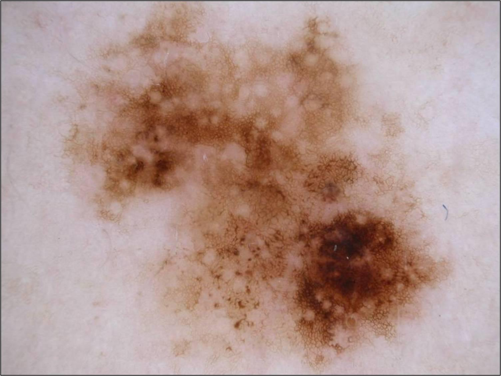

## 문제
80세 여자가 등에 있던 갈색 반점이 몇 년 사이 넓어지고 색이 짙어졌다고 딸이 알려 주어 피부과에 왔다. 가렵거나 피가 난 적은 없다. 젊었을 때 해수욕을 자주 했고 피부암 가족력은 없다. 등 아래쪽에 가로 약 2.5 cm 의 경계가 불규칙하고 납작한 갈색·흑갈색 반이 있으며 만져지는 결절은 없다. 겨드랑이 림프절은 만져지지 않는다. 병변의 더모스코피 사진은 그림과 같다. 다음 처치로 가장 적절한 것은?

- A. 액체질소 냉동치료
- B. 6개월 뒤 더모스코피 사진을 비교하는 추적 관찰
- C. 2 cm 경계의 광범위 절제와 감시림프절 생검
- D. 1~3 mm 경계를 두고 병변 전체를 절제생검
- E. 가장 짙은 부위 한 곳의 펀치생검만 시행

_피부 병변의 더모스코피 사진, 원본 그대로 축소만 (ISIC Archive, CC0 — 크롭·보정 없음)_

## 정답 및 해설
> 정답: D

- **정답 핵심**: 더모스코피에서 병변이 비대칭이고 굵기가 고르지 않은 비정형 색소 그물, 연갈색·진갈색·흑갈색이 섞인 여러 색, 한쪽의 불규칙한 짙은 얼룩, 가장자리의 불규칙한 점·소구와 흰 퇴행 구역이 보인다 — 흑색종을 의심하는 소견이다. 임상적으로도 넓어지고 짙어진 비대칭 다색 반이다. 흑색종이 의심되면 먼저 병변 전체를 1~3 mm 경계로 절제생검해 진단과 Breslow 두께를 확인하고, 그 두께에 따라 최종 절제 경계와 감시림프절 생검 여부를 정한다.
- **원리**: <b>왜 「전체」를 떼어 보는가</b>: 흑색종의 예후와 이후 치료는 거의 전부 <b>Breslow 두께</b>(과립층에서 가장 깊은 종양세포까지의 깊이)로 정해진다. 큰 병변의 일부만 떼면 가장 두꺼운 곳을 놓쳐 병기를 낮게 매길 수 있고, 제자리 흑색종과 침윤 흑색종이 한 병변 안에 섞여 있을 때 진단이 틀어진다.  <b>왜 좁은 경계(1~3 mm)인가</b>: 진단 전에 넓게 떼면 림프 흐름이 바뀌어 나중에 감시림프절 생검의 정확도가 떨어지고, 양성으로 판명되면 불필요한 결손이 남는다. 그래서 진단 절제는 좁게, 두께가 나온 뒤 재절제로 최종 경계(제자리 0.5~1 cm, 1 mm 이하 1 cm, 2 mm 초과 2 cm)를 맞춘다.  <b>더모스코피 소견의 뜻</b>: 비정형 그물·여러 색·불규칙 얼룩은 표피-진피 경계에서 비정형 멜라닌세포가 고르지 않게 퍼진 모양이고, 흰 퇴행 구역은 면역반응으로 종양 일부가 사라진 흔적이다.
- **비교**: <table><thead><tr><th style="width:22%">구분</th><th style="width:39%">전체 절제생검(정답)</th><th>짙은 부위 펀치생검(가장 가까운 오답)</th></tr></thead><tbody> <tr><td>얻는 정보</td><td><b>진단 + 병변 전체의 최대 Breslow 두께</b></td><td>떼어 낸 한 점의 진단뿐</td></tr> <tr><td>표본 오류</td><td>거의 없음</td><td>가장 두꺼운 곳을 놓치면 병기를 낮게 매긴다</td></tr> <tr><td>쓰는 상황</td><td>흑색종 의심 병변의 기본</td><td>얼굴의 큰 악성흑색점처럼 전체 절제가 어려울 때</td></tr> </tbody></table> 「짙은 곳을 찍으면 된다」가 아니라 「두께를 정확히 재야 한다」가 기준이다 — 그래서 가능하면 병변 전체를 좁게 뗀다.
- **오답 이유**:
  - ① 냉동치료는 조직을 남기지 않아 진단을 못 하므로, 임상적으로 확실한 광선각화증이나 바이러스 사마귀일 때에만 정답이 된다.
  - ② 단기 추적 관찰은 비정형 소견이 약하고 평평한 모반의 변화를 지켜볼 때 쓰며, 이처럼 여러 흑색종 소견이 모이면 해당하지 않는다.
  - ③ 2 cm 광범위 절제와 감시림프절 생검은 조직검사로 두께 2 mm 를 넘는 침윤 흑색종이 확인된 뒤의 최종 수술일 때 정답이 된다.
  - ⑤ 부분 펀치생검은 얼굴·손바닥처럼 전체 절제가 어려운 매우 큰 병변에서 가장 의심스러운 곳을 고를 때 정답이 될 수 있다.
- **함정**: 흑색종이 의심되니 처음부터 2 cm 광범위 절제를 고르는 것 — 진단과 두께를 모르는 상태에서는 좁은 경계의 전체 절제생검이 먼저다.
- **학습목표**: 더모스코피에서 비정형 색소 그물·여러 색·불규칙한 얼룩과 점·소구·퇴행 구역을 흑색종 소견으로 읽고, 진단을 위해 병변 전체를 좁은 경계로 절제생검한다
- **근거·출처**: Swetter SM, Tsao H, Bichakjian CK, et al. Guidelines of care for the management of primary cutaneous melanoma. J Am Acad Dermatol 2019;80:208-250 · Bolognia JL, Schaffer JV, Cerroni L. Dermatology, 4th ed. Elsevier; 2018. Chapter 113: Melanoma

## 출처
- ISIC Archive ISIC_0000049 (CC-0) · CC0 1.0 Universal · https://creativecommons.org/publicdomain/zero/1.0/
