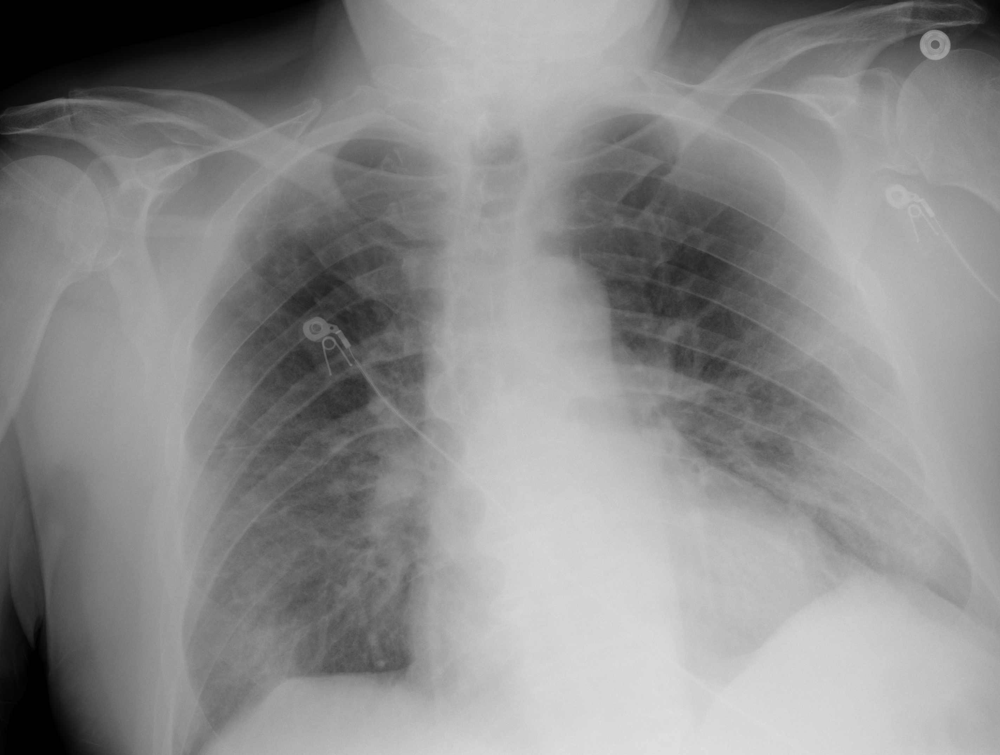

## 문제
A 79-year-old man is brought to the emergency department because of fever, cough, and increasing shortness of breath for 6 days. A nasal swab RT-PCR test performed yesterday was positive for SARS-CoV-2. He has hypertension treated with amlodipine. Temperature is 38.4°C, pulse is 104/min, respirations are 26/min, and blood pressure is 132/78 mm Hg. Oxygen saturation is 88% on room air and rises to 94% with oxygen at 3 L/min by nasal cannula. Crackles are heard at both lung bases. A portable chest radiograph is shown. Which of the following is the most appropriate pharmacotherapy?

- A. Nirmatrelvir–ritonavir
- B. Tocilizumab
- C. Hydroxychloroquine
- D. Oseltamivir
- E. Dexamethasone

_Portable anteroposterior chest radiograph, unaltered apart from scaling (TCIA, CC BY 4.0 — no crop or adjustment; ECG electrodes visible)_

## 정답 및 해설
> 정답: E

- **정답 핵심**: The radiograph shows hazy ground-glass and reticular opacities in both lower lung zones, denser on the left, with relatively clear upper zones and no pneumothorax or large effusion — bilateral pneumonia. With confirmed SARS-CoV-2 infection and hypoxemia that requires supplemental oxygen, dexamethasone 6 mg daily for up to 10 days reduces mortality; remdesivir may be added in hospitalized patients who need low-flow oxygen.
- **원리**: <b>Why a steroid helps only now</b>: COVID-19 runs in two phases. In the first week the virus replicates; later, lung injury is driven mostly by the host inflammatory response. Patients who already need oxygen are in the inflammatory phase, and dexamethasone dampens it — in the RECOVERY trial it lowered 28-day mortality in patients on oxygen or mechanical ventilation but not in those who needed no oxygen, where it trended toward harm.  <b>Why the radiograph matters</b>: bilateral, lower-zone and peripheral opacities show that hypoxemia comes from viral pneumonia rather than from bronchospasm or a focal bacterial consolidation; it places him in the "hospitalized, needs oxygen" category that the guidelines use to choose drugs.  <b>Why antivirals alone are not enough</b>: oral antivirals are given early to outpatients at high risk to prevent progression; once oxygen is needed, the inflammatory phase has begun and antiviral therapy adds little without a steroid.
- **비교**: <table><thead><tr><th style="width:24%">Feature</th><th style="width:38%">Dexamethasone (answer)</th><th>Nirmatrelvir–ritonavir (closest distractor)</th></tr></thead><tbody> <tr><td>Target phase</td><td><b>Inflammatory phase — patient needs oxygen</b></td><td>Early viral phase — within 5 days of symptoms</td></tr> <tr><td>Usual setting</td><td>Hospitalized with SpO2 &lt; 94% on room air</td><td>Outpatient at high risk, no oxygen requirement</td></tr> <tr><td>Proven benefit</td><td>Lower mortality (RECOVERY)</td><td>Fewer hospitalizations and deaths in unvaccinated high-risk outpatients</td></tr> <tr><td>Caution</td><td>Hyperglycemia, secondary infection</td><td>Strong CYP3A inhibition — many drug interactions</td></tr> </tbody></table> The oxygen requirement is the switch: no oxygen and early illness → oral antiviral; oxygen required → dexamethasone (± remdesivir).
- **오답 이유**:
  - (A) Nirmatrelvir–ritonavir would be correct for a high-risk outpatient within 5 days of symptom onset who does not yet need supplemental oxygen.
  - (B) Tocilizumab would be added to dexamethasone if oxygen needs rose rapidly to high-flow or ventilation with markedly elevated inflammatory markers.
  - (C) Hydroxychloroquine showed no benefit in randomized trials and would only be considered for conditions such as malaria or lupus, not COVID-19.
  - (D) Oseltamivir would be correct if the swab were positive for influenza, which also causes fever, cough, and bilateral pneumonia in older adults.
- **함정**: Choosing the oral antiviral because the infection is viral — once hypoxemia requires oxygen, the inflammatory phase calls for dexamethasone.
- **학습목표**: SARS-CoV-2 감염 환자에서 흉부 X선의 양측 아래폐야 음영과 실내 공기 산소포화도 저하로 산소가 필요한 폐렴을 확인하고 덱사메타손을 투여한다
- **근거·출처**: RECOVERY Collaborative Group. Dexamethasone in Hospitalized Patients with Covid-19. N Engl J Med 2021;384:693-704 · NIH COVID-19 Treatment Guidelines Panel. Therapeutic Management of Hospitalized Adults With COVID-19 (archived 2024)

## 출처
- COVID-19-AR, The Cancer Imaging Archive (CC BY 4.0) · series …27279274 · Creative Commons Attribution 4.0 International · https://www.cancerimagingarchive.net/data-usage-policies-and-restrictions/
