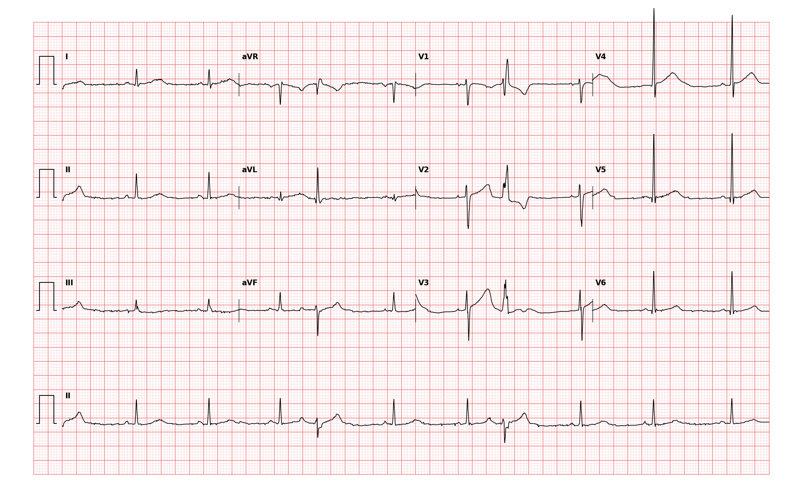

## 문제
41세 여자가 두 달 전부터 가끔 가슴이 「쿵」 하고 내려앉는 느낌이 들어 내과에 왔다. 증상은 쉴 때 더 잘 느끼고 몇 초 만에 사라진다. 흉통·실신·호흡곤란은 없고 커피를 하루 3잔 마신다. 혈압 118/72 mmHg, 맥박 62회/분으로 가끔 불규칙하다. 심잡음은 들리지 않는다. 혈청 칼륨 4.1 mEq/L 이고 갑상샘자극호르몬은 정상이다. 12유도 심전도는 그림과 같다. 심전도 판독으로 가장 적절한 것은?

- A. 간헐적 좌각차단
- B. 비지속성 심실빈맥
- C. 심실 기외수축
- D. 변행전도를 동반한 심방 기외수축
- E. 2도 방실차단(Mobitz II형)

_12유도 심전도, 25 mm/s · 10 mm/mV, 3×4 + II 리듬 스트립 (PTB-XL ECG dataset, PhysioNet, CC BY 4.0 — 원신호 그대로 작도)_

## 정답 및 해설
> 정답: C

- **정답 핵심**: 바탕 리듬은 분당 약 60회의 동리듬이다. 리듬 스트립 중간과 뒤쪽에 예정보다 일찍 오는 박동이 하나씩 있는데, QRS 가 0.12초를 넘게 넓고 모양이 기이하며(II 에서 깊은 음성, V1~V3 에서 양성), 그 앞에 일찍 온 P파가 없고, T파는 QRS 와 반대 방향이다 — 심실에서 시작한 조기 박동, 곧 심실 기외수축이다. 구조적 심질환 소견이 없는 젊은 사람의 드문 단발성 심실 기외수축이므로 판독 다음 단계는 대개 안심시키기와 유발 요인(카페인) 조절이다.
- **원리**: <b>왜 넓고 기이한가</b>: 동방결절에서 온 흥분은 히스-퍼킨제 전도계라는 「고속도로」를 타고 두 심실을 거의 동시에 탈분극시켜 QRS 가 좁다(0.10초 미만). 심실 근육 한 곳에서 스스로 시작한 흥분은 이 고속도로를 타지 못하고 근육세포에서 근육세포로 천천히 번져 한 심실이 먼저, 다른 심실이 나중에 흥분한다 — 그래서 QRS 가 0.12초를 넘게 넓고 모양이 낯설다.  <b>왜 T파가 반대로 서는가</b>: 탈분극 순서가 비정상이면 재분극 순서도 따라 바뀐다. 가장 늦게 탈분극한 부위가 가장 늦게 재분극하므로 T파가 QRS 주된 방향과 반대(불일치)로 그려진다 — 이차성 ST-T 변화이며 허혈을 뜻하지 않는다.  <b>왜 앞에 P파가 없는가</b>: 박동이 심방이 아니라 심실에서 시작했기 때문이다. 동방결절은 대개 이 박동의 영향을 받지 않아 다음 동박동이 제 리듬대로 오고, 그래서 조기 박동 뒤에 「쉼」이 느껴진다 — 환자가 말하는 「쿵 하고 내려앉는 느낌」은 쉼 뒤에 더 많이 찬 심실이 세게 뛰는 박동이다.
- **비교**: <table><thead><tr><th style="width:24%">보는 곳</th><th style="width:38%">심실 기외수축(정답)</th><th>변행전도 심방 기외수축(가장 가까운 오답)</th></tr></thead><tbody> <tr><td>넓은 박동 앞</td><td><b>일찍 온 P파가 없다</b></td><td>일찍 온 P파가 있다(앞 박동의 T파에 묻혀 T 모양이 달라짐)</td></tr> <tr><td>QRS 모양</td><td>기이하고 넓다 — 어느 각차단 모양과도 딱 맞지 않을 수 있다</td><td>대개 전형적 우각차단 모양(우각의 불응기가 더 길어서)</td></tr> <tr><td>뒤따르는 쉼</td><td>흔히 완전 보상(동방결절이 재설정되지 않음)</td><td>흔히 불완전 보상(동방결절이 재설정됨)</td></tr> </tbody></table> 넓은 조기 박동을 만나면 「앞 박동의 T파가 다른 T파와 모양이 같은가」부터 본다 — 같으면 숨은 P파가 없고, 심실 기외수축 쪽이다.
- **오답 이유**:
  - ① 간헐적 좌각차단은 넓은 박동이 조기에 오지 않고 정상 PR 간격의 P파를 앞에 두고 제때 나타날 때 정답이 된다(주로 심박수에 따라 나타나는 각차단).
  - ② 비지속성 심실빈맥은 넓은 박동이 3개 이상 연달아 분당 100회 이상으로 나올 때 정답이 되며, 이 기록은 동박동 사이에 하나씩 끼어 있다.
  - ④ 변행전도 심방 기외수축은 넓은 박동 바로 앞 T파에 일찍 온 P파가 겹쳐 T 모양이 바뀌어 있고 QRS 가 전형적 우각차단 모양일 때 정답이 된다.
  - ⑤ Mobitz II형 2도 방실차단은 PR 간격이 일정한 P파 뒤에 QRS 가 갑자기 빠지는 「빠진 박동」이 있을 때 정답이 되며, 여기처럼 박동이 더 생기지는 않는다.
- **함정**: 넓은 QRS 만 보고 「각차단」을 고르는 것 — 그 박동이 조기에 왔는지, 앞에 P파가 있는지를 먼저 본다. 조기 + P파 없음 + 넓은 QRS 는 심실 기외수축이다.
- **학습목표**: 리듬 스트립에서 조기에 오는 넓고 기이한 QRS, 앞선 조기 P파의 부재, QRS 와 반대 방향의 T파로 심실 기외수축을 읽고 변행전도 심방 기외수축과 가른다
- **근거·출처**: Goldberger AL, Goldberger ZD, Shvilkin A. Goldberger's Clinical Electrocardiography: A Simplified Approach, 10th ed. Elsevier; 2023. Chapter 16: Ventricular arrhythmias · Al-Khatib SM, Stevenson WG, Ackerman MJ, et al. 2017 AHA/ACC/HRS guideline for management of patients with ventricular arrhythmias and the prevention of sudden cardiac death. Circulation 2018;138:e272-e391

## 출처
- PTB-XL ECG dataset v1.0.3 (PhysioNet, CC BY 4.0) · record 18790 · Creative Commons Attribution 4.0 International · https://physionet.org/content/ptb-xl/1.0.3/LICENSE.txt
