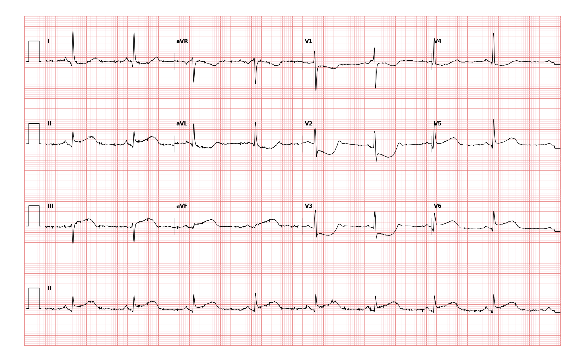

## 문제
85세 여자가 1시간 전 시작된 가슴 한가운데의 쥐어짜는 통증과 식은땀으로 응급실에 왔다. 통증은 왼팔로 뻗치고 쉬어도 가라앉지 않는다. 고혈압과 이상지질혈증으로 약을 먹고 있다. 혈압 102/64 mmHg, 맥박 52회/분, 호흡 20회/분, 산소포화도 96%이다. 경정맥 확장은 없고 양쪽 폐는 깨끗하다. 이 병원은 24시간 심혈관조영실을 운영한다. 아스피린을 씹어 먹게 했다. 12유도 심전도는 그림과 같다. 다음 처치로 가장 적절한 것은?

- A. 응급 관상동맥조영술과 일차 경피적 관상동맥중재술
- B. 고감도 트로포닌을 3시간 뒤 재검한 후 치료 결정
- C. 정맥 혈전용해제(테넥테플라제) 투여
- D. 설하 니트로글리세린 반복 투여 후 경과 관찰
- E. 정맥 메토프롤롤 투여

_12유도 심전도, 25 mm/s · 10 mm/mV, 3×4 + II 리듬 스트립 (PTB-XL ECG dataset, PhysioNet, CC BY 4.0 — 원신호 그대로 작도)_

## 정답 및 해설
> 정답: A

- **정답 핵심**: II·III·aVF 에서 ST 분절이 올라가 있고(III 이 II 보다 높음) V5·V6 도 올라가 있다. V1~V3 에는 수평 ST 하강이 있는데, 이는 후벽 ST 상승의 거울상이다 — 급성 하측후벽 ST 상승 심근경색이다. 증상 1시간, 24시간 심혈관조영실이 있는 병원이므로 트로포닌 결과를 기다리지 않고 응급 관상동맥조영술과 일차 경피적 관상동맥중재술로 재관류한다(도착부터 풍선까지 90분 안).
- **원리**: <b>왜 심전도만으로 결정하는가</b>: ST 상승은 관상동맥이 완전히 막혀 심근 전층이 허혈에 빠졌다는 신호다. 막힌 시간이 길수록 괴사가 심내막에서 심외막으로 번져 살릴 수 있는 심근이 줄어든다(「시간이 곧 심근」). 트로포닌은 세포가 이미 죽은 뒤에 올라가는 지표라, 기다리는 동안 구제할 심근을 잃는다. 그래서 인접 두 유도 이상의 ST 상승과 맞는 증상이 있으면 바이오마커 없이 바로 재관류로 간다.  <b>왜 V1~V3 의 ST 하강을 「후벽」으로 읽는가</b>: 12유도에는 좌심실 후벽을 정면으로 보는 유도가 없다. V1~V3 는 후벽을 반대편(앞)에서 보므로 후벽의 ST 상승이 거꾸로 — 수평 ST 하강과 큰 R파로 — 그려진다. 하벽 경색에 이것이 붙으면 우세한 우관상동맥이나 회선지가 막혀 경색 범위가 넓다는 뜻이다.  <b>왜 PCI 가 혈전용해보다 나은가</b>: 일차 PCI 는 막힌 혈관을 90 % 이상 열고 재경색·뇌출혈이 적다. 특히 75세 이상은 혈전용해제의 두개내출혈 위험이 커서, 120분 안에 PCI 가 가능하면 PCI 가 우선이다.
- **비교**: <table><thead><tr><th style="width:24%">구분</th><th style="width:38%">일차 PCI(정답)</th><th>트로포닌 재검 후 결정(가장 가까운 오답)</th></tr></thead><tbody> <tr><td>진단 근거</td><td><b>심전도의 ST 상승 + 증상</b>으로 충분(STEMI)</td><td>ST 상승이 없는 흉통에서 비ST상승 경색을 가를 때 쓰는 근거</td></tr> <tr><td>시간 목표</td><td>도착부터 풍선까지 90분 안</td><td>0·1~3시간 연속 측정 — 그동안 재관류가 늦어진다</td></tr> <tr><td>쓰는 상황</td><td>인접 두 유도 ST 상승(하벽 1 mm 이상) 또는 후벽 경색 소견</td><td>ST 하강·T 역위·정상 심전도의 급성 관상동맥 증후군</td></tr> </tbody></table> 「ST 가 올라갔는가」가 갈림길이다 — 올라갔으면 혈액검사를 기다리지 않고, 안 올라갔으면 트로포닌으로 위험도를 나눈다.
- **오답 이유**:
  - ② 트로포닌 연속 측정 후 결정은 ST 상승이 없는 흉통 환자에서 비ST상승 심근경색을 가르고 위험도를 나눌 때 정답이 된다.
  - ③ 혈전용해제는 심혈관조영실이 없어 진단부터 PCI 까지 120분 넘게 걸리는 병원에서 증상 12시간 안의 STEMI 일 때 정답이 된다(75세 이상은 용량을 줄인다).
  - ④ 니트로글리세린은 혈압이 충분하고 우심실 경색이 배제된 허혈성 흉통의 증상 완화에 쓰이며, 재관류를 대신하는 처치가 될 수는 없다 — 하벽 경색의 우심실 침범이면 저혈압을 일으킨다.
  - ⑤ 정맥 베타차단제는 서맥·저혈압·심부전 징후가 없는 고혈압성 빈맥 상태의 경색 환자일 때 정답이 될 수 있으며, 맥박 52회인 이 환자에서는 금기에 가깝다.
- **함정**: V1~V3 의 ST 하강만 보고 「전벽 허혈(비ST상승)」로 읽어 트로포닌을 기다리는 것 — 하벽 ST 상승과 함께 있으면 후벽 경색의 거울상이다.
- **학습목표**: 하벽 유도 ST 상승과 V1~V3 ST 하강(후벽 거울상)을 급성 하측후벽 ST 상승 심근경색으로 읽고, 심혈관조영실이 있는 병원에서는 바이오마커를 기다리지 않고 일차 경피적 관상동맥중재술을 한다
- **근거·출처**: Byrne RA, Rossello X, Coughlan JJ, et al. 2023 ESC Guidelines for the management of acute coronary syndromes. Eur Heart J 2023;44:3720-3826 · O'Gara PT, Kushner FG, Ascheim DD, et al. 2013 ACCF/AHA guideline for the management of ST-elevation myocardial infarction. Circulation 2013;127:e362-e425 · Goldberger AL, Goldberger ZD, Shvilkin A. Goldberger's Clinical Electrocardiography: A Simplified Approach, 10th ed. Elsevier; 2023. Chapter 9: Myocardial ischemia and infarction

## 출처
- PTB-XL ECG dataset v1.0.3 (PhysioNet, CC BY 4.0) · record 2993 · Creative Commons Attribution 4.0 International · https://physionet.org/content/ptb-xl/1.0.3/LICENSE.txt
