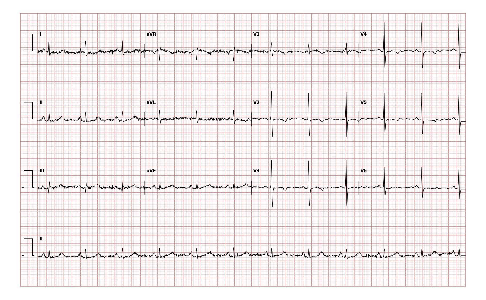

## 문제
A 70-year-old woman comes to the physician because of episodes of chest pressure for 2 months. The episodes occur when she walks uphill and resolve within 5 minutes of rest. She has had no pain at rest. She has type 2 diabetes mellitus and hypertension. Her pulse is 70/min and blood pressure is 146/84 mm Hg. Cardiac examination shows no murmurs. She is pain free at the time of evaluation, and a 12-lead ECG is obtained and shown. Which of the following coronary arteries is most likely to have a hemodynamically significant stenosis?

- A. Left internal mammary artery
- B. Left anterior descending artery
- C. Left circumflex artery
- D. Right coronary artery
- E. Posterior descending artery

_12-lead ECG, 25 mm/s, 10 mm/mV, 3×4 + lead II rhythm strip (PTB-XL, PhysioNet, CC BY 4.0; raw signal, no filtering)_

## 정답 및 해설
> 정답: B

- **정답 핵심**: The ECG shows sinus rhythm at about 70/min with shallow T-wave inversions in aVL and V2 through V5 and a flat T wave in V6; the limb leads are noisy but show no ST elevation. T-wave inversion confined to the anteroseptal and anterior precordial leads points to ischemia in the territory of the left anterior descending artery (its diagonal branches supply the high lateral wall seen by aVL). With exertional chest pressure relieved by rest, the most likely culprit is a significant LAD stenosis.
- **원리**: <b>Why lead location maps to an artery</b>: each precordial lead looks at the wall directly beneath it. V1–V2 face the septum, V3–V4 the anterior wall, V5–V6 and I/aVL the lateral wall, and II/III/aVF the inferior wall. The LAD runs down the anterior interventricular groove, sending septal perforators to the septum and diagonal branches to the anterolateral and high lateral wall, so ischemia in its territory shows up in V1–V4 (often V5) and, with diagonal involvement, in aVL.  <b>Why T-wave inversion rather than ST elevation</b>: a fixed stenosis that is not completely occlusive produces subendocardial ischemia; repolarization in that layer is delayed and the T-wave vector turns away from the affected region. This pattern can persist between episodes, which is why it is visible when she is pain free.  <b>Why the circumflex and right coronary artery fit less well</b>: the circumflex supplies the lateral and posterior wall (I, aVL, V5–V6, and reciprocal changes in V1–V3); the right coronary artery usually supplies the inferior wall (II, III, aVF). Neither produces T-wave inversion centered on V2–V4.
- **비교**: <table><thead><tr><th style="width:24%">Leads with changes</th><th style="width:38%">Left anterior descending (answer)</th><th>Left circumflex (closest distractor)</th></tr></thead><tbody> <tr><td>Precordial</td><td><b>V1–V4 (± V5)</b> — septal and anterior</td><td>V5–V6; V1–V3 only as reciprocal posterior changes</td></tr> <tr><td>Limb</td><td>aVL (and I) when a diagonal branch is involved</td><td>I and aVL as the main finding</td></tr> <tr><td>Wall supplied</td><td>Septum, anterior wall, apex</td><td>Lateral and posterior wall</td></tr> </tbody></table> If the inversion is centered on V2–V4, think LAD; if it sits mainly in I, aVL, V5 and V6 with little change in V2–V4, think circumflex.
- **오답 이유**:
  - (A) The left internal mammary artery is a bypass conduit, not a native coronary artery; it would be relevant only after coronary artery bypass grafting to the LAD.
  - (C) The left circumflex artery would be the answer if the T-wave inversion were centered on I, aVL, V5, and V6, or if V1–V3 showed horizontal ST depression with tall R waves from posterior ischemia.
  - (D) The right coronary artery would be the answer if the ischemic changes were in the inferior leads II, III, and aVF, often with sinus bradycardia or AV block.
  - (E) The posterior descending artery would be the answer if the changes involved the inferior wall alone; it supplies the inferior septum and is a branch of the dominant right coronary artery.
- **함정**: Looking only at aVL and calling the pattern lateral (circumflex). The inversion is greatest across V2–V4, the LAD territory; aVL reflects a diagonal branch of the same artery.
- **학습목표**: 휴식 시 심전도의 aVL·V2~V5 T파 역위를 전중격·전벽 허혈로 읽고 좌전하행지를 책임 혈관으로 고른다
- **근거·출처**: Goldberger AL, Goldberger ZD, Shvilkin A. Goldberger's Clinical Electrocardiography: A Simplified Approach, 10th ed. Elsevier; 2023. Chapter 10: Myocardial ischemia and infarction — non-ST elevation patterns · Virani SS, Newby LK, Arnold SV, et al. 2023 AHA/ACC/ACCP/ASPC/NLA/PCNA guideline for the management of patients with chronic coronary disease. Circulation 2023;148:e9-e119

## 출처
- PTB-XL ECG dataset v1.0.3 (PhysioNet, CC BY 4.0) · record 4964 · Creative Commons Attribution 4.0 International · https://physionet.org/content/ptb-xl/1.0.3/LICENSE.txt
