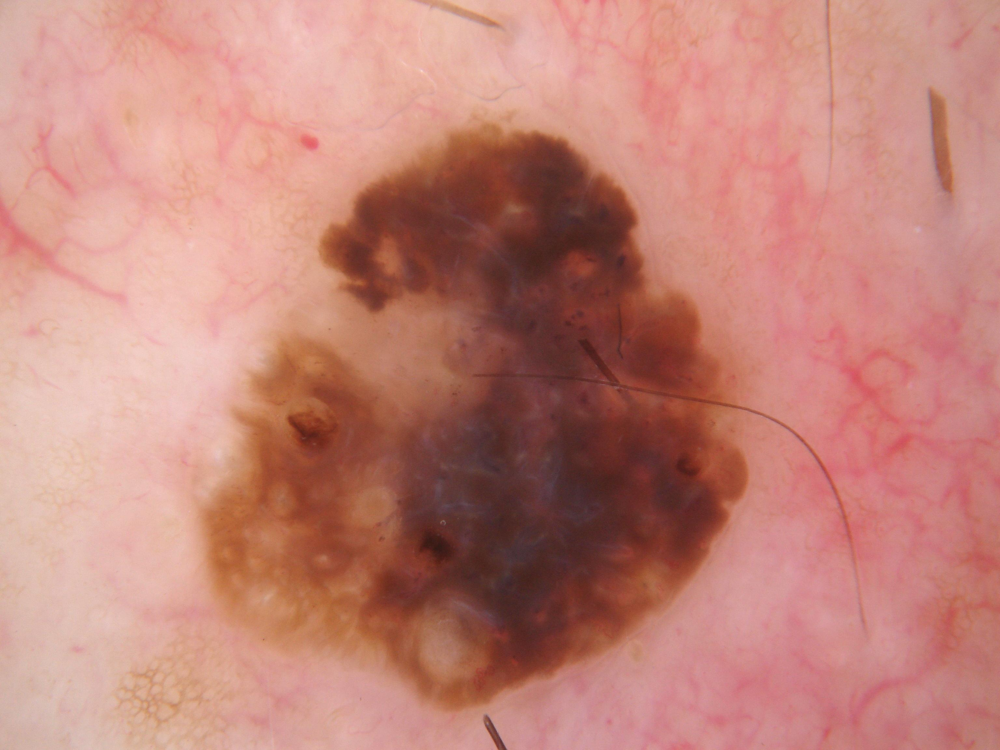

## 문제
60세 남자가 앞가슴에 있는 갈색 반점이 거슬린다며 피부과에 왔다. 10년 전부터 있었고 최근 1년 사이 약간 두꺼워졌으며 옷에 쓸리면 가끔 가렵다. 출혈이나 궤양은 없었다. 몸통에 비슷한 작은 갈색 구진이 여러 개 있다. 앞가슴에 지름 약 1.5 cm 의 경계가 뚜렷하고 표면이 약간 오톨도톨하며 피부에 「붙여 놓은 듯한」 갈색·흑갈색 판이 있다. 병변의 더모스코피 사진은 그림과 같다. 가장 가능성이 높은 진단은?

- A. 색소성 기저세포암
- B. 복합 모반
- C. 일광흑자
- D. 지루각화증
- E. 흑색종

_피부 병변의 더모스코피 사진, 원본 그대로 축소만 (ISIC Archive, CC0 — 크롭·보정 없음)_

## 정답 및 해설
> 정답: D

- **정답 핵심**: 더모스코피에서 병변 경계가 뚜렷하고 가장자리가 좀먹은 듯하며, 안에 여러 개의 둥근 흰 점(비립종 유사 낭종)과 갈색 각질 마개가 찬 구멍(면포 유사 개구부), 뇌회 모양 고랑이 보인다. 색소 그물은 없다 — 표피가 두꺼워지며 각질이 갇히는 비멜라닌세포 병변, 곧 지루각화증의 소견이다. 임상적으로도 오래된, 「붙여 놓은 듯한」 오톨도톨한 판이고 몸통에 비슷한 병변이 여럿이다. 중앙의 청회색 구역은 흑색종을 떠올리게 하지만, 여러 개의 비립종 유사 낭종과 면포 유사 개구부가 함께 있으면 지루각화증이 먼저다(이 병변은 조직으로 확정되었다).
- **원리**: <b>왜 흰 점과 갈색 구멍이 생기는가</b>: 지루각화증은 표피 기저양 각질세포가 위로 쌓이며 두꺼워지는 양성 종양이다. 두꺼워진 표피 안에 각질이 동그랗게 갇히면 <b>각질 가성낭종</b>이 되어 더모스코피에서 하얗게 빛나는 둥근 점(비립종 유사 낭종)으로 보이고, 표면으로 열린 각질 마개는 산화된 각질 때문에 갈색·흑색 구멍(면포 유사 개구부)으로 보인다. 표면의 이랑과 고랑은 뇌회 모양을 만든다.  <b>왜 색소 그물이 없는가</b>: 색소 그물은 표피 능선을 따라 늘어선 멜라닌세포의 멜라닌이 그리는 무늬다. 지루각화증은 멜라닌세포가 아니라 각질세포가 증식하는 병변이라 그물 무늬를 만들지 않는다 — 그래서 더모스코피의 첫 질문은 「멜라닌세포 병변인가」이고, 그물·소구·줄무늬가 없고 각질 구조가 보이면 비멜라닌세포 쪽으로 간다.  <b>왜 청회색이 있어도 되는가</b>: 두꺼운 각질과 깊은 멜라닌 때문에 지루각화증도 청회색으로 보일 수 있다. 판단은 한 소견이 아니라 소견의 묶음으로 한다.
- **비교**: <table><thead><tr><th style="width:22%">보는 곳</th><th style="width:39%">지루각화증(정답)</th><th>흑색종(가장 가까운 오답)</th></tr></thead><tbody> <tr><td>세포 기원</td><td>각질세포 — 비멜라닌세포</td><td>멜라닌세포</td></tr> <tr><td>특징 구조</td><td><b>비립종 유사 낭종 · 면포 유사 개구부 · 뇌회 모양</b></td><td>비정형 색소 그물 · 불규칙 줄무늬 · 청백색 베일 · 퇴행 구역</td></tr> <tr><td>경계</td><td>뚜렷하고 좀먹은 듯함 — 「붙여 놓은」 모양</td><td>불규칙하고 비대칭, 주변으로 번져 흐려짐</td></tr> <tr><td>경과</td><td>수년간 천천히, 여러 개</td><td>최근의 변화, 「미운 오리 새끼」 하나</td></tr> </tbody></table> 각질 구조가 여럿 보이면 지루각화증, 멜라닌세포 구조가 비정형이면 흑색종이다 — 둘 다 애매하면 절제해 조직으로 확인한다.
- **오답 이유**:
  - ① 색소성 기저세포암은 색소 그물이 없으면서 나무가지 모양 혈관, 청회색 난형 둥지, 잎사귀 모양 구조, 궤양이 보일 때 정답이 된다.
  - ② 복합 모반은 대칭적이고 규칙적인 색소 그물이나 고른 소구가 보이고 표면이 매끈하며 각질 구조가 없을 때 정답이 된다.
  - ③ 일광흑자는 얼굴·손등의 납작한 연갈색 반으로 지문 모양 선이나 고른 그물이 보이고 두께·각질 마개가 없을 때 정답이 된다.
  - ⑤ 흑색종은 비정형 색소 그물·불규칙한 줄무늬·청백색 베일이 있고 각질 구조 없이 최근 크기·색이 빠르게 바뀐 단일 병변일 때 정답이 된다.
- **함정**: 중앙의 청회색만 보고 흑색종을 고르는 것 — 비립종 유사 낭종과 면포 유사 개구부가 여럿 있으면 지루각화증이 먼저다.
- **학습목표**: 더모스코피에서 비립종 유사 낭종·면포 유사 개구부·뇌회 모양 고랑과 뚜렷한 좀먹은 경계를 지루각화증 소견으로 읽고 흑색종과 가른다
- **근거·출처**: Bolognia JL, Schaffer JV, Cerroni L. Dermatology, 4th ed. Elsevier; 2018. Chapter 109: Benign Epithelial Tumors and Proliferations · Marghoob AA, Malvehy J, Braun RP. Atlas of Dermoscopy, 2nd ed. CRC Press; 2012

## 출처
- ISIC Archive ISIC_0001144 (CC-0) · CC0 1.0 Universal · https://creativecommons.org/publicdomain/zero/1.0/
