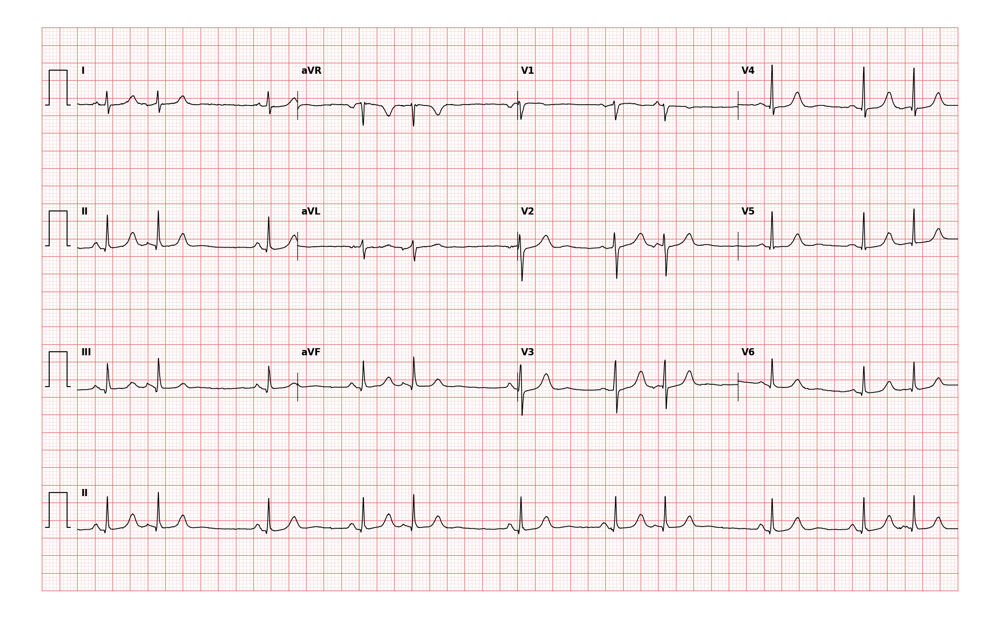

## 문제
A 74-year-old woman comes to the physician because of a sensation of skipped heartbeats for 3 weeks. She has had no chest pain, dizziness, or syncope. She has hypertension treated with hydrochlorothiazide and drinks two cups of coffee daily. Pulse is 64/min and irregular, with a pattern that repeats every third beat; blood pressure is 138/82 mm Hg. Cardiac examination shows no murmurs. Serum potassium is 3.9 mEq/L, and TSH is within the reference range. A 12-lead ECG is shown. Which of the following is the most likely diagnosis?

- A. Second-degree atrioventricular block, Mobitz type I
- B. Sinus arrhythmia
- C. Atrial flutter with variable conduction
- D. Premature atrial contractions in a trigeminal pattern
- E. Premature ventricular contractions in a trigeminal pattern

_12-lead ECG, 25 mm/s, 10 mm/mV, 3×4 + lead II rhythm strip (PTB-XL, PhysioNet, CC BY 4.0; raw signal, no filtering)_

## 정답 및 해설
> 정답: D

- **정답 핵심**: In the lead II rhythm strip, two sinus beats are followed by one early beat, and the cycle repeats every third beat (trigeminy). Each early beat is preceded by an early P wave and has a narrow QRS complex identical to the sinus beats, followed by a pause. A premature narrow beat with its own early P wave arises in the atria: premature atrial contractions occurring in a trigeminal pattern. PR intervals of the sinus beats are constant, and no P wave is left without a QRS.
- **원리**: <b>Why the QRS stays narrow</b>: an impulse from an ectopic atrial focus still reaches the ventricles through the AV node and His–Purkinje system, so ventricular activation is the same as in sinus rhythm — a narrow QRS that looks like the sinus beats. A ventricular ectopic beat bypasses this conduction system and spreads slowly through muscle, making the QRS wide and bizarre.  <b>Why there is a pause after the early beat</b>: the premature atrial impulse enters and resets the sinus node, so the next sinus beat comes one sinus cycle after the PAC — the pause is usually <b>less than compensatory</b>. A PVC usually does not reset the sinus node, giving a fully compensatory pause.  <b>Why "grouped beating" is not always AV block</b>: any repeating 2:1 or 3:1 pattern of early beats groups the QRS complexes. Wenckebach groups beats by <i>dropping</i> a QRS after progressive PR prolongation; trigeminy groups them by <i>adding</i> an early beat.
- **비교**: <table><thead><tr><th style="width:24%">Look at</th><th style="width:38%">PACs in trigeminy (answer)</th><th>Mobitz type I block (closest distractor)</th></tr></thead><tbody> <tr><td>Third beat of the group</td><td><b>Comes early, with its own early P wave</b></td><td>Absent — a P wave appears with no QRS after it</td></tr> <tr><td>PR interval</td><td>Constant in sinus beats</td><td>Lengthens beat by beat until the dropped QRS</td></tr> <tr><td>Pause</td><td>Follows an early beat</td><td>Contains a non-conducted P wave</td></tr> <tr><td>QRS width</td><td>Narrow, same as sinus</td><td>Narrow (block in the AV node)</td></tr> </tbody></table> Ask whether the irregularity is from an extra early beat or from a missing beat — then search the pause for a lone P wave.
- **오답 이유**:
  - (A) Mobitz type I block would be correct if the PR interval lengthened progressively and a P wave inside each pause failed to conduct to the ventricles.
  - (B) Sinus arrhythmia would be correct if the P waves were all identical sinus P waves and the rate rose and fell gradually with respiration rather than abruptly.
  - (C) Atrial flutter with variable conduction would be correct if sawtooth flutter waves at about 300/min replaced the discrete P waves in II, III, and aVF.
  - (E) PVCs in a trigeminal pattern would be correct if every third beat were wide and bizarre without a preceding early P wave and with a discordant T wave.
- **함정**: Calling grouped beating Wenckebach — here the third beat arrives early with its own P wave instead of dropping out.
- **학습목표**: 리듬 스트립에서 동박동 2개마다 일찍 온 P파를 가진 좁은 QRS 조기 박동이 되풀이되는 것을 심방 기외수축 3단맥으로 읽고, 묶여 오는 박동을 만드는 Wenckebach 방실차단과 가른다
- **근거·출처**: Goldberger AL, Goldberger ZD, Shvilkin A. Goldberger's Clinical Electrocardiography: A Simplified Approach, 10th ed. Elsevier; 2023. Chapter 14 · Loscalzo J, Fauci A, Kasper D, et al. Harrison's Principles of Internal Medicine, 21st ed. McGraw-Hill; 2022. Chapter 251

## 출처
- PTB-XL ECG dataset v1.0.3 (PhysioNet, CC BY 4.0) · record 8945 · Creative Commons Attribution 4.0 International · https://physionet.org/content/ptb-xl/1.0.3/LICENSE.txt
