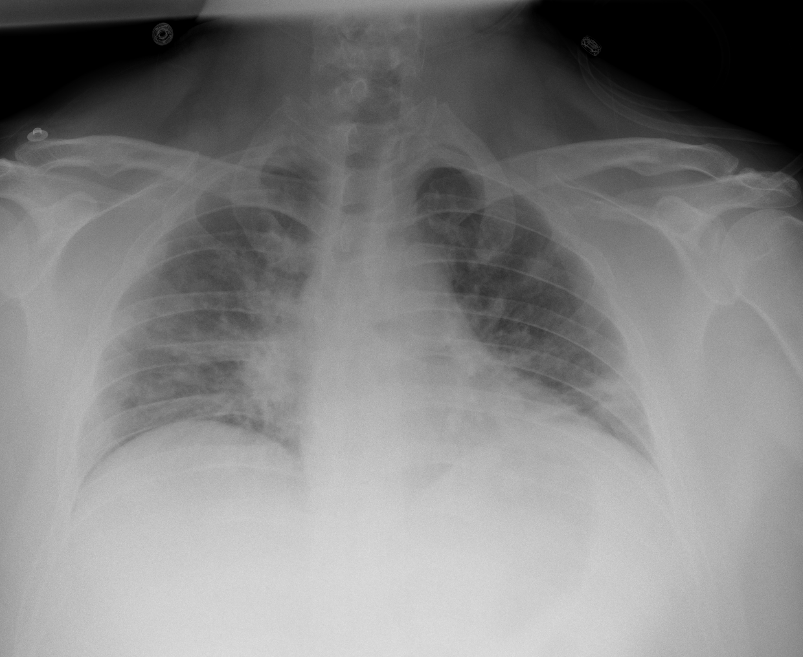

## 문제
40세 남자가 5일 전부터 열과 기침이 있었고 오늘 숨이 많이 차서 응급실에 왔다. 어제 SARS-CoV-2 신속항원검사가 양성이었다. 비만(체질량지수 34 kg/m²)이 있고 다른 병력은 없다. 체온 38.6℃, 혈압 128/80 mmHg, 맥박 108회/분, 호흡 30회/분이다. 의식은 명료하고 문장으로 말할 수 있다. 비강 캐뉼라로 산소 6 L/분을 주는데도 산소포화도는 88 % 이다. 동맥혈가스(산소 투여 중) pH 7.47, PaCO₂ 32 mmHg, PaO₂ 56 mmHg 이다. 이미 덱사메타손과 렘데시비르를 시작하였다. 흉부 X선은 그림과 같다. 다음 처치로 가장 적절한 것은?

- A. 푸로세미드 정맥 주사
- B. 고유량 비강 캐뉼라 산소 요법
- C. 즉시 기관삽관 후 기계환기
- D. 체외막산소공급(ECMO)
- E. 벤투리 마스크 산소 28 %

_이동식 전후면 흉부 X선, 축소만 (TCIA, CC BY 4.0 — 크롭·보정 없음, 심전도 전극이 보임)_

## 정답 및 해설
> 정답: B

- **정답 핵심**: 흉부 X선에서 양쪽 아래·가운데폐야에 바깥쪽과 아래쪽이 더 짙은 흐릿한 간유리·반점 음영이 있고 폐 용적이 작다 — 양측 바이러스 폐렴이다. 저유량 산소 6 L/분으로도 산소포화도 88 % 인 급성 저산소성 호흡부전이지만 의식이 명료하고 말할 수 있으며 혈압이 안정적이고 PaCO₂ 가 낮아 환기는 유지된다. 이때는 고유량 비강 캐뉼라로 산소를 올려 기관삽관을 줄일 수 있는지 먼저 본다. 1~2시간 안에 호흡수·산소화가 나아지지 않거나 의식 저하·피로가 생기면 지체 없이 삽관한다.
- **원리**: <b>왜 고유량 비강 캐뉼라가 먼저인가</b>: 숨찬 환자는 분당 흡기 유량이 30~60 L 까지 올라 저유량 캐뉼라(최대 약 6 L/분)의 산소가 바깥 공기로 희석되어 실제 흡입 산소 농도가 낮아진다. 고유량 장치는 가온·가습한 산소를 최대 60 L/분으로 흘려 흡기 유량을 넘어서므로 흡입 산소 농도를 거의 설정값(최대 100 %)대로 전달하고, 코인두의 사강을 씻어 내며 약간의 호기말 양압을 만든다.  <b>왜 아직 삽관하지 않는가</b>: 삽관의 근거는 산소포화도 숫자 하나가 아니라 <b>기도 보호 불능·의식 저하·환기 부전(PaCO₂ 상승)·혈역학 불안정·호흡근 피로</b>다. 이 환자는 의식이 명료하고 과호흡으로 PaCO₂ 가 낮다. 고유량 산소는 코로나19 저산소성 호흡부전에서 삽관을 줄였다(RECOVERY-RS 는 CPAP, HENIVOT 등).  <b>왜 지켜봐야 하는가</b>: 고유량 산소가 실패의 신호를 가려 삽관이 늦어지면 예후가 나빠진다 — ROX 지수(산소포화도/흡입 산소 농도 ÷ 호흡수)로 재평가한다.
- **비교**: <table><thead><tr><th style="width:22%">구분</th><th style="width:39%">고유량 비강 캐뉼라(정답)</th><th>즉시 기관삽관(가장 가까운 오답)</th></tr></thead><tbody> <tr><td>의식·기도</td><td><b>명료, 스스로 기도 유지</b></td><td>의식 저하, 기도 보호 불능</td></tr> <tr><td>환기</td><td>PaCO₂ 정상 또는 낮음</td><td>PaCO₂ 상승·호흡산증</td></tr> <tr><td>혈역학·피로</td><td>안정, 문장으로 말함</td><td>쇼크, 보조호흡근 탈진·역설호흡</td></tr> <tr><td>재평가</td><td>1~2시간 뒤 ROX 지수·호흡수</td><td>—</td></tr> </tbody></table> 산소포화도가 낮다는 것만으로 삽관하지 않는다 — 의식·환기·혈역학 중 하나라도 무너지면 삽관이다.
- **오답 이유**:
  - ① 푸로세미드는 심장비대·흉수·커얼리 B선과 경정맥 팽대 등 체액 과다에 의한 심인성 폐부종일 때 정답이 된다.
  - ③ 즉시 기관삽관은 의식 저하·PaCO₂ 상승·쇼크·호흡근 피로가 있거나 고유량 산소 1~2시간 뒤에도 악화할 때 정답이 된다.
  - ④ 체외막산소공급은 기계환기와 복와위에도 PaO₂/FiO₂ 가 50~80 mmHg 미만으로 지속되는 중증 ARDS 의 구제 치료일 때 정답이 된다.
  - ⑤ 벤투리 마스크 28 % 는 고탄산혈증 위험이 있는 COPD 악화에서 정해진 낮은 농도를 주어야 할 때 정답이 되며, 6 L/분 캐뉼라보다 오히려 산소가 적다.
- **함정**: 산소포화도 88 % 라는 숫자만 보고 즉시 삽관을 고르는 것 — 의식이 명료하고 PaCO₂ 가 낮으면 고유량 산소를 먼저 시도한다.
- **학습목표**: 양측 폐 음영이 있는 바이러스 폐렴에서 저유량 산소로 산소포화도를 유지하지 못하지만 의식이 명료하고 혈역학이 안정된 급성 저산소성 호흡부전에 고유량 비강 캐뉼라 산소를 먼저 적용한다
- **근거·출처**: Frat JP, Thille AW, Mercat A, et al. High-flow oxygen through nasal cannula in acute hypoxemic respiratory failure. N Engl J Med 2015;372:2185-2196 · Rochwerg B, Einav S, Chaudhuri D, et al. The role for high flow nasal cannula as a respiratory support strategy in adults: a clinical practice guideline. Intensive Care Med 2020;46:2226-2237

## 출처
- COVID-19-AR, The Cancer Imaging Archive (CC BY 4.0) · series …10113736 · Creative Commons Attribution 4.0 International · https://www.cancerimagingarchive.net/data-usage-policies-and-restrictions/
