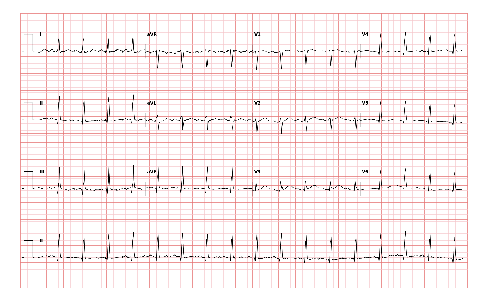

## 문제
67세 여자가 3일 전부터 열·오한과 오른쪽 옆구리 통증이 있고 오늘 기운이 없어 응급실에 왔다. 잘 먹지 못했다고 한다. 체온 38.9℃, 혈압 104/66 mmHg, 호흡 20회/분이다. 오른쪽 늑골척추각 압통이 있고 입안이 말라 있다. 심잡음은 들리지 않는다. 소변검사에서 백혈구가 많이 보이고 아질산염 양성이다. 혈청 칼륨 3.8 mEq/L 이다. 맥박이 빨라 12유도 심전도를 찍었고 그림과 같다. 심전도 판독으로 가장 적절한 것은?

- A. 가속 접합부 리듬
- B. 동빈맥
- C. 발작성 상심실빈맥
- D. 2:1 전도 심방조동
- E. 다소성 심방빈맥

_12유도 심전도, 25 mm/s · 10 mm/mV, 3×4 + II 리듬 스트립 (PTB-XL ECG dataset, PhysioNet, CC BY 4.0 — 원신호 그대로 작도)_

## 정답 및 해설
> 정답: B

- **정답 핵심**: 리듬 스트립의 QRS 간격이 약 3큰칸(0.57초)으로 규칙적이라 심박수는 분당 약 105회이고 QRS 는 좁다. II·III·aVF 에서 모든 QRS 앞에 같은 모양의 양성 P파가 있고 PR 간격이 일정하며 전기축은 정상이다 — 동방결절에서 나온 빠른 리듬, 곧 동빈맥이다(V4~V6 의 T파 평탄은 비특이 소견). 열과 탈수가 있는 급성 신우신염에서 생긴 생리적 반응이므로 리듬 자체를 낮추려 하지 말고 수액과 항생제로 원인을 치료한다.
- **원리**: <b>왜 P파의 모양과 방향이 결정적인가</b>: 동방결절은 우심방 위·바깥쪽에 있어, 거기서 시작한 흥분은 심방을 <b>위에서 아래로, 오른쪽에서 왼쪽으로</b> 퍼진다. 그래서 동 P파는 II·III·aVF 에서 양성, aVR 에서 음성이다. 이 모양의 P파가 모든 QRS 앞에 일정한 PR 로 있으면 리듬의 출발점은 동방결절이다 — 빠르기와 상관없이.  <b>왜 빨라졌는가</b>: 열은 체온 1℃ 오를 때마다 심박수를 약 10회 올리고, 탈수로 줄어든 1회 박출량을 보상하려 교감신경이 동방결절의 4상 탈분극 기울기를 가파르게 만든다. 따라서 동빈맥은 「진단」이 아니라 「신호」이고, 치료 대상은 열·저혈량·통증·빈혈·저산소증·폐색전증 같은 원인이다.  <b>왜 다른 빈맥과 헷갈리는가</b>: 심박수가 빨라지면 P파가 앞 박동의 T파에 가까워져 묻히기 쉽다. 그때는 리듬 스트립 전체에서 박동마다 P파가 같은 자리에 있는지, 심박수가 서서히 변하는지를 본다.
- **비교**: <table><thead><tr><th style="width:22%">보는 곳</th><th style="width:39%">동빈맥(정답)</th><th>발작성 상심실빈맥(가장 가까운 오답)</th></tr></thead><tbody> <tr><td>심박수</td><td><b>대개 100~150, 원인에 따라 서서히 변함</b></td><td>대개 150~250, 갑자기 시작·멈춤</td></tr> <tr><td>P파</td><td>II·III·aVF 양성, 모든 QRS 앞, PR 일정</td><td>보이지 않거나 QRS 바로 뒤의 역행 P파(II 에서 음성)</td></tr> <tr><td>미주신경 자극·아데노신</td><td>잠깐 느려졌다 돌아온다</td><td>갑자기 끊긴다</td></tr> <tr><td>치료</td><td>원인 치료(수액·해열·항생제)</td><td>미주신경 자극 → 아데노신</td></tr> </tbody></table> P파가 QRS 앞에 바로 서 있으면 출발점은 동방결절이다 — 빠르다는 이유로 상심실빈맥이라 부르지 않는다.
- **오답 이유**:
  - ① 가속 접합부 리듬은 심박수 60~100회에 P파가 없거나 QRS 앞뒤의 역행 P파로 보이고 흔히 디곡신 중독·심근경색 뒤에 생길 때 정답이 된다.
  - ③ 발작성 상심실빈맥은 심박수가 150회 이상으로 갑자기 시작하고 P파가 보이지 않거나 QRS 바로 뒤의 역행 P파로 보일 때 정답이 된다.
  - ④ 2:1 전도 심방조동은 심박수가 약 150회로 고정되고 II·III·aVF 에서 분당 300회 정도의 톱니 모양 조동파가 보일 때 정답이 된다.
  - ⑤ 다소성 심방빈맥은 모양이 다른 P파가 세 가지 이상이고 PR·RR 간격이 불규칙하며 흔히 중증 폐질환 환자에서 보일 때 정답이 된다.
- **함정**: 빠른 좁은 QRS 빈맥을 모두 상심실빈맥으로 부르는 것 — II·III·aVF 의 양성 P파가 QRS 앞마다 일정하게 있으면 동빈맥이다.
- **학습목표**: 분당 100회를 조금 넘는 규칙적 좁은 QRS 빈맥에서 II·III·aVF 의 QRS 앞마다 양성 P파와 일정한 PR 을 확인해 동빈맥으로 읽고, 발작성 상심실빈맥·심방조동 2:1 과 가른다
- **근거·출처**: Goldberger AL, Goldberger ZD, Shvilkin A. Goldberger's Clinical Electrocardiography: A Simplified Approach, 10th ed. Elsevier; 2023. Chapter 13 · Page RL, Joglar JA, Caldwell MA, et al. 2015 ACC/AHA/HRS Guideline for the Management of Adult Patients With Supraventricular Tachycardia. Circulation 2016;133:e506-e574

## 출처
- PTB-XL ECG dataset v1.0.3 (PhysioNet, CC BY 4.0) · record 1375 · Creative Commons Attribution 4.0 International · https://physionet.org/content/ptb-xl/1.0.3/LICENSE.txt
