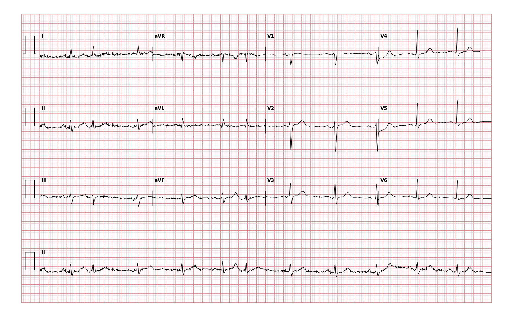

## 문제
82세 여자가 한 달 전부터 가끔 가슴이 「툭」 하고 건너뛰는 느낌이 있어 내과에 왔다. 하루에 몇 번 몇 초씩 느끼고 일상생활에는 지장이 없다. 어지러움·실신·흉통·호흡곤란은 없다. 고혈압으로 암로디핀을 먹고 있고 저녁마다 녹차를 두 잔 마신다. 혈압 132/76 mmHg, 맥박 62회/분으로 가끔 불규칙하다. 심잡음은 없다. 혈청 칼륨 4.2 mEq/L, 마그네슘 2.0 mg/dL 이고 갑상샘자극호르몬은 정상이다. 심장초음파에서 좌심실 박출률 62 %, 좌심방 크기와 판막은 정상이다. 12유도 심전도는 그림과 같다. 가장 적절한 처치는?

- A. 안심시키고 카페인 등 유발 요인 줄이기
- B. 직접작용 경구 항응고제 시작
- C. 메토프롤롤 매일 복용 시작
- D. 아미오다론 매일 복용 시작
- E. 전극도자절제술 의뢰

_12유도 심전도, 25 mm/s · 10 mm/mV, 3×4 + II 리듬 스트립 (PTB-XL ECG dataset, PhysioNet, CC BY 4.0 — 원신호 그대로 작도)_

## 정답 및 해설
> 정답: A

- **정답 핵심**: 리듬 스트립에서 바탕 리듬은 분당 약 60회의 동리듬이고, 사이사이에 예정보다 일찍 오는 박동이 있다(I·II 열의 2번째, aVF 열의 3번째 박동). 이 박동은 QRS 가 좁고 동박동과 모양이 같으며 뒤에 짧은 쉼이 따른다 — 심방 기외수축이다. 증상이 가볍고 구조적 심질환·전해질·갑상샘 이상이 없으므로, 양성임을 설명해 안심시키고 카페인·알코올·수면 부족 같은 유발 요인을 줄이는 것이 처치다. 심방세동이 아니므로 항응고 대상이 아니다.
- **원리**: <b>왜 대부분 치료하지 않는가</b>: 심방 기외수축은 건강한 고령자 24시간 기록에서 거의 모두 보일 만큼 흔하다. 심방 근육 한 곳의 자동능이 잠깐 앞서 발화하는 것이고, 정상 전도로를 타므로 혈역학적 영향이 거의 없다. 치료의 목표는 리듬을 없애는 것이 아니라 증상을 줄이는 것이어서, 증상이 가벼우면 설명과 유발 요인 조절이 가장 이득이 크고 해가 없다.  <b>왜 항응고를 하지 않는가</b>: 뇌졸중 위험을 높이는 것은 심방이 <b>떨기만 하고 수축하지 못해</b> 좌심방귀에 혈류가 고이는 심방세동이다. 심방 기외수축 사이에는 정상 심방 수축이 유지된다. CHA₂DS₂-VASc 점수는 심방세동(또는 조동)이 확인된 환자에게만 적용한다. 다만 기외수축이 매우 잦으면 나중에 심방세동이 생길 위험이 커지므로, 두근거림의 양상이 바뀌면 다시 기록한다.  <b>약을 쓸 때</b>: 증상이 생활을 방해하면 베타차단제나 비디하이드로피리딘 칼슘통로차단제를 먼저 쓴다. 아미오다론은 독성이 커서 양성 기외수축에는 쓰지 않는다.
- **비교**: <table><thead><tr><th style="width:22%">구분</th><th style="width:39%">안심·유발 요인 조절(정답)</th><th>직접작용 경구 항응고제(가장 가까운 오답)</th></tr></thead><tbody> <tr><td>대상 리듬</td><td><b>동리듬 사이의 단발 심방 기외수축</b></td><td>심방세동·심방조동</td></tr> <tr><td>심전도</td><td>동 P파가 있고, 조기 박동 뒤 다시 규칙적인 동리듬</td><td>P파 없음, RR 간격이 완전히 불규칙</td></tr> <tr><td>위험 평가</td><td>증상·구조적 심질환·유발 요인</td><td>CHA₂DS₂-VASc(이 환자라면 여성·75세 이상·고혈압 4점)</td></tr> <tr><td>해</td><td>거의 없음</td><td>82세에서 주요 출혈 위험</td></tr> </tbody></table> 「불규칙한 맥박 + 고령 + 고혈압」을 보고 항응고부터 떠올리지 않는다 — 리듬이 심방세동인지 먼저 확인한다.
- **오답 이유**:
  - ② 직접작용 경구 항응고제는 심전도에서 P파가 없고 RR 이 완전히 불규칙한 심방세동이 확인되고 CHA₂DS₂-VASc 가 높을 때 정답이 된다.
  - ③ 메토프롤롤은 안심과 유발 요인 조절에도 두근거림이 잦고 생활을 방해할 만큼 심할 때 증상 조절 약으로 정답이 될 수 있다.
  - ④ 아미오다론은 양성 기외수축에는 쓰지 않고, 구조적 심질환이 있는 심실빈맥이나 다른 약이 실패한 심방세동 리듬 조절일 때 고려된다.
  - ⑤ 전극도자절제술은 약물에도 증상이 심한 매우 잦은 단일 초점 기외수축이나 반복성 심방빈맥, 기외수축 유발 심근병증일 때 정답이 된다.
- **함정**: 고령·고혈압·불규칙한 맥박을 보고 항응고제를 고르는 것 — 동리듬 사이의 단발 심방 기외수축은 심방세동이 아니다.
- **학습목표**: 동리듬 사이의 단발 심방 기외수축을 읽고, 구조적 심질환·유발 질환이 없고 증상이 가벼우면 안심시키고 유발 요인을 줄이는 것이 처치이며 심방세동으로 오인해 항응고를 시작하지 않는다
- **근거·출처**: Goldberger AL, Goldberger ZD, Shvilkin A. Goldberger's Clinical Electrocardiography: A Simplified Approach, 10th ed. Elsevier; 2023. Chapter 14 · Page RL, Joglar JA, Caldwell MA, et al. 2015 ACC/AHA/HRS Guideline for the Management of Adult Patients With Supraventricular Tachycardia. Circulation 2016;133:e506-e574

## 출처
- PTB-XL ECG dataset v1.0.3 (PhysioNet, CC BY 4.0) · record 13709 · Creative Commons Attribution 4.0 International · https://physionet.org/content/ptb-xl/1.0.3/LICENSE.txt
