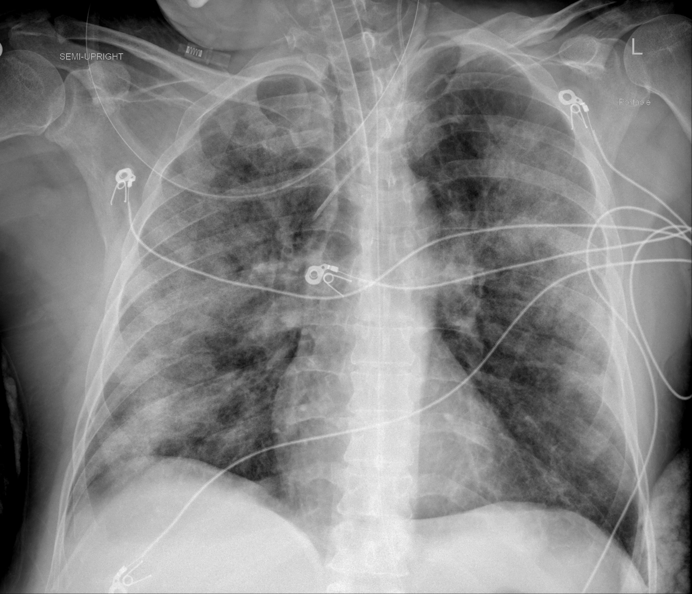

## 문제
56세 남자가 일주일 전부터 열과 기침이 있다가 사흘 전부터 숨이 차서 입원하였다. 입원 둘째 날 저산소혈증이 심해져 기관삽관 후 기계환기를 시작하였다. 고혈압 외에 다른 병력은 없다. 체온 38.4℃, 혈압 118/72 mmHg, 맥박 104회/분이다. 양쪽 폐에서 수포음이 들린다. 호기말양압 10 cmH₂O, 흡입산소분율 0.6 에서 측정한 동맥혈 PaO₂ 는 90 mmHg 이다. 심초음파에서 좌심실 박출률은 60 % 이고 좌심방 확장은 없다. 흉부 X선은 그림과 같다. 이 환자 상태의 분류로 가장 적절한 것은?

- A. 경증 급성호흡곤란증후군
- B. 중등도 급성호흡곤란증후군
- C. 중증 급성호흡곤란증후군
- D. 심인성 폐부종
- E. 수혈 관련 급성 폐손상

_휴대용 반좌위 전후 흉부 X선, 위치·방향 글자는 원본의 것 (TCIA, CC BY 4.0 — 크롭·보정 없음, 심전도 전극·관이 겹쳐 보임)_

## 정답 및 해설
> 정답: B

- **정답 핵심**: 흉부 X선에서 양쪽 폐에 넓은 반점·융합성 음영이 있고(오른쪽 중하폐야와 왼쪽 중폐야 바깥쪽이 두드러짐), 증상은 1주 안에 악화되었으며, 좌심실 박출률 60 %·좌심방 확장 없음으로 심부전이나 수액 과다만으로 설명되지 않는다 — 급성호흡곤란증후군(Berlin 정의)의 조건을 갖춘다. 중증도는 호기말양압 5 cmH₂O 이상에서 PaO₂/FiO₂ 로 나눈다. 90 ÷ 0.6 = 150 으로 100 초과 200 이하이므로 중등도다.
- **원리**: <b>왜 PaO₂ 만이 아니라 PaO₂/FiO₂ 인가</b>: 같은 PaO₂ 90 mmHg 라도 실내 공기(FiO₂ 0.21)에서라면 비율 430 으로 정상이고, FiO₂ 0.6 이 필요하다면 폐포에 들어간 산소가 혈액으로 넘어가지 못하는 정도가 크다는 뜻이다. 비율은 산소를 얼마나 주고 있는지를 보정해 <b>폐의 산소화 장애 자체</b>를 나타낸다.  <b>왜 호기말양압 조건이 붙는가</b>: 호기말양압은 허탈된 폐포를 열어 두어 PaO₂ 를 크게 바꾼다. 같은 환자도 호기말양압 0 과 10 에서 비율이 전혀 다르므로, 정의는 「최소 5 cmH₂O 를 준 상태」로 측정 조건을 고정한다.  <b>왜 심기능을 따로 확인하는가</b>: 정수압이 높아 생긴 폐부종도 양측 음영과 저산소혈증을 만든다. ARDS 는 폐포-모세혈관 막의 투과성이 높아진 비심인성 부종이므로, 위험 요인이 분명하지 않거나 심부전을 의심할 때는 심초음파로 정수압성 부종을 객관적으로 배제해야 한다.
- **비교**: <table><thead><tr><th style="width:24%">PaO₂/FiO₂ (PEEP ≥ 5)</th><th style="width:38%">중등도(정답)</th><th>중증(가장 가까운 오답)</th></tr></thead><tbody> <tr><td>기준</td><td><b>100 초과 ~ 200 이하</b></td><td>100 이하</td></tr> <tr><td>이 환자</td><td>90 ÷ 0.6 = <b>150</b></td><td>PaO₂ 가 60 mmHg 미만이어야 FiO₂ 0.6 에서 100 이하</td></tr> <tr><td>뜻</td><td>폐보호 환기·충분한 호기말양압</td><td>복와위·근이완제·ECMO 검토</td></tr> </tbody></table> FiO₂ 를 백분율(60)로 넣어 1.5 를 얻는 실수가 「중증」으로 끌려가는 흔한 경로다 — 반드시 소수(0.6)로 나눈다.
- **오답 이유**:
  - ① 경증은 호기말양압 5 이상에서 PaO₂/FiO₂ 가 200 초과 300 이하일 때, 예컨대 같은 FiO₂ 0.6 에서 PaO₂ 가 150 mmHg 일 때 정답이다.
  - ③ 중증은 PaO₂/FiO₂ 가 100 이하일 때, 곧 같은 설정에서 PaO₂ 가 60 mmHg 미만으로 떨어졌을 때 정답이 된다.
  - ④ 심인성 폐부종은 좌심실 박출률이 낮거나 좌심방 확장·이완기 충만압 상승이 있고 심장 비대·나비 모양 음영이 보일 때 정답이 된다.
  - ⑤ 수혈 관련 급성 폐손상은 수혈 중이나 수혈 6시간 안에 양측 음영과 저산소혈증이 새로 생겼을 때만 정답이 된다.
- **함정**: FiO₂ 를 60 으로 나누거나 PaO₂ 만 보고 「90 이면 괜찮다」고 판단하는 것 — 비율은 90/0.6 = 150 이다.
- **학습목표**: 양측 폐 음영·1주 이내 발병·심기능 정상인 기계환기 환자에서 호기말양압 5 이상일 때 PaO₂/FiO₂ 로 급성호흡곤란증후군의 중증도를 분류한다
- **근거·출처**: ARDS Definition Task Force. Acute respiratory distress syndrome: the Berlin Definition. JAMA. 2012;307(23):2526-2533. PMID: 22797452 · Loscalzo J, Fauci A, Kasper D, et al. Harrison's Principles of Internal Medicine, 21st ed. McGraw-Hill; 2022. Chapter 301: Acute Respiratory Distress Syndrome

## 출처
- COVID-19-AR, The Cancer Imaging Archive (CC BY 4.0) · series …84640493 · Creative Commons Attribution 4.0 International · https://www.cancerimagingarchive.net/data-usage-policies-and-restrictions/
