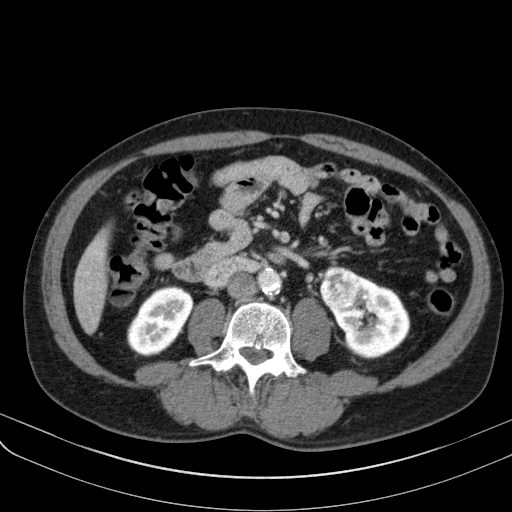

## 문제
59세 남자가 건강검진 복부 초음파에서 왼쪽 신장 종괴가 발견되어 비뇨의학과에 왔다. 증상은 없고 육안적 혈뇨나 옆구리 통증은 없었다. 고혈압으로 약을 먹고 있다. 신체 진찰에서 만져지는 종괴는 없다. 혈청 크레아티닌 0.9 mg/dL 이고 소변검사에서 적혈구는 없다. 복부 조영증강 CT 동맥기 영상은 그림과 같다. 종괴의 최대 지름은 3.4 cm 이고 반대쪽 신장은 정상이며 신정맥 침범이나 커진 림프절은 없다. 흉부 CT 에서 폐 결절은 없다. 가장 적절한 치료는?

- A. 6개월 뒤 초음파 추적 관찰
- B. 부분 신장절제술
- C. 근치적 신장절제술
- D. 경피적 신장 생검 후 경과 관찰
- E. 수니티닙 경구 투여

_복부 조영증강 CT 동맥기 축상면 1장, 연부조직 창 (TCIA, CC BY 3.0 — 크롭·보정 없음, 분할선 없음)_

## 정답 및 해설
> 정답: B

- **정답 핵심**: CT 에서 왼쪽 신장 앞쪽에 피질처럼 강하게, 그러나 불균질하게 조영증강되는 고형 종괴가 있다. 지방이 없는 조영증강 고형 신장 종괴는 신세포암을 먼저 생각한다(이 종괴는 수술 병리로 투명세포 신세포암 pT1a 가 확인되었다). 4 cm 이하이고 정맥 침범·림프절·원격 전이가 없으므로 cT1a 이며, 이때 표준 치료는 종양학적 결과가 근치적 절제와 같으면서 신장 기능을 보존하는 부분 신장절제술이다. 고혈압이 있어 이후 만성 신장병 위험이 있다는 점도 신장 보존 쪽을 지지한다.
- **원리**: <b>왜 조영증강이 핵심인가</b>: 신장 종괴는 먼저 낭성인지 고형인지, 그리고 조영 후 감쇠값이 15~20 HU 이상 오르는지(혈관이 있는 조직인지)로 가른다. 지방(−10 HU 이하)이 보이면 혈관근지방종이고, 지방 없이 조영되는 고형 종괴는 80~90 % 가 신세포암이다. 투명세포형은 혈관이 풍부해 동맥기에 강하고 불균질하게(괴사·출혈 부위가 섞여) 조영된다.  <b>왜 작은 종양은 부분절제인가</b>: 근치적 절제는 신장 하나를 통째로 없애 신원(nephron) 수를 절반으로 줄이고, 그 뒤 만성 신장병과 심혈관 사건 위험이 늘어난다. T1a 종양에서 부분절제는 국소 재발·암 특이 생존이 근치적 절제와 같으므로, 기술적으로 가능하면 신장 보존이 원칙이다.  <b>왜 생검이 기본이 아닌가</b>: 영상이 전형적이고 수술할 계획이면 생검 결과가 치료를 바꾸지 않는다. 생검은 감시·국소 소작을 고를 때나 림프종·전이암을 의심할 때 쓴다.
- **비교**: <table><thead><tr><th style="width:22%">고려점</th><th style="width:39%">부분 신장절제술(정답)</th><th>근치적 신장절제술(가장 가까운 오답)</th></tr></thead><tbody> <tr><td>대상</td><td><b>cT1a(≤ 4 cm)</b>, 기술적으로 가능한 위치</td><td>큰 종양(T2 이상)·신문 중심부·정맥 혈전</td></tr> <tr><td>암 조절</td><td>T1a 에서 근치적과 같음</td><td>같음</td></tr> <tr><td>신기능</td><td>신원 보존 → 만성 신장병 위험 낮음</td><td>신장 하나를 잃음</td></tr> <tr><td>대가</td><td>출혈·소변 누출 위험이 조금 더</td><td>수술은 단순</td></tr> </tbody></table> 작고 접근 가능한 종양이면 신장 보존, 크거나 중심부·정맥 침범이면 근치적 절제 — 크기와 위치가 선택을 정한다.
- **오답 이유**:
  - ① 초음파 추적 관찰은 2 cm 미만의 작은 종괴이거나 기대여명이 짧아 능동 감시를 택할 때 정답이 된다.
  - ③ 근치적 신장절제술은 종양이 크거나(대개 7 cm 초과) 신문 중심부를 채워 부분절제가 기술적으로 어렵거나 신정맥 혈전이 있을 때 정답이 된다.
  - ④ 생검 후 관찰은 고령·동반질환으로 수술 위험이 크거나 영상이 비전형적이어서 림프종·전이암을 배제해야 할 때 정답에 가까워진다.
  - ⑤ 수니티닙 같은 표적 치료는 원격 전이가 있는 진행성 투명세포 신세포암일 때 정답이 된다 — 국소 T1a 에는 쓰지 않는다.
- **함정**: 「암이면 신장을 통째로」라고 생각해 근치적 절제를 고르는 것 — T1a 는 신장 보존이 표준이다.
- **학습목표**: 조영 CT 에서 강하게 불균질 조영되는 4 cm 이하의 신장 고형 종괴(cT1a)를 신세포암으로 보고 신장 보존 부분절제술을 선택한다
- **근거·출처**: Campbell SC, Clark PE, Chang SS, et al. Renal Mass and Localized Renal Cancer: Evaluation, Management, and Follow-Up: AUA Guideline: Part I. J Urol. 2021;206(2):199-208. PMID: 34115547 · Partin AW, Dmochowski RR, Kavoussi LR, Peters CA. Campbell-Walsh-Wein Urology, 12th ed. Elsevier; 2020. Chapter: Malignant Renal Tumors

## 출처
- The Cancer Imaging Archive (CC BY 3.0) · KiTS-00015 · Creative Commons Attribution 3.0 Unported · https://www.cancerimagingarchive.net/data-usage-policies-and-restrictions/
