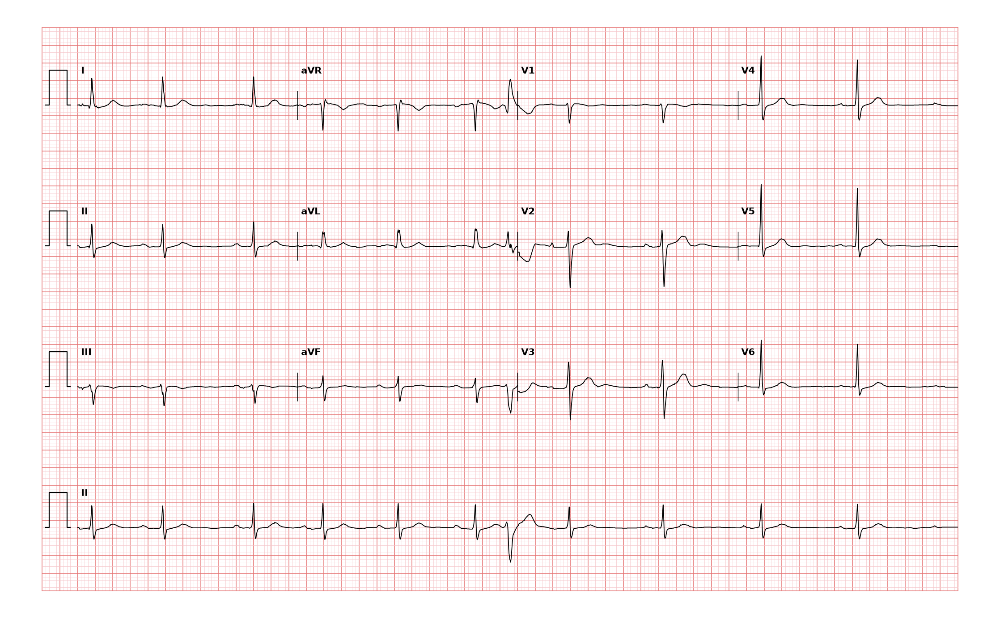

## 문제
An 89-year-old woman is brought to the clinic by her daughter because she has noticed an occasional 'skipped beat' for the past 2 months. She has had no chest pain, dyspnea, light-headedness, or syncope. She has hypertension controlled with amlodipine and takes no other medications. Pulse is 68/min with an occasional irregular beat; blood pressure is 134/76 mm Hg. Cardiac examination shows no murmurs or gallops. Serum potassium is 4.3 mEq/L, and serum magnesium is 2.0 mg/dL. A 12-lead ECG is shown. Which of the following is the most likely cause of the irregular beat?

- A. Ventricular escape beat
- B. Intermittent ventricular preexcitation
- C. Premature ventricular contraction
- D. Premature atrial contraction with aberrant conduction
- E. Intermittent left bundle branch block

_12-lead ECG, 25 mm/s, 10 mm/mV, 3×4 + lead II rhythm strip (PTB-XL, PhysioNet, CC BY 4.0; raw signal, no filtering)_

## 정답 및 해설
> 정답: C

- **정답 핵심**: In the lead II rhythm strip, one beat in the middle comes early and is wide and bizarre, with a T wave pointing opposite to its main QRS deflection. No premature P wave precedes it, and the next sinus beat arrives on schedule, so the sinus rhythm is not reset and there is no pause — an interpolated premature ventricular contraction. All other beats are narrow sinus beats with a constant PR interval and mild sinus arrhythmia.
- **원리**: <b>Why a ventricular beat is wide</b>: an impulse that starts in ventricular muscle does not use the His–Purkinje system, so it spreads cell to cell and activation takes longer than 120 ms. Repolarization follows the same abnormal path in reverse order, which is why the T wave points opposite to the QRS (secondary ST–T change).  <b>Why no pause follows this beat</b>: a PVC usually does not enter the sinus node, so the sinus node keeps firing on time. If the next sinus P wave falls when the AV node is still refractory, it is blocked and a fully compensatory pause appears; if the PVC comes early enough and the sinus rate is slow, the next sinus impulse conducts normally and the PVC is simply <b>interpolated</b> between two sinus beats.  <b>Why this argues against an atrial origin</b>: a premature atrial impulse enters and resets the sinus node, shifting all later sinus beats. A beat that leaves the sinus schedule untouched did not come from the atria.
- **비교**: <table><thead><tr><th style="width:24%">Look at</th><th style="width:38%">PVC (answer)</th><th>PAC with aberrancy (closest distractor)</th></tr></thead><tbody> <tr><td>Before the wide beat</td><td><b>No premature P wave</b></td><td>An early P wave, often hidden in the preceding T wave</td></tr> <tr><td>QRS shape</td><td>Wide, bizarre, discordant T</td><td>Often RBBB-like with a normal initial deflection</td></tr> <tr><td>Next sinus beat</td><td><b>On schedule</b> (interpolated) or after a full compensatory pause</td><td>Reset — usually a less-than-compensatory pause</td></tr> </tbody></table> Search the preceding T wave for a hidden early P wave, then measure whether the sinus schedule was reset.
- **오답 이유**:
  - (A) A ventricular escape beat would be correct if the wide beat came late, after a long pause caused by sinus arrest or AV block, rather than early.
  - (B) Intermittent preexcitation would be correct if the wide beats had a short PR interval with a slurred delta wave and were not premature.
  - (D) PAC with aberrancy would be correct if an early, differently shaped P wave preceded the wide beat and the following sinus beat came late because the sinus node was reset.
  - (E) Intermittent LBBB would be correct if the wide beats were not premature, each followed an on-time sinus P wave with a normal PR interval, and showed a broad notched R in V6.
- **함정**: Calling every wide beat a bundle branch block or aberrancy — first check whether it is premature and whether a P wave drives it.
- **학습목표**: 리듬 스트립에서 조기 P파 없이 나타난 넓고 기이한 조기 박동과 그 뒤 동박동이 제때 오는 것을 삽입성 심실 기외수축으로 읽고 변행전도를 동반한 심방 기외수축과 가른다
- **근거·출처**: Goldberger AL, Goldberger ZD, Shvilkin A. Goldberger's Clinical Electrocardiography: A Simplified Approach, 10th ed. Elsevier; 2023. Chapter 16 · Loscalzo J, Fauci A, Kasper D, et al. Harrison's Principles of Internal Medicine, 21st ed. McGraw-Hill; 2022. Chapter 251

## 출처
- PTB-XL ECG dataset v1.0.3 (PhysioNet, CC BY 4.0) · record 8579 · Creative Commons Attribution 4.0 International · https://physionet.org/content/ptb-xl/1.0.3/LICENSE.txt
