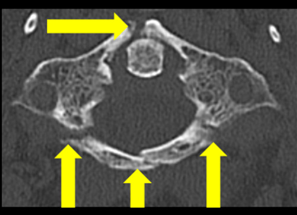

## 문제
A 70-year-old man is brought to the emergency department 1 hour after he dove into the shallow end of a swimming pool and struck the top of his head on the bottom. He reports severe upper neck pain but no weakness or numbness. He has coronary artery disease. Pulse is 88/min, and blood pressure is 142/84 mm Hg. He is wearing a rigid cervical collar. Neurologic examination shows normal strength, sensation, and reflexes in all extremities. An axial CT scan of the upper cervical spine at the level of the first cervical vertebra is shown. Which of the following mechanisms most likely produced this injury?

- A. Axial compression transmitted from the vertex through the occipital condyles
- B. Hyperextension compressing the posterior arch between the occiput and C2
- C. Hyperflexion with compression of the anterior vertebral body
- D. Lateral flexion with avulsion of the alar ligament from the dens
- E. Rotational force causing atlantoaxial facet subluxation

_Axial CT, bone window; arrows are from the original published figure — one panel cropped, no other change (PMC Open Access Subset, CC BY)_

## 정답 및 해설
> 정답: A

- **정답 핵심**: The CT shows a ring broken in several places: one fracture of the anterior arch and fractures of the posterior arch and the junction of the left lateral mass and posterior arch (arrows), with the dens centered in the ring. A ring fractured both in front and behind is the burst (Jefferson) fracture of C1. It results from an axial load on the vertex — here diving into shallow water — that drives the occipital condyles down into the wedge-shaped lateral masses and forces them apart, breaking the ring at its weakest points. Neurologic deficits are usually absent because the canal widens rather than narrows.
- **원리**: <b>Why an axial load bursts the atlas</b>: the lateral masses of C1 are wedge-shaped — thicker laterally and thinner medially — and their upper surfaces cup the occipital condyles. A force on the top of the head pushes the condyles into these wedges like a splitting maul, so the lateral masses spread outward and the ring snaps at the thin junctions of the anterior and posterior arches with the lateral masses.  <b>Why the cord is usually spared</b>: the fragments move outward, enlarging the spinal canal at C1, which is already the widest part of the cervical canal. Patients often present with neck pain only.  <b>Why stability depends on the transverse ligament</b>: the transverse atlantal ligament holds the dens against the anterior arch. If the lateral masses spread so far that the ligament tears (combined overhang of the lateral masses on C2 beyond about 7 mm on an open-mouth view, or a bony avulsion on CT/MRI), the fracture is unstable and needs fixation rather than a collar alone.
- **비교**: <table><thead><tr><th style="width:24%">Look at</th><th style="width:38%">Axial load — burst (answer)</th><th>Hyperextension (closest distractor)</th></tr></thead><tbody> <tr><td>Fracture pattern</td><td><b>Anterior and posterior arches both broken</b> — ring in ≥ 2–4 parts</td><td>Posterior arch alone (bilateral), anterior arch intact</td></tr> <tr><td>How it happens</td><td>Condyles drive lateral masses apart</td><td>Arch pinched between occiput and C2 spinous process</td></tr> <tr><td>Typical story</td><td>Diving, fall onto the head, roof collapse</td><td>Chin or forehead strikes an object, neck forced back</td></tr> </tbody></table> A ring can break in only one place if it is held in front: when the anterior arch is also broken, an outward-spreading axial force is required.
- **오답 이유**:
  - (B) Hyperextension would be correct if only the posterior arch were fractured on both sides, pinched between the occiput and C2, with the anterior arch intact.
  - (C) Hyperflexion would be correct for an anterior wedge compression or flexion teardrop fracture of a lower cervical vertebral body, not a C1 ring burst.
  - (D) Lateral flexion would be correct for an alar ligament avulsion or an occipital condyle fracture, seen as a small fragment at the tip of the dens.
  - (E) Rotation would be correct for atlantoaxial rotatory subluxation, seen as asymmetric lateral mass–dens relationships without fractures, often in children.
- **함정**: Assuming every C1 arch fracture comes from hyperextension — only an isolated posterior arch fracture does; a ring broken front and back means axial loading.
- **학습목표**: 고리뼈(C1) 축상 CT 에서 앞·뒤고리가 여러 곳 끊긴 고리 파열(Jefferson 골절)을 읽고 머리 꼭대기로 전달된 축성 압박 기전과 연결한다
- **근거·출처**: Jefferson G. Fracture of the atlas vertebra: report of four cases, and a review of those previously recorded. Br J Surg. 1920;7(27):407-422 · Tornetta P III, Ricci WM, Ostrum RF, et al. Rockwood and Green's Fractures in Adults, 9th ed. Wolters Kluwer; 2019. Chapter: Cervical Spine Fractures and Dislocations · Case figure: Front Surg. 2023;10:1123947. doi: 10.3389/fsurg.2023.1123947 (CC BY)

## 출처
- Case report: Interdisciplinary treatment of complex C1/C2 fractures in a patient with concomitant three-vessel coronary artery disease requiring bypass surgery. Front Surg. 2023 May 16;10:1123947. doi: 10.3389/fsurg.2023.1123947 (CC BY) — Figure 1 · CC BY · https://creativecommons.org/licenses/
