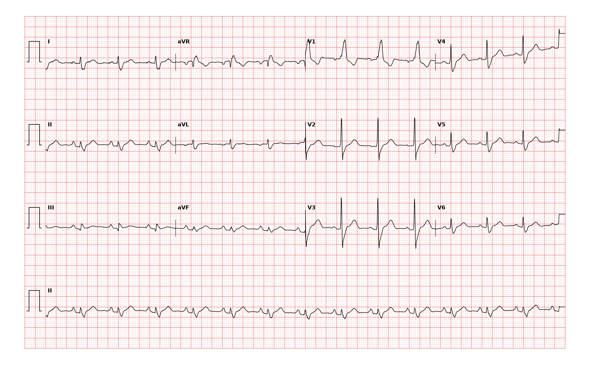

## 문제
66세 남자가 오른쪽 서혜부 탈장 수술을 앞두고 수술 전 검사를 받았다. 증상은 없고 계단 두 층을 쉬지 않고 오른다. 고혈압으로 약을 먹고 있고 흡연한 적은 없다. 혈압 132/80 mmHg, 맥박 88회/분이다. 심잡음은 없고 제2심음이 넓게 분열되어 들린다. 흉부 X선은 정상이다. 혈청 칼륨 4.2 mEq/L 이다. 12유도 심전도는 그림과 같다. 심전도 판독으로 가장 적절한 것은?

- A. 우심실 비대
- B. 완전 우각차단
- C. 완전 좌각차단
- D. 좌전섬유속 차단
- E. 브루가다 1형 양상

_12유도 심전도, 25 mm/s · 10 mm/mV, 3×4 + II 리듬 스트립 (PTB-XL ECG dataset, PhysioNet, CC BY 4.0 — 원신호 그대로 작도)_

## 정답 및 해설
> 정답: B

- **정답 핵심**: QRS 폭이 3칸(0.12 s) 이상으로 넓고, V1 에서 작은 r 뒤 S, 그리고 크고 넓은 R′ 가 이어지는 rsR′ 모양이며, I·V5·V6 에는 넓고 둔한 S파가 있다. 우심실의 탈분극이 늦게 일어나 마지막 부분이 오른쪽·앞쪽(V1 쪽)으로 향하는 모습 — 완전 우각차단이다. V1~V2 의 T파가 QRS 끝부분과 반대 방향인 것은 이차성 재분극 변화다. 진찰의 넓은 제2심음 분열도 폐동맥판 폐쇄가 늦어진 결과로 같은 방향을 가리킨다.
- **원리**: <b>왜 끝부분이 오른쪽으로 향하는가</b>: 정상에서는 좌·우각이 거의 동시에 양쪽 심실을 탈분극하고, 두꺼운 좌심실이 벡터를 지배한다. 우각이 막히면 좌심실은 제때 탈분극하고, 우심실은 좌심실에서 근육을 따라 느리게 전해진 흥분으로 <b>늦게</b> 탈분극한다. 이 늦은 우심실 성분이 QRS 끝에 오른쪽·앞쪽으로 덧붙어 V1 에 큰 R′, 왼쪽 유도(I·V6)에 넓은 S파를 만든다.  <b>왜 처음 부분은 정상인가</b>: 중격 탈분극은 좌각에서 시작해 왼쪽에서 오른쪽으로 가므로 우각차단에서도 그대로 남는다 — V1 의 작은 r 과 V6 의 작은 q 가 유지된다. 좌각차단은 이 첫 부분부터 바뀌어 V6 의 q 가 사라진다.  <b>왜 제2심음이 넓게 갈라지는가</b>: 우심실 수축이 늦어지면 폐동맥판이 늦게 닫혀 P2 가 뒤로 밀리고, 이 분열은 호기 때도 남는다.
- **비교**: <table><thead><tr><th style="width:22%">보는 곳</th><th style="width:39%">완전 우각차단(정답)</th><th>완전 좌각차단(가장 가까운 오답)</th></tr></thead><tbody> <tr><td>V1</td><td><b>rsR′ — 끝부분이 위로</b></td><td>넓은 QS 또는 rS — 깊게 아래로</td></tr> <tr><td>I·V6</td><td>넓고 둔한 S파, 작은 q 유지</td><td>넓고 끝이 패인 R파, q 없음</td></tr> <tr><td>탈분극 순서</td><td>좌심실 → 늦은 우심실</td><td>우심실 → 늦은 좌심실(중격도 거꾸로)</td></tr> <tr><td>의미</td><td>건강한 사람에서도 흔함</td><td>대개 구조적 심질환 동반 — 평가 필요</td></tr> </tbody></table> 넓은 QRS 를 보면 V1 의 마지막 방향부터 본다 — 위로면 우각, 아래로면 좌각이다.
- **오답 이유**:
  - ① 우심실 비대는 V1 에 큰 R파(R/S > 1)가 있어도 QRS 폭이 정상이고 우축 편위와 V1~V3 의 변형 ST-T 가 함께 있을 때 정답이 된다.
  - ③ 완전 좌각차단은 V1 이 넓고 깊은 QS·rS 로 끝부분이 아래로 향하고, I·V6 에 q 없이 넓고 끝이 패인 R파가 있을 때 정답이 된다.
  - ④ 좌전섬유속 차단은 QRS 폭이 0.12 s 미만으로 좁고 전기축이 −45° 보다 왼쪽이며 II·III·aVF 에 rS, I·aVL 에 qR 이 있을 때 정답이 된다.
  - ⑤ 브루가다 1형 양상은 V1~V2 에서 2 mm 이상 둥글게 솟은 ST 상승이 음성 T파로 이어지고 I·V6 의 넓은 S파가 없을 때 정답이 된다.
- **함정**: V1 의 R′ 와 ST-T 변화만 보고 브루가다를 고르는 것 — I·V6 의 넓은 S파와 넓어진 QRS 는 우각차단의 짝이다.
- **학습목표**: V1 의 넓은 rsR′ 와 I·V6 의 넓고 둔한 S파, QRS 0.12 s 이상을 완전 우각차단으로 읽고 좌각차단·브루가다 양상과 가른다
- **근거·출처**: Goldberger AL, Goldberger ZD, Shvilkin A. Goldberger's Clinical Electrocardiography: A Simplified Approach, 10th ed. Elsevier; 2023. Chapter 7 · Surawicz B, Childers R, Deal BJ, Gettes LS. AHA/ACCF/HRS Recommendations for the Standardization and Interpretation of the Electrocardiogram: Part III: Intraventricular Conduction Disturbances. Circulation. 2009;119(10):e235-e240. PMID: 19228822

## 출처
- PTB-XL ECG dataset v1.0.3 (PhysioNet, CC BY 4.0) · record 903 · Creative Commons Attribution 4.0 International · https://physionet.org/content/ptb-xl/1.0.3/LICENSE.txt
