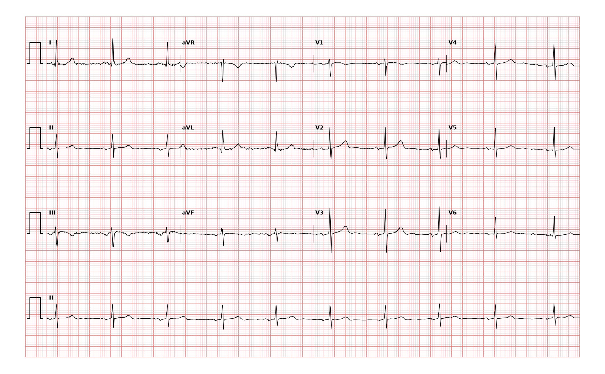

## 문제
72세 여자가 건강검진에서 맥박이 느리다는 말을 듣고 외래에 왔다. 어지러움·실신·호흡곤란·운동 시 피로는 없고 매일 40분씩 걷는다. 고지혈증으로 스타틴을 먹고 있고 베타차단제나 칼슘통로차단제는 먹지 않는다. 혈압 128/76 mmHg, 맥박 56회/분이다. 갑상샘자극호르몬과 혈청 칼륨은 정상이다. 계단을 오르게 한 뒤 다시 잰 맥박은 92회/분이다. 12유도 심전도는 그림과 같다. 가장 적절한 처치는?

- A. 추가 치료 없이 경과를 관찰한다
- B. 아트로핀을 정맥 주사한다
- C. 영구 심박동기를 삽입한다
- D. 이소프로테레놀을 지속 주입한다
- E. 일시적 경피 심박조율을 시작한다

_12유도 심전도, 25 mm/s · 10 mm/mV, 3×4 + II 리듬 스트립 (PTB-XL ECG dataset, PhysioNet, CC BY 4.0 — 원신호 그대로 작도)_

## 정답 및 해설
> 정답: A

- **정답 핵심**: 리듬 스트립의 RR 간격이 약 5큰칸(약 1.04 s)으로 규칙적이라 심박수는 분당 약 57회이고, 모든 QRS 앞에 같은 모양의 P파가 일정한 PR 로 있으며 QRS 는 좁다 — 동서맥이다. 방실차단은 없다. 증상이 없고, 서맥을 일으키는 약이나 갑상샘 기능 저하가 없으며, 운동하면 맥박이 92회까지 오른다(변시성 기능 보존). 증상 없는 동서맥은 치료 대상이 아니므로 경과를 관찰한다.
- **원리**: <b>왜 「느리다」만으로는 치료하지 않는가</b>: 심박출량은 심박수 × 1회 박출량이다. 휴식 시 심박수가 50대라도 1회 박출량이 보상하면 조직 관류는 충분하고 증상이 없다. 동서맥 치료의 기준은 숫자가 아니라 <b>서맥과 연결된 증상</b>(어지러움·실신·운동 시 피로·심부전)이다.  <b>왜 운동 시 맥박을 보는가</b>: 동방결절 기능 부전의 핵심은 필요할 때 심박수를 올리지 못하는 변시성 부전이다. 운동으로 맥박이 적절히 오르면 결절의 예비력이 있다는 뜻이다.  <b>왜 원인을 먼저 찾는가</b>: 베타차단제·비디하이드로피리딘 칼슘통로차단제·디곡신, 갑상샘 기능 저하, 고칼륨혈증, 수면 무호흡 같은 되돌릴 수 있는 원인을 먼저 배제한다. 원인이 없고 증상도 없으면 박동조율기는 이득 없이 시술 위험만 더한다.
- **비교**: <table><thead><tr><th style="width:22%">보는 곳</th><th style="width:39%">경과 관찰(정답)</th><th>영구 심박동기(가장 가까운 오답)</th></tr></thead><tbody> <tr><td>증상</td><td><b>없음</b></td><td>서맥과 연관된 어지러움·실신·피로</td></tr> <tr><td>리듬</td><td>동서맥, 방실 전도 정상</td><td>증상 있는 동결절 기능 부전, 2도 Mobitz II·3도 방실차단</td></tr> <tr><td>운동 반응</td><td>맥박이 적절히 오름</td><td>오르지 않음(변시성 부전)</td></tr> <tr><td>가역 원인</td><td>없음</td><td>배제한 뒤에도 지속</td></tr> </tbody></table> 동서맥에서 심박동기를 정하는 것은 심박수가 아니라 증상과 서맥의 연관이다 — 방실차단이 있는 경우와는 기준이 다르다.
- **오답 이유**:
  - ② 아트로핀 정맥 주사는 서맥으로 저혈압·의식 변화·쇼크 같은 불안정 징후가 있을 때 첫 약물로 정답이 된다.
  - ③ 영구 심박동기는 서맥과 연관된 실신·어지러움이 기록되거나 변시성 부전이 있거나 3도·Mobitz II 방실차단이 있을 때 정답이 된다.
  - ④ 이소프로테레놀 지속 주입은 아트로핀에 반응하지 않는 불안정 서맥에서 조율 준비 전까지 쓰는 다리 역할일 때 정답에 가까워진다.
  - ⑤ 경피 심박조율은 아트로핀에 반응하지 않는 혈역학적으로 불안정한 서맥이나 고도 방실차단일 때 정답이 된다.
- **함정**: 맥박 56회라는 숫자에 끌려 약물·조율을 고르는 것 — 증상이 없고 운동 반응이 정상이면 치료하지 않는다.
- **학습목표**: 증상 없는 동서맥(분당 50대, P파·PR 정상)은 치료하지 않고 경과 관찰하며, 박동조율기·아트로핀은 증상이 있거나 방실차단이 있을 때로 가른다
- **근거·출처**: Kusumoto FM, Schoenfeld MH, Barrett C, et al. 2018 ACC/AHA/HRS Guideline on the Evaluation and Management of Patients With Bradycardia and Cardiac Conduction Delay. Circulation. 2019;140(8):e382-e482. PMID: 30586772 · Goldberger AL, Goldberger ZD, Shvilkin A. Goldberger's Clinical Electrocardiography: A Simplified Approach, 10th ed. Elsevier; 2023. Chapter 13

## 출처
- PTB-XL ECG dataset v1.0.3 (PhysioNet, CC BY 4.0) · record 1795 · Creative Commons Attribution 4.0 International · https://physionet.org/content/ptb-xl/1.0.3/LICENSE.txt
