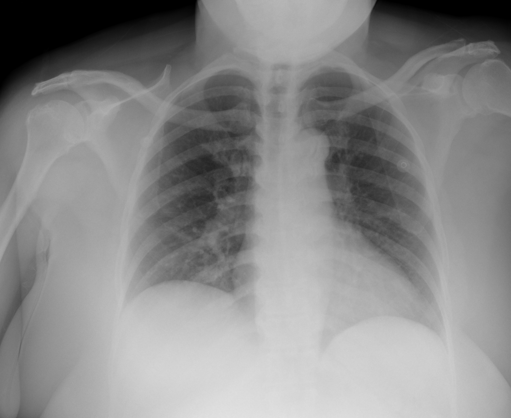

## 문제
61세 여자가 5일 전부터 열과 마른기침이 있다가 이틀 전부터 숨이 차서 응급실에 왔다. 고혈압과 제2형 당뇨병으로 약을 먹고 있다. 체온 38.2℃, 혈압 132/78 mmHg, 맥박 102회/분, 호흡 26회/분이고 실내 공기에서 산소포화도는 91 % 이다. 양쪽 아래 폐에서 수포음이 들린다. 비인두 검체의 SARS-CoV-2 핵산증폭검사는 양성이다. C-반응단백 6.2 mg/dL 이고 프로칼시토닌은 정상이다. 흉부 X선은 그림과 같다. 입원시켜 코삽관으로 산소를 주기 시작하였다. 이 환자에게 가장 적절한 약물 치료는?

- A. 덱사메타손
- B. 니르마트렐비르·리토나비르
- C. 토실리주맙
- D. 아지트로마이신
- E. 오셀타미비르

_흉부 X선 정면상 1장 (TCIA, CC BY 4.0 — 크롭·보정 없음)_

## 정답 및 해설
> 정답: A

- **정답 핵심**: 흉부 X선에서 폐용적이 작고 양쪽 하폐야(오른쪽 우세)와 중폐야 바깥쪽에 반점·그물 모양 음영이 퍼져 있다 — 핵산증폭검사 양성과 함께 코로나19 폐렴이다. 실내 공기 산소포화도 91 % 로 산소 보충이 필요한 입원 환자이므로, 사망률을 낮추는 것이 입증된 덱사메타손(6 mg 하루 1회, 최대 10일)을 준다(렘데시비르를 함께 쓸 수 있다).
- **원리**: <b>왜 이 시기에 스테로이드인가</b>: 코로나19 는 초기에 바이러스 증식이 주를 이루다가, 산소가 필요해지는 시기에는 <b>숙주의 과도한 염증 반응</b>이 폐 손상을 이끈다. 그래서 산소가 필요한 환자에서 덱사메타손은 염증을 눌러 28일 사망률을 낮췄고(RECOVERY), 산소가 필요 없는 환자에서는 이득이 없고 해로운 경향이 있었다.  <b>왜 니르마트렐비르는 아닌가</b>: 단백분해효소 억제제는 바이러스가 늘어나는 초기, 곧 <b>입원하지 않은 고위험 경증 환자</b>에게 증상 5일 안에 주어 입원을 줄이는 약이다. 이미 산소가 필요한 단계에서의 이득은 입증되지 않았다.  <b>토실리주맙의 자리</b>: 덱사메타손을 쓰는데도 산소 요구가 빠르게 늘고 염증 지표가 높을 때 더한다 — 첫 약이 아니다.
- **비교**: <table><thead><tr><th style="width:24%">조건</th><th style="width:38%">덱사메타손(정답)</th><th>니르마트렐비르·리토나비르(가장 가까운 오답)</th></tr></thead><tbody> <tr><td>대상</td><td><b>산소가 필요한 입원 환자</b></td><td>입원하지 않은 고위험 경증·중등증</td></tr> <tr><td>시기</td><td>염증기</td><td>증상 5일 이내 바이러스 증식기</td></tr> <tr><td>효과</td><td>사망률 감소</td><td>입원·사망 위험 감소(외래)</td></tr> </tbody></table> 「산소가 필요한가」가 갈림길이다 — 필요하면 덱사메타손, 필요 없으면 덱사메타손을 쓰지 않는다.
- **오답 이유**:
  - ② 니르마트렐비르·리토나비르는 산소 보충이 필요 없는 외래 고위험 환자가 증상 5일 안에 왔을 때 정답이다.
  - ③ 토실리주맙은 덱사메타손을 쓰는 중에도 산소 요구가 빠르게 늘고 C-반응단백이 높은 환자에게 더할 때 정답이 된다.
  - ④ 아지트로마이신은 세균성 폐렴이 함께 의심될 때(프로칼시토닌 상승·화농성 가래) 경험적 항생제로 정답이 될 수 있다.
  - ⑤ 오셀타미비르는 인플루엔자 검사가 양성이거나 유행기에 인플루엔자가 의심될 때 정답이다 — 이 환자는 코로나19 양성이다.
- **함정**: 입원한 코로나19 환자에게 외래용 항바이러스제를 고르는 것 — 산소 요구 여부가 약을 정한다.
- **학습목표**: 산소 보충이 필요한 입원 코로나19 폐렴 환자에게 덱사메타손을 투여하고, 외래 경증용 항바이러스제·면역조절제의 적응과 구분한다
- **근거·출처**: RECOVERY Collaborative Group. Dexamethasone in hospitalized patients with Covid-19. N Engl J Med. 2021;384(8):693-704. PMID: 32678530 · Loscalzo J, Fauci AS, Kasper DL, et al., eds. Harrison's Principles of Internal Medicine, 22nd ed. McGraw Hill; 2025. Chapter 205: SARS-CoV-2 and COVID-19

## 출처
- COVID-19-AR, The Cancer Imaging Archive (CC BY 4.0) · series …50585929 · Creative Commons Attribution 4.0 International · https://www.cancerimagingarchive.net/data-usage-policies-and-restrictions/
