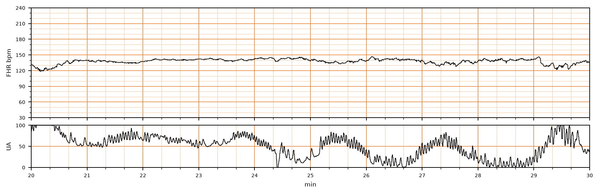

## 문제
A 31-year-old nulliparous woman at 39 weeks' gestation is admitted in spontaneous labor. Her pregnancy has been uncomplicated. Membranes ruptured 2 hours ago with clear fluid. She is not receiving oxytocin and has epidural analgesia. Temperature is 37.0°C and blood pressure is 118/72 mm Hg. The cervix is 6 cm dilated and 90% effaced, and the fetal head is at 0 station. Over the past 30 minutes, contractions have averaged four every 10 minutes. A representative 10-minute segment of the continuous fetal heart rate and uterine activity tracing is shown. Which of the following is the most appropriate next step in management?

- A. Fetal scalp stimulation
- B. Emergency cesarean delivery
- C. Continue current labor management with ongoing fetal monitoring
- D. Maternal repositioning and supplemental oxygen
- E. Transcervical amnioinfusion

_Fetal heart rate (top) and uterine activity (bottom) during labor, a 10-minute segment, bold vertical lines = 1 min (PhysioNet CTU-UHB, ODC-BY 1.0; 4 Hz raw data, no smoothing)_

## 정답 및 해설
> 정답: C

- **정답 핵심**: The tracing shows a baseline fetal heart rate of about 140/min, moderate variability (amplitude about 6–10 beats/min), and no late or variable decelerations; contractions average four per 10 minutes, which is not tachysystole. This is a Category I (normal) tracing, which predicts normal fetal acid–base status at the time of observation, so routine labor management and monitoring continue without intervention.
- **원리**: <b>Why Category I is reassuring</b>: Moderate variability means the fetal autonomic nervous system — sympathetic and parasympathetic inputs to the sinus node — is intact and well oxygenated. Metabolic acidemia blunts this beat-to-beat control first, so a normal baseline with moderate variability and no late or variable decelerations strongly predicts a normal pH at that moment.  <b>Why intervene only in Category II or III</b>: Intrauterine resuscitation (repositioning, fluids, stopping oxytocin, oxygen) is used when decelerations or reduced variability suggest impaired uteroplacental or cord flow. Without them, intervention adds risk without benefit.  <b>Why the tracing is re-evaluated</b>: The category describes the present moment only; labor can change it, so monitoring continues.
- **비교**: <table><thead><tr><th style="width:24%">Feature</th><th style="width:38%">Category I — continue (answer)</th><th>Category II — intrauterine resuscitation (closest distractor)</th></tr></thead><tbody> <tr><td>Baseline</td><td>110–160/min (here about 140)</td><td>Bradycardia without absent variability, or tachycardia</td></tr> <tr><td>Variability</td><td><b>Moderate (6–25)</b></td><td>Minimal, absent without decelerations, or marked</td></tr> <tr><td>Decelerations</td><td>None late or variable</td><td>Recurrent late or variable, prolonged</td></tr> </tbody></table> Read the tracing in the same order every time: baseline, variability, accelerations/decelerations, contractions — then categorize.
- **오답 이유**:
  - (A) Fetal scalp stimulation is correct when variability is minimal or absent and fetal acidemia must be excluded by eliciting an acceleration.
  - (B) Emergency cesarean delivery is correct for a Category III tracing (absent variability with recurrent decelerations, or sinusoidal pattern) that does not resolve.
  - (D) Repositioning and oxygen are correct for a Category II tracing, such as recurrent late decelerations or minimal variability.
  - (E) Amnioinfusion is correct for recurrent variable decelerations from cord compression, which this tracing does not show.
- **함정**: Intervening because the uterine activity line looks busy — four contractions per 10 minutes averaged over 30 minutes is normal.
- **학습목표**: 정상 기저 심박수·중등도 변이도·감속 없음의 분만 중 태아심박동 기록을 범주 I 로 분류하고 진통 관리를 그대로 이어 간다
- **근거·출처**: Cunningham FG, Leveno KJ, Dashe JS, et al. Williams Obstetrics, 26th ed. McGraw Hill; 2022. Chapter 24: Intrapartum Assessment

## 출처
- CTU-UHB Intrapartum Cardiotocography Database (PhysioNet, ODC-BY 1.0) · record 1439 · Open Data Commons Attribution License v1.0 · https://opendatacommons.org/licenses/by/1-0/
