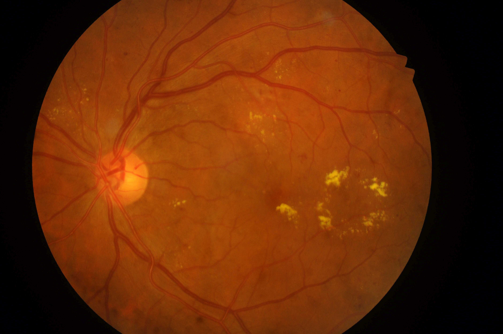

## 문제
당뇨병으로 14년째 치료 중인 환자가 두 달 전부터 왼눈으로 글자가 흐릿하고 직선이 약간 휘어 보여 안과에 왔다. 갑자기 시야가 가려진 적은 없다. 당화혈색소는 8.9 % 이다. 왼눈 교정시력이 0.4, 오른눈 교정시력은 0.9 이다. 안압은 양쪽 모두 정상이고 상대구심동공운동장애는 없다. 산동 후 왼눈의 안저 사진은 그림과 같다. 왼눈 시력 저하의 원인으로 가장 적절한 것은?

- A. 당뇨황반부종
- B. 증식당뇨망막병증
- C. 망막중심정맥폐쇄
- D. 습성 연령관련황반변성
- E. 고혈압망막병증

_안저 사진, 원본 그대로 축소만 (IEEE DataPort, CC BY 4.0) ※ 발문의 임상 상황은 문항 구성을 위한 가정이다 — 원 데이터에는 나이·병력이 없다_

## 정답 및 해설
> 정답: A

- **정답 핵심**: 안저 사진에서 시신경유두 이측의 황반 주위에 밝은 노란 경성삼출물이 여러 군집으로 모여 있고, 일부는 황반 중심에서 1 유두직경 안에 있다. 그 사이에 점상출혈·미세동맥류가 흩어져 있고 시신경유두나 망막의 신생혈관은 없다. 당뇨망막병증의 미세혈관 누출로 황반이 붓고 지질이 침착한 당뇨황반부종이 시력 저하와 변형시의 원인이다.
- **원리**: <b>왜 경성삼출물이 황반부종의 표지인가</b>: 당뇨병의 고혈당은 망막 모세혈관의 주피세포를 잃게 하고 기저막을 두껍게 해 미세동맥류가 생긴다. 이 약한 혈관벽으로 혈장이 새어 나오면 물은 다시 흡수되지만 <b>지단백(지질)</b>은 남아 노란 경성삼출물로 쌓인다. 그래서 경성삼출물의 군집·고리는 그 자리에 만성 누출과 부종이 있다는 흔적이다.  <b>왜 황반이 중요한가</b>: 원뿔세포가 모인 황반 중심이 부으면 시세포 배열이 흐트러져 중심 시력이 떨어지고 직선이 휘어 보인다(변형시). 주변부의 같은 병변은 시력에 영향이 적다.  <b>증식성과의 차이</b>: 증식당뇨망막병증의 시력 저하는 신생혈관 출혈(유리체출혈)이나 견인 망막박리로 갑자기 오고, 사진에서 유두나 망막 위의 가는 새 혈관 그물이 보인다. 이 사진에는 그것이 없다.
- **비교**: <table><thead><tr><th style="width:24%">소견</th><th style="width:38%">당뇨황반부종(정답)</th><th>증식당뇨망막병증(가장 가까운 오답)</th></tr></thead><tbody> <tr><td>핵심 병변</td><td><b>황반 주위 경성삼출물 군집</b>, 미세동맥류</td><td>유두·망막 신생혈관, 망막앞·유리체출혈</td></tr> <tr><td>시력 저하 양상</td><td>몇 주~몇 달에 걸친 흐림·변형시</td><td>갑작스러운 흐림·비문증(출혈)</td></tr> <tr><td>확인 검사</td><td>빛간섭단층촬영으로 황반 두께</td><td>형광안저혈관조영으로 신생혈관 누출</td></tr> </tbody></table> 둘은 함께 있을 수 있다 — 「신생혈관이 있는가」와 「황반이 붓는가」를 따로 묻는다.
- **오답 이유**:
  - ② 증식당뇨망막병증은 시신경유두나 망막에 신생혈관이 보이거나 유리체출혈로 시력이 갑자기 떨어졌을 때 정답이다.
  - ③ 망막중심정맥폐쇄는 한쪽 눈 네 사분면 모두에 불꽃 모양 출혈과 확장·구불구불한 정맥이 갑자기 나타났을 때 정답이 된다.
  - ④ 습성 연령관련황반변성은 고령에서 황반 아래 회녹색 맥락막신생혈관막과 망막하출혈이 보이고 당뇨 병변이 없을 때 정답이다.
  - ⑤ 고혈압망막병증은 동맥 협착·동정맥 교차 현상과 불꽃 출혈·면화반, 심하면 유두부종이 있을 때 정답이 된다.
- **함정**: 당뇨병 환자의 시력 저하를 곧 증식성 병변으로 생각하는 것 — 신생혈관이 없으면 황반의 누출을 본다.
- **제작 가정**: IDRiD 는 안저 사진과 망막병증 등급·황반부종 위험만 있고 나이·성별·병력이 없다 — 당뇨병 유병 기간·당화혈색소·시력 저하를 가정했다 (가정한 정보: 당뇨병으로 14년째 치료 중인 · 당화혈색소는 8.9 % 이다 · 왼눈 교정시력이 0.4)
- **학습목표**: 당뇨병 환자의 안저 사진에서 황반 가까이 모인 경성삼출물과 점상출혈을 읽고 신생혈관이 없음을 확인해 시력 저하의 원인을 당뇨황반부종으로 판단한다
- **근거·출처**: Loscalzo J, Fauci AS, Kasper DL, et al., eds. Harrison's Principles of Internal Medicine, 22nd ed. McGraw Hill; 2025. Chapter 417: Diabetes Mellitus: Complications · Loscalzo J, Fauci AS, Kasper DL, et al., eds. Harrison's Principles of Internal Medicine, 22nd ed. McGraw Hill; 2025. Chapter 34: Disorders of the Eye

## 출처
- IDRiD (IEEE DataPort, CC BY 4.0) · IDRiD_328 · Creative Commons Attribution 4.0 International · https://creativecommons.org/licenses/by/4.0/
