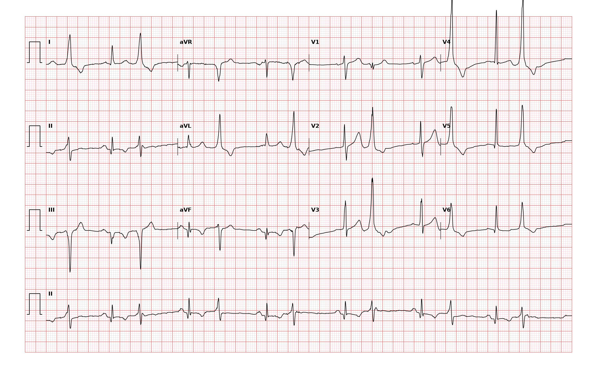

## 문제
47세 남자가 2주 전부터 가끔 가슴이 「덜컥」 하고 한 박자 건너뛰는 느낌이 들어 왔다. 흉통·실신·호흡곤란은 없다. 고혈압으로 약을 먹고 있고 하루 커피 네 잔을 마신다. 혈압 136/84 mmHg 이고 요골동맥 맥박은 강약이 번갈아 느껴진다. 심잡음은 없다. 혈청 칼륨 4.0 mEq/L, 마그네슘과 갑상샘자극호르몬은 정상이다. 12유도 심전도는 그림과 같다. 심전도 판독으로 가장 적절한 것은?

- A. 간헐적 조기흥분 증후군
- B. 심실 기외수축 이단맥
- C. 심방세동
- D. 모비츠 2형 2도 방실차단
- E. 가속 심실고유리듬

_12유도 심전도, 25 mm/s · 10 mm/mV, 3×4 + II 리듬 스트립 (PTB-XL ECG dataset, PhysioNet, CC BY 4.0 — 원신호 그대로 작도)_

## 정답 및 해설
> 정답: B

- **정답 핵심**: 리듬 스트립과 사지·흉부 유도에서 좁은 동박동 하나와 넓고 기이한 조기 박동 하나가 짝을 이루어 번갈아 나온다. 조기 박동은 I·V4·V5 에서 크고 넓은 R파에 T파가 QRS 와 반대 방향이다 — 심실에서 시작해 정상 전도로가 아닌 심근을 따라 천천히 퍼진 박동의 모양이다. 동박동마다 기외수축이 하나씩 붙는 규칙적인 짝은 심실 기외수축 이단맥이다.
- **원리**: <b>왜 넓고 기이한가</b>: 동박동은 히스-푸르키니에 전도계를 타고 두 심실을 거의 동시에 탈분극시켜 QRS 가 좁다. 심실 한 곳에서 시작한 박동은 전도계를 거치지 않고 심근 세포끼리 천천히 전해져 QRS 가 0.12 s 이상으로 넓고 모양이 기이하다.  <b>왜 T파가 반대 방향인가</b>: 탈분극 순서가 비정상이면 재분극 순서도 따라 바뀐다. 먼저 탈분극된 부위가 먼저 재분극하므로 T파는 QRS 의 주 방향과 반대로 그려진다(이차성 ST-T 변화).  <b>왜 「건너뛰는」 느낌인가</b>: 일찍 온 박동은 심실이 덜 차 박출량이 적어 맥이 약하거나 만져지지 않는다. 그 뒤의 박동은 충만 시간이 길어 강하게 느껴진다 — 강약이 번갈아 느껴지는 맥과 「덜컥」 하는 증상의 원인이다.
- **비교**: <table><thead><tr><th style="width:24%">소견</th><th style="width:38%">심실 기외수축 이단맥(정답)</th><th>심방세동(가장 가까운 오답)</th></tr></thead><tbody> <tr><td>리듬</td><td><b>짝을 이룬 규칙적 반복</b>(정상-조기-정상-조기)</td><td>완전히 불규칙한 RR</td></tr> <tr><td>QRS</td><td>번갈아 넓고 기이함, T파 반대 방향</td><td>대개 모두 좁고 같은 모양</td></tr> <tr><td>P파</td><td>동박동 앞에 같은 P파</td><td>P파 없고 기저선이 잔물결</td></tr> </tbody></table> 「불규칙하다」에서 멈추지 말고 반복되는 규칙(짝)이 있는지, QRS 가 두 종류인지를 본다.
- **오답 이유**:
  - ① 조기흥분 증후군은 짧은 PR 과 QRS 시작부의 델타파가 있고 그 넓은 QRS 앞에 P파가 정상적으로 있을 때 정답이 된다.
  - ③ 심방세동은 RR 이 규칙 없이 완전히 불규칙하고 P파 대신 잔물결 같은 기저선이 보일 때 정답이다.
  - ④ 모비츠 2형 방실차단은 PR 이 일정하다가 P파 뒤에 QRS 가 갑자기 빠질 때 정답이다 — 이 기록은 빠지는 박동이 없다.
  - ⑤ 가속 심실고유리듬은 넓은 QRS 가 분당 50~110회로 연달아 이어져 동리듬을 대신할 때 정답이 된다.
- **함정**: 번갈아 넓어지는 QRS 를 「불규칙한 맥 = 심방세동」으로 읽는 것 — 짝을 이루는 규칙성이 있다.
- **학습목표**: 좁은 동박동과 넓고 기이한 조기 박동이 번갈아 나오는 리듬을 심실 기외수축 이단맥으로 읽고 심방세동·2도 방실차단과 가른다
- **근거·출처**: Loscalzo J, Fauci AS, Kasper DL, et al., eds. Harrison's Principles of Internal Medicine, 22nd ed. McGraw Hill; 2025. Chapter 260: Premature Ventricular Contractions, Nonsustained Ventricular Tachycardia, and Accelerated Idioventricular Rhythm · Loscalzo J, Fauci AS, Kasper DL, et al., eds. Harrison's Principles of Internal Medicine, 22nd ed. McGraw Hill; 2025. Chapter 247: Electrocardiography

## 출처
- PTB-XL ECG dataset v1.0.3 (PhysioNet, CC BY 4.0) · record 4637 · Creative Commons Attribution 4.0 International · https://physionet.org/content/ptb-xl/1.0.3/LICENSE.txt
