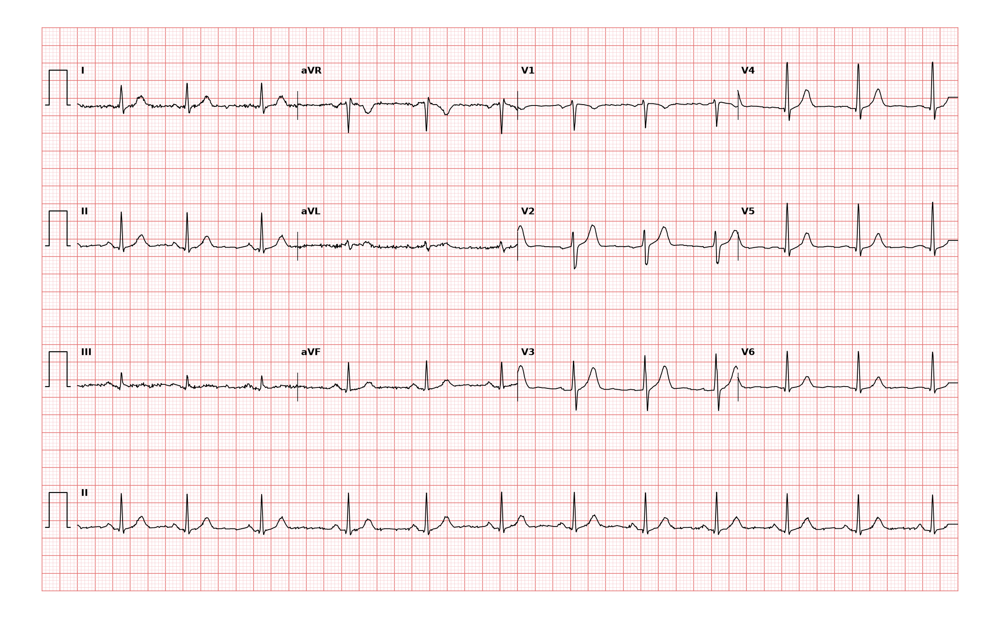

## 문제
45세 남자가 건강검진에서 맥박이 불규칙하다는 말을 듣고 왔다. 두근거림·어지러움·실신은 없고 매주 세 번 달리기를 한다. 약은 먹지 않는다. 혈압 122/76 mmHg 이다. 맥박은 숨을 들이쉴 때 빨라지고 내쉴 때 느려지며, 숨을 참으면 규칙적이 된다. 심잡음은 없다. 혈청 전해질과 갑상샘자극호르몬은 정상이다. 12유도 심전도는 그림과 같다. 가장 적절한 처치는?

- A. 항응고제를 시작한다
- B. 전기생리검사를 의뢰한다
- C. 추가 검사나 치료 없이 정상 변이임을 설명한다
- D. 24시간 활동 심전도 검사를 시행한다
- E. 베타차단제를 투여한다

_12유도 심전도, 25 mm/s · 10 mm/mV, 3×4 + II 리듬 스트립 (PTB-XL ECG dataset, PhysioNet, CC BY 4.0 — 원신호 그대로 작도)_

## 정답 및 해설
> 정답: C

- **정답 핵심**: 리듬 스트립에서 RR 간격이 약 0.77~1.0 s 사이로 서서히 늘고 줄지만, 모든 QRS 앞에 같은 모양의 P파가 있고 PR 이 일정하며 QRS 는 좁다. 숨에 따라 맥이 빨라지고 느려지며 숨을 참으면 규칙적이 된다 — 호흡성 동부정맥이다. 증상이 없고 구조적 이상이 없으면 정상 생리 변이이므로 검사나 치료 없이 설명하고 안심시킨다.
- **원리**: <b>왜 숨에 따라 맥이 변하는가</b>: 들숨에는 흉강 압력이 낮아져 오른심장으로 돌아오는 혈액이 늘고, 폐 신장 수용체와 뇌줄기 호흡 중추의 연결로 <b>미주신경 긴장이 줄어</b> 동결절이 빨리 뛴다. 날숨에는 미주신경 긴장이 다시 늘어 느려진다. 그래서 숨을 참으면 변동이 사라진다.  <b>왜 건강의 표지인가</b>: 이 변동은 자율신경이 동결절을 잘 조절한다는 뜻이다. 젊고 운동하는 사람에게 크고, 나이·당뇨 자율신경병증·심부전에서는 줄어든다.  <b>병적 불규칙과 가르는 법</b>: P파 모양이 매번 같고 PR 이 일정하면 박동은 모두 동결절에서 나온다 — 심방 기외수축(다른 P파), 심방세동(P파 없음), 동결절 기능부전(긴 정지·변시성 장애)과 다르다.
- **비교**: <table><thead><tr><th style="width:24%">조건</th><th style="width:38%">설명·안심(정답)</th><th>24시간 활동 심전도(가장 가까운 오답)</th></tr></thead><tbody> <tr><td>증상</td><td><b>없음</b></td><td>두근거림·어지러움·실신이 간헐적으로 있음</td></tr> <tr><td>심전도</td><td>같은 P파·일정한 PR, 숨에 따른 RR 변동</td><td>기록 중 원인 리듬이 잡히지 않음</td></tr> <tr><td>목적</td><td>정상 변이 확인으로 충분</td><td>증상과 리듬의 연관을 찾음</td></tr> </tbody></table> 「불규칙한 맥」이라는 말보다 리듬의 정체가 처치를 정한다 — 동부정맥이 확인되면 더 찾을 것이 없다.
- **오답 이유**:
  - ① 항응고제는 심방세동·조동에서 뇌졸중 위험 점수가 높을 때 정답이다 — P파가 매번 보이는 이 기록에는 해당하지 않는다.
  - ② 전기생리검사는 실신을 동반한 원인 불명의 넓은 QRS 빈맥이나 고도 방실차단이 의심될 때 정답이 된다.
  - ④ 24시간 활동 심전도는 간헐적 두근거림·실신처럼 증상이 있고 진료실 심전도에서 원인 리듬이 잡히지 않았을 때 정답이 된다.
  - ⑤ 베타차단제는 증상 있는 동빈맥이나 잦은 기외수축으로 불편할 때 쓰지만 생리적 동부정맥에는 쓸 이유가 없다.
- **함정**: 「맥이 불규칙하다」는 말에 곧 활동 심전도·약을 고르는 것 — 숨에 따라 변하고 P파가 같으면 정상이다.
- **학습목표**: 숨에 따라 RR 이 서서히 늘고 주는 동부정맥을 P파 모양·PR 이 일정함으로 확인하고, 증상 없는 생리적 변이에는 검사·치료 없이 안심시킨다
- **근거·출처**: Loscalzo J, Fauci AS, Kasper DL, et al., eds. Harrison's Principles of Internal Medicine, 22nd ed. McGraw Hill; 2025. Chapter 251: The Bradyarrhythmias: Disorders of the Sinoatrial Node · Loscalzo J, Fauci AS, Kasper DL, et al., eds. Harrison's Principles of Internal Medicine, 22nd ed. McGraw Hill; 2025. Chapter 247: Electrocardiography

## 출처
- PTB-XL ECG dataset v1.0.3 (PhysioNet, CC BY 4.0) · record 5126 · Creative Commons Attribution 4.0 International · https://physionet.org/content/ptb-xl/1.0.3/LICENSE.txt
