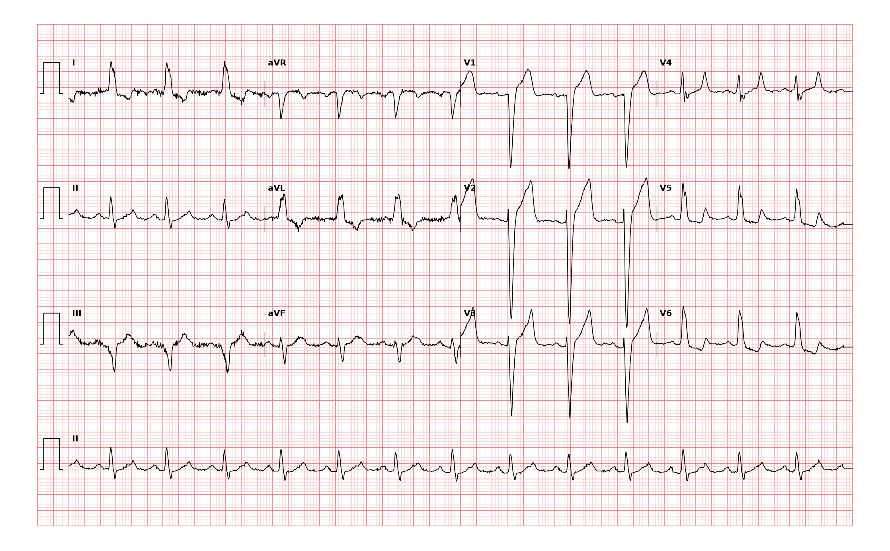

## 문제
An 85-year-old man comes to the physician because of shortness of breath when climbing one flight of stairs for 3 months. He has no chest pain. He has hypertension treated with amlodipine. Blood pressure is 148/82 mm Hg and pulse is 80/min. Crackles are heard at both lung bases, and there is mild bilateral ankle edema. Serum troponin concentration is within the reference range and unchanged 3 hours later. A 12-lead ECG is shown. Which of the following is the most likely interpretation of this ECG?

- A. Left bundle branch block
- B. Acute anterior ST-elevation myocardial infarction
- C. Right bundle branch block
- D. Left ventricular hypertrophy with strain pattern
- E. Ventricular preexcitation

_12-lead ECG, 25 mm/s, 10 mm/mV, 3×4 + lead II rhythm strip (PTB-XL, PhysioNet, CC BY 4.0; raw signal, no filtering)_

## 정답 및 해설
> 정답: A

- **정답 핵심**: Sinus rhythm at about 80/min with a QRS duration of at least 120 ms. Leads I, aVL, V5 and V6 show broad, notched R waves with no septal q waves, and V1–V3 show deep, wide QS or rS complexes. The ST segments and T waves point opposite to the main QRS deflection (ST elevation in V1–V3, ST depression and T inversion in I, aVL, V5–V6). This is complete left bundle branch block; the anterior ST elevation is the expected discordant change, not infarction.
- **원리**: <b>Why the septal q wave disappears</b>: Normally the septum is activated first from the left bundle, left to right, which makes a small q in I, aVL and V6. When the left bundle is blocked, the right bundle activates the septum from right to left, so the q is lost and the first force already points leftward.  <b>Why the QRS is wide and notched</b>: The left ventricle is depolarized slowly cell to cell from the right side; the delay produces a broad, notched R in the lateral leads and a deep wide S (QS) in the right precordial leads.  <b>Why ST elevation in V1–V3 is expected</b>: Abnormal depolarization changes repolarization, so ST and T go opposite to the QRS — discordant ST elevation in leads with deep QS. Infarction is suggested only when ST changes are concordant with the QRS or the discordant elevation is disproportionate (Sgarbossa criteria).
- **비교**: <table><thead><tr><th style="width:24%">Feature</th><th style="width:38%">Left bundle branch block (answer)</th><th>Acute anterior STEMI (closest distractor)</th></tr></thead><tbody> <tr><td>QRS</td><td><b>≥ 120 ms</b>, broad notched R in I, V6, no septal q</td><td>Usually narrow; new Q waves in V1–V4</td></tr> <tr><td>ST in V1–V3</td><td>Elevated but <b>discordant</b>, proportionate to the deep S</td><td>Elevated with a normal-width QRS, reciprocal inferior depression</td></tr> <tr><td>Clinical</td><td>No chest pain, flat normal troponin</td><td>Chest pain, rising troponin</td></tr> </tbody></table> In LBBB, ask whether ST deviation follows the expected discordant rule; concordance points to ischemia.
- **오답 이유**:
  - (B) Acute anterior STEMI would be correct with chest pain, rising troponin and ST elevation over a narrow QRS or concordant ST elevation in LBBB.
  - (C) Right bundle branch block would be correct with a wide rsR′ in V1 and wide slurred S waves in I and V6, the reverse of this pattern.
  - (D) Left ventricular hypertrophy with strain would be correct with tall voltage and lateral ST depression but a QRS under 120 ms and preserved septal q waves.
  - (E) Ventricular preexcitation would be correct with a short PR interval and a slurred delta wave at the start of a wide QRS.
- **함정**: Calling discordant ST elevation in V1–V3 an anterior infarction — in LBBB it is the expected secondary change.
- **학습목표**: 넓은 QRS, I·aVL·V5~V6 의 넓고 갈라진 R파와 중격 q파 소실, V1~V3 의 깊은 QS 와 반대 방향 ST 상승을 좌각차단으로 읽고 전벽 ST 상승 경색과 가른다
- **근거·출처**: Loscalzo J, Fauci AS, Kasper DL, et al., eds. Harrison's Principles of Internal Medicine, 22nd ed. McGraw Hill; 2025. Chapter 247: Electrocardiography

## 출처
- PTB-XL ECG dataset v1.0.3 (PhysioNet, CC BY 4.0) · record 6661 · Creative Commons Attribution 4.0 International · https://physionet.org/content/ptb-xl/1.0.3/LICENSE.txt
