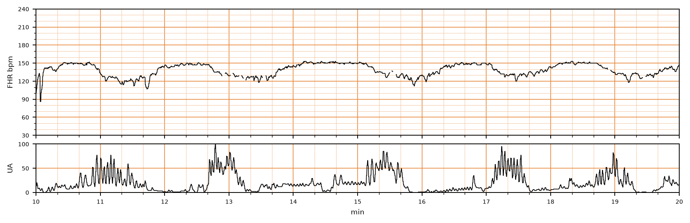

## 문제
34세 경산부(2회 분만)가 임신 42주에 진통으로 입원하였다. 임신 중 특별한 합병증은 없었고 양막은 2시간 전에 저절로 터졌으며 양수는 맑았다. 산모의 체온은 37.0 ℃, 혈압은 118/72 mmHg 이고 자궁경부는 6 cm 열려 있다. 옥시토신은 쓰지 않았다. 분만 중 태아심박동과 자궁활동 감시 기록의 10분 구간은 그림과 같다. 이 기록에서 자궁수축 때마다 반복되는 태아심박동 감속의 종류로 가장 적절한 것은?

- A. 지속감속
- B. 동요성 심박동
- C. 후기감속
- D. 조기감속
- E. 변이감속

_분만 중 태아심박동(위)과 자궁활동(아래), 기록 시작 후 10~20분 구간, 굵은 세로선 = 1분 (PhysioNet CTU-UHB, ODC-BY 1.0 — 4 Hz 원자료, 평활화 없음)_

## 정답 및 해설
> 정답: C

- **정답 핵심**: 기저 태아심박동은 145~150회/분이다. 자궁수축(11·12.8·15.4·17.3분 무렵)마다 심박동이 수축 시작과 함께 서서히(최저점까지 30초 이상) 20~30회/분 떨어지는데, 최저점이 수축 정점보다 늦게 오고(약 13.4·15.9분) 수축이 끝난 뒤에야 기저선으로 돌아온다. 수축의 거울상처럼 정점과 최저점이 겹치는 조기감속이 아니라, 수축에 늦게 따라오는 반복 후기감속이다.
- **원리**: <b>왜 후기감속은 늦게 오는가</b>: 자궁이 수축하면 근층을 지나는 나선동맥이 눌려 융모사이공간으로 가는 모체 혈류가 줄어든다. 태반 예비력이 충분하면 태아는 이 짧은 감소를 견디지만, 예비력이 줄면(과숙 임신·고혈압·당뇨·자궁수축 과다) 태아 혈중 산소가 떨어진다. 이 저산소혈증을 <b>화학수용체</b>가 감지해 미주신경 반사를 일으키기까지 시간이 걸리므로 감속은 수축보다 늦게 시작·바닥·회복한다. 저산소가 깊어지면 심근 자체가 억눌려 같은 모양이 된다.  <b>왜 조기감속과 다르게 다루는가</b>: 조기감속은 태아 머리 압박에 의한 미주신경 반사라 수축과 동시에 움직이고(거울상) 저산소와 관계가 없다. 반복 후기감속은 태반 기능 저하의 신호로 범주 II 이며, 체위 변경·수액·자궁수축 억제(옥시토신 중단)로 자궁 내 소생을 하고 변이도를 보며 다음 결정을 한다. 변이도가 사라지면 범주 III 이다.
- **비교**: <table><thead><tr><th style="width:24%">구분</th><th style="width:38%">후기감속(정답)</th><th>조기감속(가장 가까운 오답)</th></tr></thead><tbody> <tr><td>최저점과 수축 정점</td><td><b>정점보다 늦다</b></td><td>정점과 동시(거울상)</td></tr> <tr><td>회복</td><td>수축이 끝난 뒤</td><td>수축이 끝날 때 함께</td></tr> <tr><td>기전</td><td>자궁태반 기능 저하 → 태아 저산소</td><td>태아 머리 압박 → 미주신경 반사</td></tr> <tr><td>의미</td><td>반복되면 범주 II, 자궁 내 소생</td><td>양성, 처치 불필요</td></tr> </tbody></table> 둘 다 서서히(30초 이상) 떨어진다 — 모양이 아니라 <b>수축과의 시간 관계</b>로 가른다. 갑자기(30초 미만) 떨어지면 변이감속이다.
- **오답 이유**:
  - ① 지속감속은 기저선보다 15회/분 이상 낮은 상태가 2분 이상 10분 미만 이어질 때 정답이 된다.
  - ② 동요성 심박동은 3~5회/분 주기의 매끈한 물결 모양이 20분 이상 이어지고 변이도가 없을 때 정답이다.
  - ④ 조기감속은 감속의 최저점이 수축 정점과 겹치고 수축이 끝날 때 함께 회복하는 거울상일 때 정답이다.
  - ⑤ 변이감속은 수축과의 관계가 일정하지 않고 시작부터 최저점까지 30초 안에 갑자기 떨어지는 V·U 모양일 때 정답이다.
- **함정**: 서서히 떨어지는 감속을 모두 조기감속으로 읽는 것 — 최저점이 수축 정점보다 늦으면 후기감속이다.
- **학습목표**: 분만 중 태아심박동 기록에서 감속의 시작·최저점·회복을 자궁수축과 맞춰 읽어 반복 후기감속을 조기감속·변이감속과 가른다
- **근거·출처**: American College of Obstetricians and Gynecologists. ACOG Practice Bulletin No. 106: Intrapartum fetal heart rate monitoring: nomenclature, interpretation, and general management principles. Obstet Gynecol. 2009;114(1):192-202 · Macones GA, Hankins GD, Spong CY, et al. The 2008 National Institute of Child Health and Human Development workshop report on electronic fetal monitoring. Obstet Gynecol. 2008;112(3):661-666

## 출처
- CTU-UHB Intrapartum Cardiotocography Database (PhysioNet, ODC-BY 1.0) · record 1220 · Open Data Commons Attribution License v1.0 · https://opendatacommons.org/licenses/by/1-0/
