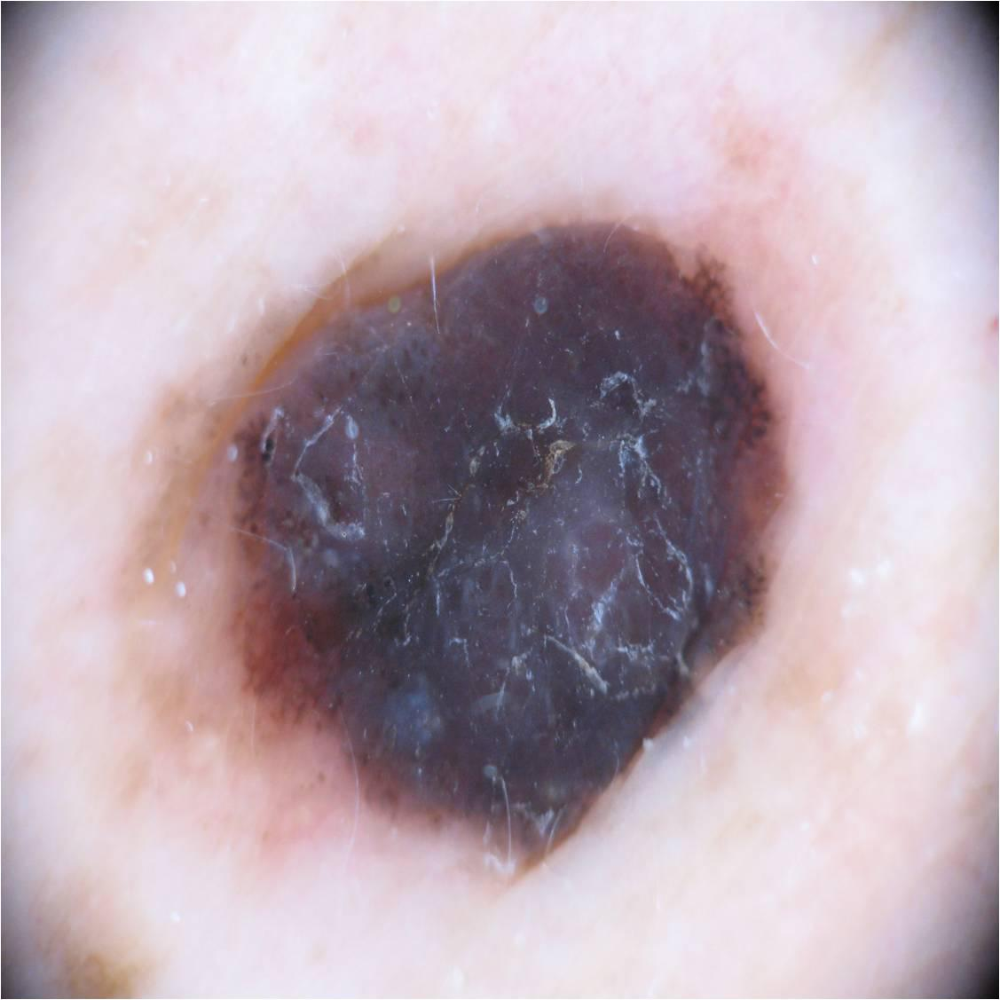

## 문제
A 55-year-old woman comes to the physician because of a dark skin bump that has grown quickly over several months. It began as a small flat spot, became raised over the past 2 months, and bled once after minor trauma. It is not painful or itchy. She has no family history of skin cancer. Examination shows a firm, 9-mm blue-black nodule; no regional lymph nodes are palpable. A dermoscopic photograph of the lesion is shown. Which of the following is the most likely diagnosis?

- A. Cherry hemangioma
- B. Nodular melanoma
- C. Blue nevus
- D. Pigmented basal cell carcinoma
- E. Seborrheic keratosis

_Dermoscopic photograph of the skin lesion, downscaled only (ISIC Archive, CC BY 4.0; no cropping or color adjustment)_

## 정답 및 해설
> 정답: B

- **정답 핵심**: Dermoscopy shows an asymmetric, structureless blue-black to purple area covering the nodule without a pigment network, with a blue-white veil, white shiny lines, and irregular brown dots at the edge. Together with a firm nodule that grew quickly over months and bled, this is nodular melanoma. The next step is a full-thickness excisional biopsy with 1-3 mm margins to measure Breslow thickness.
- **원리**: <b>Why nodular melanoma escapes the ABCD rule</b>: Superficial spreading melanoma first grows sideways along the epidermis (radial growth phase), so it is asymmetric, irregularly bordered, and multicolored. Nodular melanoma begins in the <b>vertical growth phase</b>, invading the dermis from the start, so it can be small, symmetric, and nearly one color. The better clue is EFG: elevated, firm, and growing for more than a month.  <b>What the colors mean</b>: Melanin in the epidermis looks brown or black; melanin deep in the dermis looks <b>blue</b> because of light scattering (the Tyndall effect). A blue-white veil is dermal melanin under a thickened, orthokeratotic epidermis, and white shiny lines reflect altered dermal collagen; both point to invasive melanoma.  <b>Why excisional biopsy</b>: Breslow thickness decides the surgical margin and whether sentinel lymph node biopsy is offered, so the first biopsy should remove the whole lesion down to fat. A shave biopsy can transect the tumor and underestimate its depth.
- **비교**: <table><thead><tr><th style="width:24%">Dermoscopy</th><th style="width:38%">Nodular melanoma (answer)</th><th>Blue nevus (closest distractor)</th></tr></thead><tbody> <tr><td>Color</td><td>Blue-black, purple, and brown <b>mixed</b>, asymmetric</td><td>Uniform steel-blue, one color</td></tr> <tr><td>Structures</td><td>Blue-white veil, white shiny lines, irregular dots and vessels</td><td>Structureless and homogeneous</td></tr> <tr><td>Course</td><td>Grows over months, may bleed</td><td>Present since childhood, stable for years</td></tr> </tbody></table> A blue nodule that is multicolored or newly growing is treated as melanoma until an excisional biopsy says otherwise.
- **오답 이유**:
  - (A) Cherry hemangioma would be correct with sharply demarcated red to purple lacunae separated by whitish septa on dermoscopy.
  - (C) Blue nevus would be correct for a small, long-standing, unchanged nodule that shows only homogeneous steel-blue color on dermoscopy.
  - (D) Pigmented basal cell carcinoma would be correct with leaf-like areas, large blue-gray ovoid nests, and arborizing vessels on dermoscopy.
  - (E) Seborrheic keratosis would be correct for a stuck-on lesion with comedo-like openings, milia-like cysts, and brain-like ridges.
- **함정**: Calling a symmetric dark nodule benign because it fails the ABCD rule - nodular melanoma is caught by EFG (elevated, firm, growing).
- **학습목표**: 더모스코피에서 청흑색 무구조 영역·청백색 베일·흰 반짝이는 선을 가진 빠르게 자란 결절을 결절흑색종으로 판단하고 청색모반·색소성 기저세포암과 가른다
- **근거·출처**: Swetter SM, Tsao H, Bichakjian CK, et al. Guidelines of care for the management of primary cutaneous melanoma. J Am Acad Dermatol. 2019;80(1):208-250 · Kumar V, Abbas AK, Aster JC, eds. Robbins and Cotran Pathologic Basis of Disease, 10th ed. Elsevier; 2021. Chapter 25: The Skin

## 출처
- ISIC Archive ISIC_0046450 (CC-BY) · Creative Commons Attribution 4.0 International · https://creativecommons.org/licenses/by/4.0/
