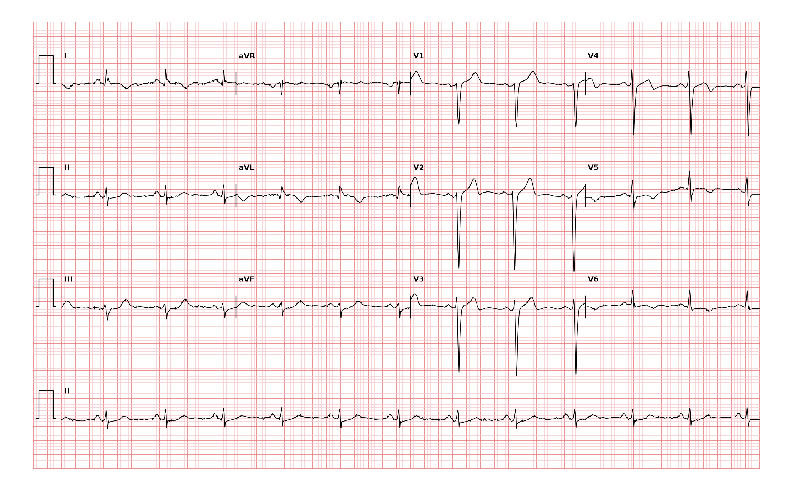

## 문제
66세 남자가 서혜부 탈장 수술 전 검사를 위해 왔다. 3개월 전 30분 넘게 가슴을 짓누르는 통증과 식은땀이 있었으나 저절로 나아져 병원에 가지 않았다. 지금은 가슴 통증이 없고 계단을 두 층 오르면 약간 숨이 차다. 당뇨병과 흡연력이 있다. 혈압 132/80 mmHg, 맥박 70회/분이고 심잡음은 없다. 고감도 트로포닌 I 는 정상 범위이다. 12유도 심전도는 그림과 같다. 심전도 판독으로 가장 적절한 것은?

- A. 정상 심전도
- B. 오래된 전벽 심근경색
- C. 급성 전벽 ST 분절 상승 심근경색
- D. 오래된 하벽 심근경색
- E. 완전 좌각차단

_12유도 심전도, 25 mm/s · 10 mm/mV, 3×4 + II 리듬 스트립 (PTB-XL ECG dataset, PhysioNet, CC BY 4.0 — 원신호 그대로 작도)_

## 정답 및 해설
> 정답: B

- **정답 핵심**: QRS 는 좁은데 V1·V2·V3 에 R파가 전혀 없는 QS 파가 있고 V4 에서도 r 이 작아 R파 진행이 끊겨 있다 — 전벽 심근이 전기적으로 죽어 그 자리 전극이 반대쪽 벽의 탈분극만 「멀어지는」 방향으로 보는 경색 Q파다. V1~V3 의 ST 는 약간 높지만 T파가 직립하고 과급성 T파·거울상 ST 하강이 없으며 트로포닌이 정상이다. 3개월 전의 흉통과 합치면 오래된 전벽 심근경색이다.
- **원리**: <b>왜 Q파가 생기는가</b>: 심근이 괴사해 섬유조직으로 바뀌면 그 부위는 탈분극하지 않는다. 그 위의 전극은 「창문」처럼 반대쪽 벽이 자기에게서 멀어지며 탈분극하는 것만 보게 되어 첫 굴절이 음성 — Q파, 그리고 R파가 전혀 없으면 QS 파가 된다. 경색 Q파는 대개 영구히 남아 몇 달·몇 년 뒤에도 과거 경색의 흔적이 된다.  <b>어느 벽인가</b>: V1~V2 는 중격, V3~V4 는 전벽, I·aVL·V5~V6 는 측벽, II·III·aVF 는 하벽을 본다. 이 기록은 V1~V3(4)에 Q 가 모여 있어 좌전하행지 영역의 전벽(전중격) 경색이다.  <b>급성과의 구별</b>: 급성 경색은 과급성 T파 → 볼록한 ST 상승과 거울상 ST 하강 → 수 시간~수일 뒤 Q파·T파 역전 순서로 변한다. 몇 주가 지나면 ST 는 대부분 기저선으로 돌아오고, 전벽 경색 뒤 ST 상승이 계속 남으면 좌심실류를 의심한다.
- **비교**: <table><thead><tr><th style="width:24%">소견</th><th style="width:38%">오래된 전벽 경색(정답)</th><th>급성 전벽 STEMI(가장 가까운 오답)</th></tr></thead><tbody> <tr><td>Q파</td><td><b>V1~V3 QS</b>, R파 진행 불량</td><td>처음 몇 시간에는 없음(나중에 생김)</td></tr> <tr><td>ST·T</td><td>ST 거의 기저선~약간 상승, T 직립 또는 역전</td><td>볼록한 ST 상승, 과급성 T, 하벽 거울상 하강</td></tr> <tr><td>증상·검사</td><td>지금 흉통 없음, 트로포닌 정상</td><td>진행 중인 흉통, 트로포닌 상승</td></tr> </tbody></table> 같은 「V1~V3 이상」이라도 지금 일어나는 일인지(흉통·트로포닌·ST 의 모양) 지나간 흔적인지(Q파)를 먼저 가른다.
- **오답 이유**:
  - ① 정상 심전도는 V1 의 작은 r 이 V3~V4 로 갈수록 커지는 R파 진행이 있을 때 정답이 된다 — V1~V3 이 모두 QS 이면 정상이 아니다.
  - ③ 급성 전벽 STEMI 는 지금 흉통이 이어지고 V1~V4 에 볼록한 ST 상승·과급성 T파와 하벽 거울상 하강, 트로포닌 상승이 있을 때 정답이다.
  - ④ 오래된 하벽 심근경색은 II·III·aVF 에 폭 0.04 s 이상의 깊은 Q파가 있을 때 정답이다 — 이 기록의 하벽 유도에는 Q파가 없다.
  - ⑤ 완전 좌각차단은 QRS 가 0.12 s 이상 넓고 I·aVL·V6 에 넓고 갈라진 R파가 있을 때 정답이다 — 이 기록은 QRS 가 좁다.
- **함정**: V1~V3 의 약간 높은 ST 만 보고 급성 STEMI 로 읽는 것 — 좁은 QRS 의 QS 파·정상 트로포닌·지금 없는 흉통이 오래된 경색을 말한다.
- **학습목표**: V1~V3 의 QS 파와 R파 진행 불량을 오래된 전벽 심근경색의 흔적으로 읽고 급성 전벽 경색·하벽 경색과 가른다
- **근거·출처**: Loscalzo J, Fauci AS, Kasper DL, et al., eds. Harrison's Principles of Internal Medicine, 22nd ed. McGraw Hill; 2025. Chapter 247: Electrocardiography · Thygesen K, Alpert JS, Jaffe AS, et al. Fourth Universal Definition of Myocardial Infarction (2018). Circulation. 2018;138(20):e618-e651

## 출처
- PTB-XL ECG dataset v1.0.3 (PhysioNet, CC BY 4.0) · record 13868 · Creative Commons Attribution 4.0 International · https://physionet.org/content/ptb-xl/1.0.3/LICENSE.txt
