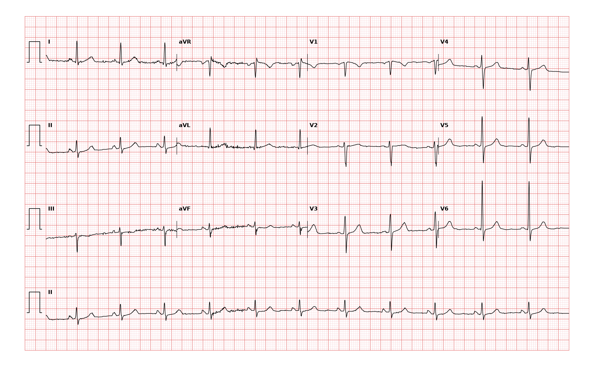

## 문제
61세 여자가 두 달 전부터 하루 두세 번, 몇 분 동안 가슴이 빠르게 뛰는 느낌이 들어 왔다. 갑자기 시작해 갑자기 멈추는지는 잘 모르겠다고 한다. 실신·흉통·호흡곤란은 없다. 고혈압과 당뇨병은 없고 커피는 마시지 않는다. 진료실에서는 두근거림이 없다. 혈압 118/72 mmHg, 맥박 70회/분이고 심잡음은 없다. 혈색소, 전해질, 갑상샘자극호르몬은 정상이다. 진료실에서 찍은 12유도 심전도는 그림과 같다. 다음 처치로 가장 적절한 것은?

- A. 24~48시간 활동중 심전도 감시
- B. 침습적 심장 전기생리검사
- C. 아미오다론 경구 투여 시작
- D. 관상동맥조영술
- E. 증상이 없으니 추가 검사 없이 종결

_12유도 심전도, 25 mm/s · 10 mm/mV, 3×4 + II 리듬 스트립 (PTB-XL ECG dataset, PhysioNet, CC BY 4.0 — 원신호 그대로 작도)_

## 정답 및 해설
> 정답: A

- **정답 핵심**: 진료실 심전도는 동리듬 약 70회/분, PR 약 0.16 s, 좁은 QRS, 정상 축, 정상 R파 진행과 ST-T 로 정상이다 — 조기흥분(짧은 PR·델타파), 긴 QT, 방실차단 같은 바탕 이상도 없다. 그러나 증상이 없을 때 찍은 정상 심전도는 간헐적 부정맥을 배제하지 못한다. 하루 여러 번 생기는 두근거림이므로 그 시간 안에 증상과 리듬을 함께 잡을 24~48시간 활동중 심전도(홀터)가 다음 검사다.
- **원리**: <b>왜 정상 심전도로 끝내지 않는가</b>: 12유도 심전도는 약 10초의 기록이다. 발작성 상심실빈맥·심방세동·기외수축은 발작 사이에는 완전히 정상일 수 있다. 진단의 핵심은 <b>증상이 있는 순간의 리듬</b>을 기록해 증상과 맞추는 것이다(증상-리듬 상관).  <b>왜 감시 기간을 증상 빈도로 고르는가</b>: 매일 생기면 24~48시간 홀터로 충분히 잡힌다. 몇 주에 한 번이면 2~4주 사건 기록기·패치형 감시, 몇 달에 한 번(특히 실신)이면 삽입형 루프 기록기를 쓴다. 기록 기간이 증상 간격보다 짧으면 결과가 정상이어도 의미가 없다.  <b>정상 심전도가 주는 정보</b>: 그래도 이 기록은 쓸모가 있다 — 짧은 PR·델타파가 없어 WPW 증후군의 바탕이 보이지 않고, QT 가 정상이며, 구조적 심질환을 시사하는 Q파·비대·각차단이 없다. 위험 신호(실신·운동 중 증상·가족력 돌연사)가 없으므로 침습 검사나 약물을 먼저 시작할 이유가 없다.
- **비교**: <table><thead><tr><th style="width:24%">증상 빈도</th><th style="width:38%">24~48시간 홀터(정답)</th><th>전기생리검사(가장 가까운 오답)</th></tr></thead><tbody> <tr><td>언제 쓰나</td><td><b>매일</b> 생기는 두근거림</td><td>기록된 빈맥의 기전 확인·절제술 계획, 또는 고위험 실신</td></tr> <tr><td>침습성</td><td>비침습</td><td>정맥으로 도관 삽입</td></tr> <tr><td>전제</td><td>리듬이 아직 기록되지 않음</td><td>비침습 기록으로 부정맥이 이미 잡혔거나 위험이 높음</td></tr> </tbody></table> 비침습 기록으로 증상과 리듬을 먼저 맞추고, 그 결과에 따라 전기생리검사·절제술로 간다.
- **오답 이유**:
  - ② 전기생리검사는 홀터 등으로 발작성 상심실빈맥이 기록되어 절제술을 계획하거나 구조적 심질환 환자의 실신을 평가할 때 정답이 된다.
  - ③ 아미오다론은 부정맥이 기록되어 종류가 확인되고 다른 치료가 맞지 않을 때 고려한다 — 리듬도 모른 채 독성이 많은 약을 쓰지 않는다.
  - ④ 관상동맥조영술은 운동 때 흉통이 있거나 비침습 검사에서 허혈이 확인되었을 때 정답이다 — 이 환자는 흉통이 없다.
  - ⑤ 추가 검사 없이 종결하는 것은 증상이 드물고 경미하며 기록으로 양성 기외수축임이 확인되었을 때 맞다 — 지금은 리듬이 기록되지 않았다.
- **함정**: 진료실 심전도가 정상이니 부정맥이 없다고 결론짓는 것 — 간헐적 증상은 증상이 있는 시간의 기록으로 진단한다.
- **학습목표**: 증상이 없을 때 찍은 정상 심전도로는 간헐적 두근거림을 배제할 수 없음을 알고 증상 빈도에 맞는 활동중 심전도 감시를 고른다
- **근거·출처**: Loscalzo J, Fauci AS, Kasper DL, et al., eds. Harrison's Principles of Internal Medicine, 22nd ed. McGraw Hill; 2025. Chapter 247: Electrocardiography · Loscalzo J, Fauci AS, Kasper DL, et al., eds. Harrison's Principles of Internal Medicine, 22nd ed. McGraw Hill; 2025. Chapter 45: Palpitations

## 출처
- PTB-XL ECG dataset v1.0.3 (PhysioNet, CC BY 4.0) · record 15105 · Creative Commons Attribution 4.0 International · https://physionet.org/content/ptb-xl/1.0.3/LICENSE.txt
