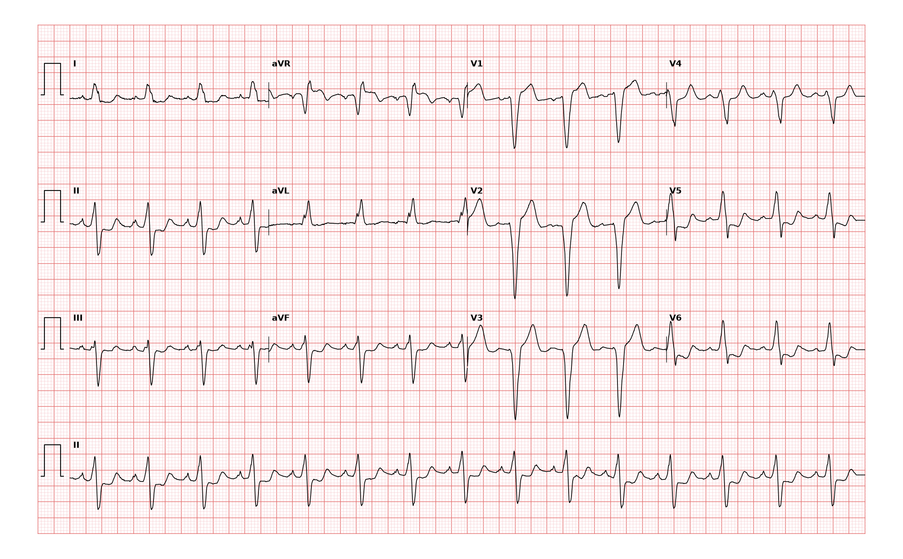

## 문제
A 67-year-old woman comes to the emergency department because of chest tightness for 2 hours that began after climbing stairs and has now eased. She has hypertension and was told years ago that her electrocardiogram was abnormal. Blood pressure is 142/84 mm Hg and pulse is 90/min. The lungs are clear. A prior ECG from 2 years ago is not available. The first high-sensitivity troponin is within normal limits. An ECG is shown. Which of the following best explains the ST-segment elevation in leads V1 through V3?

- A. Acute pericarditis with diffuse ST elevation
- B. Brugada pattern from a sodium channel disorder
- C. Repolarization change from left bundle branch block
- D. Acute anterior ST-elevation myocardial infarction
- E. Left ventricular aneurysm after old infarction

_12-lead ECG, 25 mm/s, 10 mm/mV, 3×4 + lead II rhythm strip (PTB-XL, PhysioNet, CC BY 4.0; raw signal, no filtering)_

## 정답 및 해설
> 정답: C

- **정답 핵심**: The QRS is about 0.12 s wide, with deep QS/rS complexes in V1-V3, broad notched R waves in I and aVL, and left axis deviation: complete left bundle branch block. In V1-V3 the ST segment rises opposite to the predominantly negative QRS and is less than 5 mm — the expected discordant, secondary repolarization change. No concordant ST elevation or concordant ST depression in V1-V3 is present, so the Sgarbossa criteria for acute infarction are not met.
- **원리**: <b>Why LBBB elevates ST in V1-V3</b>: When the left bundle is blocked, the left ventricle is activated slowly from right to left through myocardium. Repolarization follows the same abnormal order, so the ST segment and T wave point opposite to the main QRS deflection. In V1-V3 the QRS is mostly negative (QS/rS), so the ST is elevated; in I, aVL, and V6 the QRS is positive, so the ST is depressed. This "appropriate discordance" is expected and is not ischemia.  <b>How infarction is recognized despite LBBB</b>: Sgarbossa criteria look for what discordance cannot explain: <b>concordant</b> ST elevation ≥ 1 mm in a lead with a positive QRS, concordant ST depression ≥ 1 mm in V1-V3, or (modified Smith rule) discordant ST elevation that is ≥ 25% of the preceding S-wave depth.  <b>Why it matters</b>: A new LBBB alone no longer triggers emergency reperfusion; decisions rest on these criteria, the clinical picture, and serial troponins.
- **비교**: <table><thead><tr><th style="width:24%">Finding</th><th style="width:38%">LBBB repolarization (answer)</th><th>Acute anterior STEMI with LBBB (closest distractor)</th></tr></thead><tbody> <tr><td>Direction of ST in V1-V3</td><td>Opposite to the negative QRS (discordant)</td><td><b>Concordant ST depression</b>, or disproportionate discordant elevation</td></tr> <tr><td>Size</td><td>Less than 5 mm, proportional to the S wave</td><td>≥ 25% of the S-wave depth (Smith)</td></tr> <tr><td>Leads with positive QRS</td><td>ST depressed</td><td>Concordant ST elevation ≥ 1 mm</td></tr> <tr><td>Troponin</td><td>Normal</td><td>Rising</td></tr> </tbody></table> In LBBB, the question is never "is there ST elevation?" but "is it in the expected direction and proportion?"
- **오답 이유**:
  - (A) Acute pericarditis would be correct with diffuse concave ST elevation in many limb and precordial leads, PR depression, and a narrow QRS.
  - (B) Brugada pattern would be correct with coved ST elevation ≥ 2 mm and T-wave inversion in V1-V2 with an RBBB-like, not LBBB, morphology.
  - (D) Acute anterior STEMI would be correct if Sgarbossa criteria were met — concordant ST changes or ST elevation ≥ 25% of the S wave — with rising troponin.
  - (E) A left ventricular aneurysm would be correct with a narrow QRS, QS waves, and persistent ST elevation weeks after an anterior infarction.
- **함정**: Reading the discordant ST elevation of LBBB as an anterior STEMI — check whether the ST deviation is concordant or disproportionate (Sgarbossa).
- **학습목표**: 좌각차단에서 V1~V3 의 QRS 와 반대 방향 ST 상승을 이차성 재분극 변화로 해석하고 Sgarbossa 기준으로 급성 경색과 가른다
- **근거·출처**: Loscalzo J, Fauci AS, Kasper DL, et al., eds. Harrison's Principles of Internal Medicine, 22nd ed. McGraw Hill; 2025. Chapter 247: Electrocardiography · Loscalzo J, Fauci AS, Kasper DL, et al., eds. Harrison's Principles of Internal Medicine, 22nd ed. McGraw Hill; 2025. Chapter 286: ST-Segment Elevation Myocardial Infarction

## 출처
- PTB-XL ECG dataset v1.0.3 (PhysioNet, CC BY 4.0) · record 11135 · Creative Commons Attribution 4.0 International · https://physionet.org/content/ptb-xl/1.0.3/LICENSE.txt
