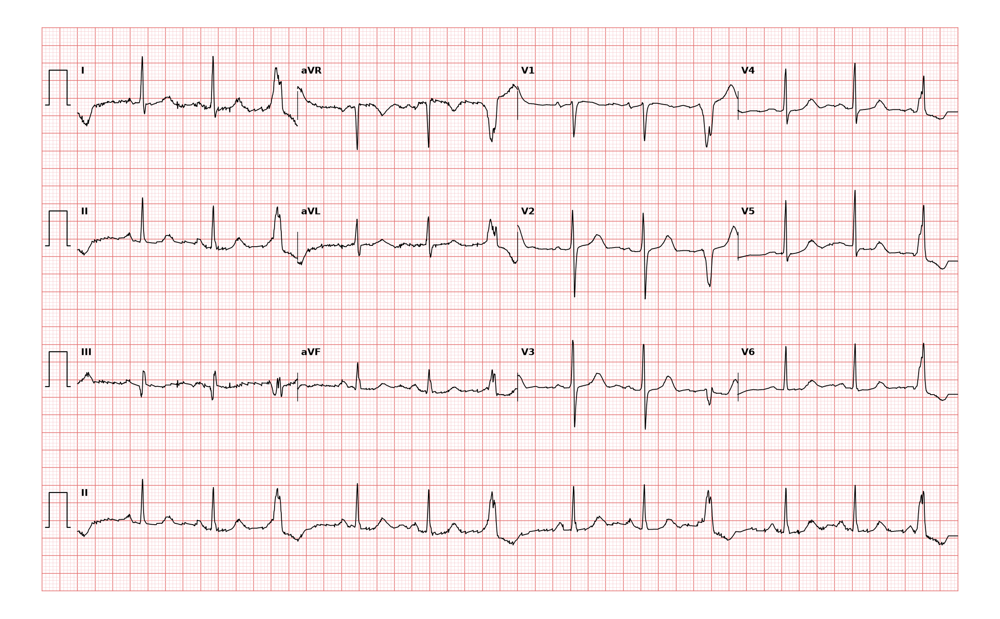

## 문제
76세 여자가 한 달 전부터 가슴이 덜컥 내려앉는 듯하고 맥이 건너뛰는 느낌이 자주 들어 왔다. 실신·흉통·호흡곤란은 없고, 커피를 하루 세 잔 마신다. 고혈압으로 약을 먹고 있다. 혈압 136/78 mmHg 이고 맥박은 불규칙하게 만져진다. 심잡음은 없다. 혈청 칼륨 4.2 mEq/L, 마그네슘과 갑상샘자극호르몬은 정상이다. 12유도 심전도는 그림과 같다. 심전도 판독으로 가장 적절한 것은?

- A. 심실조기수축(심실 삼중맥)
- B. 변행전도된 심방조기수축
- C. 간헐적 좌각차단
- D. 2도 방실차단(모비츠 1형)
- E. 비지속성 심실빈맥

_12유도 심전도, 25 mm/s · 10 mm/mV, 3×4 + II 리듬 스트립 (PTB-XL ECG dataset, PhysioNet, CC BY 4.0 — 원신호 그대로 작도)_

## 정답 및 해설
> 정답: A

- **정답 핵심**: II 리듬 스트립에서 P파가 앞선 좁은 QRS 두 개 뒤에 넓고 모양이 전혀 다른 조기 QRS 가 하나씩 규칙적으로 끼어든다 — 정상 2 : 조기 1 의 삼중맥이다. 조기 박동 앞에는 P파가 없고, T파가 QRS 와 반대 방향이며, 조기 박동 앞뒤 간격을 합치면 정상 RR 의 두 배에 가까운 보상성 휴지가 있다. 넓은 QRS·선행 P파 없음·보상성 휴지는 심실에서 생긴 조기수축(PVC)의 특징이다.
- **원리**: <b>왜 넓은가</b>: 정상 박동은 히스-푸르키니에 계통을 타고 양쪽 심실을 거의 동시에(0.08~0.10 s) 탈분극한다. 심실 근육 한 점에서 시작한 조기 박동은 이 빠른 길을 쓰지 못하고 심근세포끼리 천천히 전도되므로 QRS 가 0.12 s 이상 넓어지고, 탈분극 순서가 비정상이라 재분극(T파)도 QRS 와 반대 방향을 향한다.  <b>왜 보상성 휴지인가</b>: 심실 조기 박동은 대개 동방결절까지 거꾸로 올라가 리셋하지 못한다. 동방결절은 제 박자대로 뛰고, 조기 박동 직후의 P파는 불응기에 걸려 전도되지 않으므로 다음 정상 박동은 원래 박자에 맞춰 온다 — 조기 박동을 끼운 두 간격의 합이 정상 RR 의 두 배가 된다. 심방조기수축은 동방결절을 리셋해 이 합이 두 배보다 짧다(비보상성).  <b>삼중맥의 의미</b>: 정상 1 : PVC 1 이 이단맥, 정상 2 : PVC 1 이 삼중맥이다. 구조적 심질환이 없고 증상이 견딜 만하면 카페인 줄이기 등 유발요인 교정과 경과 관찰이 먼저이며, 부담이 크면(대개 하루 박동의 10 % 이상) 심초음파로 심실 기능을 확인한다.
- **비교**: <table><thead><tr><th style="width:24%">소견</th><th style="width:38%">심실조기수축(정답)</th><th>변행전도된 심방조기수축(가장 가까운 오답)</th></tr></thead><tbody> <tr><td>선행 P파</td><td><b>없음</b>(또는 QRS 뒤 역행 P)</td><td>조기 P파가 앞선다(T파 위에 겹쳐 모양이 바뀜)</td></tr> <tr><td>QRS 모양</td><td>넓고 기괴함, T파 반대 방향</td><td>대개 우각차단 꼴(우각의 불응기가 길어서)</td></tr> <tr><td>휴지</td><td>보상성(두 간격 합 = RR × 2)</td><td>비보상성 — 동방결절이 리셋된다</td></tr> </tbody></table> 넓은 조기 박동을 보면 앞의 T파가 다른 T파와 모양이 다른지(숨은 P파)와 휴지 길이를 재어 기원을 정한다.
- **오답 이유**:
  - ② 변행전도된 심방조기수축은 넓은 조기 QRS 앞 T파에 조기 P파가 숨어 있고 휴지가 비보상성일 때 정답이 된다.
  - ③ 간헐적 좌각차단은 넓은 QRS 가 조기에 오지 않고 정상 박동과 같은 PR 간격의 P파 뒤에 제때 나타날 때 정답이다.
  - ④ 모비츠 1형 2도 방실차단은 PR 이 점점 길어지다 P파 뒤 QRS 가 하나 빠지는 묶음 박동이 보일 때 정답이다.
  - ⑤ 비지속성 심실빈맥은 넓은 QRS 가 3개 이상 연달아 100회/분 넘게 이어지다 30초 안에 멈출 때 정답이다.
- **함정**: 넓은 QRS 면 모두 심실성이라고 단정하는 것 — 앞의 T파에 숨은 P파와 휴지의 길이를 확인해야 변행전도를 거른다.
- **학습목표**: 리듬 스트립에서 정상 박동 두 개마다 끼어드는 넓은 조기 박동을 심실조기수축(삼중맥)으로 읽고 변행전도된 심방조기수축과 가른다
- **근거·출처**: Loscalzo J, Fauci AS, Kasper DL, et al., eds. Harrison's Principles of Internal Medicine, 22nd ed. McGraw Hill; 2025. Chapter 260: Premature Ventricular Contractions, Nonsustained Ventricular Tachycardia, and Accelerated Idioventricular Rhythm · Loscalzo J, Fauci AS, Kasper DL, et al., eds. Harrison's Principles of Internal Medicine, 22nd ed. McGraw Hill; 2025. Chapter 247: Electrocardiography

## 출처
- PTB-XL ECG dataset v1.0.3 (PhysioNet, CC BY 4.0) · record 11861 · Creative Commons Attribution 4.0 International · https://physionet.org/content/ptb-xl/1.0.3/LICENSE.txt
