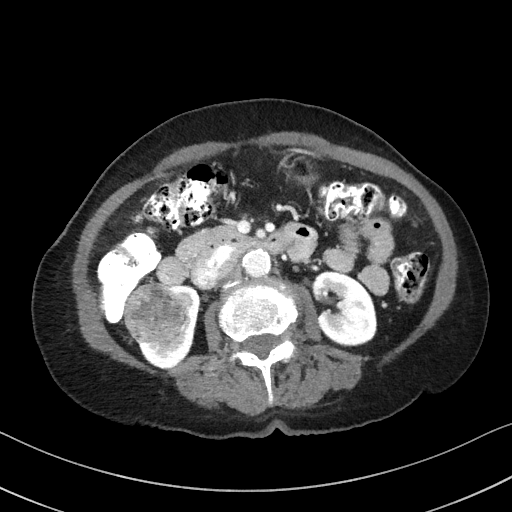

## 문제
An 83-year-old woman comes to the physician for follow-up after a contrast-enhanced abdominal CT scan was performed to evaluate mild epigastric discomfort that has since resolved. She has no flank pain or gross hematuria. She has hypertension controlled with amlodipine. Vital signs are within normal limits, and no abdominal mass is palpable. Serum creatinine is 0.8 mg/dL. Urinalysis shows no red blood cells. An axial image of the contrast-enhanced abdominal CT obtained in the arterial phase is shown. There is no renal vein invasion, no enlarged lymph nodes, and no fat attenuation within the lesion. Which of the following is the most likely diagnosis?

- A. Urothelial carcinoma of the renal pelvis
- B. Renal abscess
- C. Renal cell carcinoma
- D. Angiomyolipoma
- E. Simple renal cyst

_Contrast-enhanced abdominal CT, arterial phase, single axial image, soft-tissue window, standard display orientation (TCIA, CC BY 3.0; no cropping, adjustment, or segmentation overlay)_

## 정답 및 해설
> 정답: C

- **정답 핵심**: The CT shows a round, solid mass about 4 cm in the mid portion of the right kidney that enhances heterogeneously and expands the renal contour; the left kidney is normal. A solid, enhancing renal mass without macroscopic fat is renal cell carcinoma until proved otherwise — 80-90% of such masses are malignant. In this patient, surgical pathology confirmed renal cell carcinoma (chromophobe type, pT1b).
- **원리**: <b>Why enhancement and fat decide the diagnosis</b>: The first questions about a renal mass are whether it is cystic or solid and whether it contains blood vessels. A lesion that gains more than about 15-20 HU after contrast is vascularized tissue, not fluid. If macroscopic fat (below about -10 HU) is present, the mass is almost always an angiomyolipoma; a solid enhancing mass without fat is renal cell carcinoma in most adults.  <b>Why it is usually silent</b>: The kidney sits in the retroperitoneum and the tumor can grow large before it stretches the capsule or invades the collecting system. The classic triad of flank pain, hematuria, and a palpable mass is present in fewer than 10% of patients; most tumors today are found incidentally on CT done for another reason, as in this case.  <b>Why not biopsy first</b>: Imaging predicts malignancy well enough that a localized enhancing mass is usually treated surgically (partial or radical nephrectomy) or, in frail elderly patients, managed by active surveillance or ablation. Biopsy is reserved for cases where the result will change management.
- **비교**: <table><thead><tr><th style="width:24%">CT feature</th><th style="width:38%">Renal cell carcinoma (answer)</th><th>Angiomyolipoma (closest distractor)</th></tr></thead><tbody> <tr><td>Fat</td><td>None on CT</td><td><b>Macroscopic fat</b> (below -10 HU)</td></tr> <tr><td>Enhancement</td><td>Solid, heterogeneous (necrosis, hemorrhage)</td><td>Variable; large lesions may bleed</td></tr> <tr><td>Associations</td><td>Smoking, obesity, von Hippel-Lindau</td><td>Tuberous sclerosis (bilateral, multiple)</td></tr> </tbody></table> A fat-poor angiomyolipoma can mimic carcinoma, which is why a solid mass without fat is treated as malignant until pathology says otherwise.
- **오답 이유**:
  - (A) Urothelial carcinoma of the renal pelvis would be correct for a filling defect in the collecting system with hematuria and positive urine cytology.
  - (B) A renal abscess would be correct with fever, flank pain, pyuria, and a fluid collection with a rim-enhancing wall.
  - (D) Angiomyolipoma would be correct if the solid mass contained areas of macroscopic fat attenuation on CT, often in a patient with tuberous sclerosis.
  - (E) A simple renal cyst would be correct for a thin-walled, homogeneous water-density lesion that does not enhance after contrast.
- **함정**: Expecting the classic triad before considering cancer — most renal cell carcinomas are found incidentally, without pain or hematuria.
- **학습목표**: 조영 CT 에서 지방 없이 불균질하게 조영되는 신장 고형 종괴를 신세포암으로 판단하고 혈관근지방종·단순 낭종·신우 요로상피암과 가른다
- **근거·출처**: Loscalzo J, Fauci AS, Kasper DL, et al., eds. Harrison's Principles of Internal Medicine, 22nd ed. McGraw Hill; 2025. Chapter 90: Renal Cell Carcinoma

## 출처
- The Cancer Imaging Archive (CC BY 3.0) · KiTS-00013 · Creative Commons Attribution 3.0 Unported · https://www.cancerimagingarchive.net/data-usage-policies-and-restrictions/
