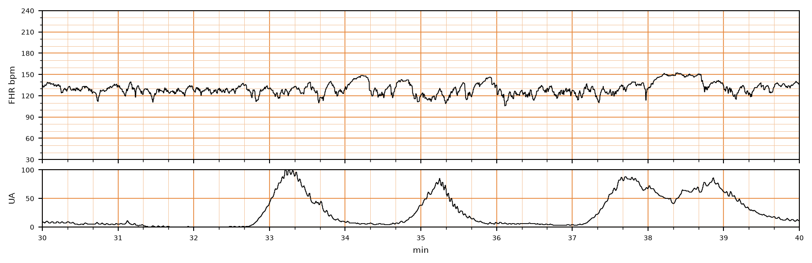

## 문제
30세 경산부(2회 분만)가 임신 41주에 규칙적인 진통으로 입원하였다. 임신 중 특이 병력은 없고 두 번 모두 질식분만을 하였다. 입원 때 혈압 118/74 mmHg, 체온 36.8 °C 이고 자궁경부는 5 cm 열려 있으며 양막은 터지지 않았다. 옥시토신은 쓰지 않았다. 입원 30분 뒤부터의 태아심박동과 자궁수축 전자감시 기록은 그림과 같다. 다음 처치로 가장 적절한 것은?

- A. 산모에게 산소를 주고 좌측위로 눕힌다
- B. 태아 두피 혈액으로 pH 를 잰다
- C. 흡인분만을 준비한다
- D. 진통 진행을 지켜보며 태아감시를 계속한다
- E. 즉시 제왕절개술을 한다

_분만 중 태아심박동(위)과 자궁활동(아래), 기록 시작 후 30~40분 구간, 굵은 세로선 = 1분 (PhysioNet CTU-UHB, ODC-BY 1.0 — 4 Hz 원자료, 평활화 없음)_

## 정답 및 해설
> 정답: D

- **정답 핵심**: 태아심박동 기저치는 약 130회/분으로 정상(110~160)이고, 변이도는 약 10~15회/분으로 중등도이며, 34분과 38분에 15회/분 이상·15초 이상 올라가는 가속이 있고, 10분 동안 세 번의 자궁수축에 뒤따르는 감속이 없다. 이는 범주 I(정상) 기록으로, 태아의 산염기 상태가 정상임을 강하게 시사한다. 따라서 특별한 처치 없이 진통 진행을 지켜보며 감시를 계속하면 된다.
- **원리**: <b>왜 변이도와 가속이 안심 신호인가</b>: 태아심박동의 박동 간 변동은 산소를 충분히 받는 태아 뇌간에서 교감·부교감 신경이 끊임없이 조율한 결과다. 저산소증과 산증이 깊어지면 이 조율이 무너져 변이도가 줄고 가속이 사라진다. 그래서 중등도 변이도나 가속이 있으면 <b>그 순간 태아가 대사성 산증이 아니라는 것</b>을 높은 신뢰도로 말해 준다.  <b>3단계 분류</b>: 범주 I 은 기저 110~160, 중등도 변이도, 후기·변이성 감속 없음 — 일상 감시. 범주 III 는 변이도 소실과 함께 반복 후기·변이성 감속이나 서맥, 또는 사인파 — 즉시 분만 준비. 그 사이 모든 것이 범주 II 로, 자궁내 소생술(체위 변경, 수액, 옥시토신 중단)과 재평가를 한다.  <b>왜 다른 처치를 하지 않나</b>: 정상 기록에서 개입하면 이득 없이 불필요한 수술·기구 분만만 늘어난다. 자궁경부 5 cm 인 분만 1기 활동기이므로 흡인분만은 조건(자궁경부 완전 개대)부터 맞지 않는다.
- **비교**: <table><thead><tr><th style="width:24%">항목</th><th style="width:38%">범주 I — 감시 계속(정답)</th><th>범주 II — 자궁내 소생술(가장 가까운 오답)</th></tr></thead><tbody> <tr><td>변이도</td><td><b>중등도(6~25회/분)</b></td><td>최소·소실(사인파 없음) 또는 현저</td></tr> <tr><td>감속</td><td>후기·변이성 감속 없음</td><td>반복 후기감속, 오래가는 감속 등</td></tr> <tr><td>처치</td><td>일상 감시</td><td>좌측위, 산소·수액, 옥시토신 중단 후 재평가</td></tr> </tbody></table> 감속이 나타나도 변이도와 가속이 유지되면 산증 가능성은 낮다 — 판단의 축은 변이도다.
- **오답 이유**:
  - ① 산소와 좌측위 같은 자궁내 소생술은 반복 후기감속이나 변이성 감속, 변이도 감소가 보이는 범주 II 기록일 때 정답이 된다.
  - ② 태아 두피 pH 측정은 범주 II 기록이 이어져 산증 여부를 확인해야 할 때 쓰는 검사로, 정상 기록에서는 할 필요가 없다.
  - ③ 흡인분만은 자궁경부가 완전히 열리고 아두가 충분히 내려온 분만 2기에 태아 상태가 나쁠 때 정답이 된다.
  - ⑤ 즉시 제왕절개술은 변이도가 사라진 채 반복 후기감속이나 지속 서맥이 이어지는 범주 III 기록이 소생술에도 회복되지 않을 때 정답이다.
- **함정**: 수축 사이 작은 흔들림을 감속으로 읽거나 41주라는 사실만으로 개입하려는 것 — 정상 변이도와 가속이 있으면 범주 I 이다.
- **학습목표**: 분만 중 태아심박동에서 정상 기저심박동·중등도 변이도·가속·감속 없음을 범주 I 으로 판정하고 분만 진행을 지켜보는 처치를 고른다
- **근거·출처**: American College of Obstetricians and Gynecologists. Practice Bulletin No. 106: Intrapartum fetal heart rate monitoring: nomenclature, interpretation, and general management principles. Obstet Gynecol. 2009;114(1):192-202

## 출처
- CTU-UHB Intrapartum Cardiotocography Database (PhysioNet, ODC-BY 1.0) · record 1231 · Open Data Commons Attribution License v1.0 · https://opendatacommons.org/licenses/by/1-0/
