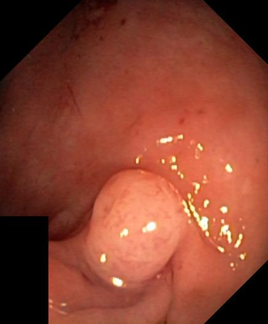

## 문제
An asymptomatic patient at average risk for colorectal cancer undergoes screening colonoscopy. There is no family history of colorectal cancer or polyposis syndromes, and the bowel preparation is excellent. The cecum is reached. A colonoscopic photograph of the single lesion found in the colon is shown. No other lesions are seen. Which of the following is the most appropriate next step in management?

- A. CT colonography
- B. Endoscopic polypectomy with histologic examination
- C. Segmental colectomy
- D. Serum carcinoembryonic antigen measurement
- E. Repeat colonoscopy in 10 years

_Colonoscopic photograph as provided by the dataset, downscaled only (HyperKvasir, OSF, CC BY 4.0; no cropping or color adjustment) ※ The clinical scenario in the stem is an authoring assumption — the source dataset has no age or clinical history_

## 정답 및 해설
> 정답: B

- **정답 핵심**: The photograph shows a round, smooth-surfaced, semipedunculated polyp rising from otherwise normal colonic mucosa, without ulceration, central depression, or spontaneous bleeding. The appearance alone cannot tell an adenoma from a hyperplastic polyp, and adenomas are the precursor of most colorectal cancers, so the polyp should be removed endoscopically during the same colonoscopy and sent for histology; the surveillance interval is then set by the pathology.
- **원리**: <b>Why remove rather than watch</b>: Most colorectal cancers arise through the adenoma-carcinoma sequence, in which an adenoma accumulates APC, KRAS, and TP53 mutations over about 10 years. Removing adenomas interrupts this sequence, which is why screening colonoscopy lowers both incidence and mortality of colorectal cancer. A polyp cannot be reliably classified by its outside appearance, so it is removed and examined.  <b>Why endoscopic, not surgical</b>: A smooth polyp without ulceration, depression, or a non-lifting sign has a low chance of deep submucosal invasion and can be resected completely with a snare. Surgery is for lesions that are not endoscopically resectable or that show invasive cancer with high-risk features on histology.  <b>Why histology sets the next step</b>: Number, size, and type (tubular, villous, sessile serrated, high-grade dysplasia) determine whether the next colonoscopy is in 3, 5-10, or 7-10 years.
- **비교**: <table><thead><tr><th style="width:24%">Feature</th><th style="width:38%">Endoscopic polypectomy (answer)</th><th>Segmental colectomy (closest distractor)</th></tr></thead><tbody> <tr><td>Lesion</td><td><b>Smooth polyp</b>, no ulceration or depression</td><td>Mass that cannot be removed endoscopically or invasive cancer with high-risk histology</td></tr> <tr><td>Diagnosis</td><td>Gives the histology and treats at once</td><td>Requires a tissue diagnosis first</td></tr> <tr><td>Risk</td><td>Low (bleeding, perforation are rare)</td><td>Anesthesia, anastomotic leak</td></tr> </tbody></table> A polyp found at screening is removed and read under the microscope first; surgery depends on what the pathology shows.
- **오답 이유**:
  - (A) CT colonography would be correct as a screening alternative for a patient who cannot or will not undergo colonoscopy.
  - (C) Segmental colectomy would be correct for a lesion that cannot be resected endoscopically or for a polyp showing invasive cancer with high-risk features.
  - (D) Serum CEA would be useful after a colorectal cancer diagnosis to monitor recurrence, but it is not a test for evaluating a polyp.
  - (E) Repeat colonoscopy in 10 years would be correct after a complete, high-quality colonoscopy that found no polyps at all.
- **함정**: Leaving a smooth, benign-looking polyp in place — its histology cannot be judged by appearance, so it is removed at the same session.
- **제작 가정**: HyperKvasir 는 내시경 사진과 소견 분류만 있고 나이·성별·병력이 없다 — 평균 위험군의 무증상 선별 대장내시경 상황을 가정했다 (가정한 정보: asymptomatic patient at average risk for colorectal cancer · screening colonoscopy)
- **학습목표**: 선별 대장내시경에서 발견한 매끈한 용종은 육안으로 조직형을 확정할 수 없으므로 내시경 절제 후 조직검사가 다음 단계임을 안다
- **근거·출처**: Loscalzo J, Fauci AS, Kasper DL, et al., eds. Harrison's Principles of Internal Medicine, 22nd ed. McGraw Hill; 2025. Chapter 86: Colorectal Cancer · Loscalzo J, Fauci AS, Kasper DL, et al., eds. Harrison's Principles of Internal Medicine, 22nd ed. McGraw Hill; 2025. Chapter 333: Gastrointestinal Endoscopy

## 출처
- HyperKvasir (OSF, CC BY 4.0) · ebecb670-0071-4a53-ae55-bc1df538e0ca.jpg · Creative Commons Attribution 4.0 International · https://datasets.simula.no/hyper-kvasir/
