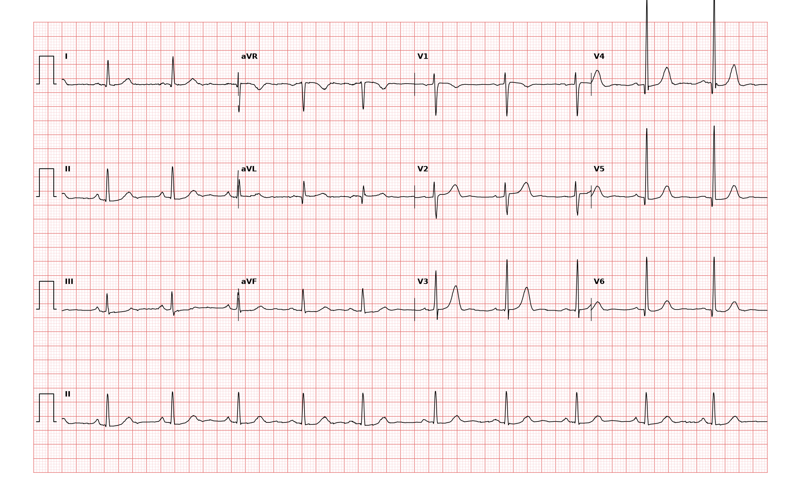

## 문제
73세 여자가 20년 동안 고혈압으로 약을 먹어 왔는데 최근 1년 동안 혈압이 잘 조절되지 않아 왔다. 가슴 통증과 실신은 없고 빠르게 걸으면 약간 숨이 차다. 혈압 168/94 mmHg, 맥박 70회/분이다. 심첨박동이 넓게 만져지고 제4심음이 들린다. 혈청 크레아티닌 1.0 mg/dL, 칼륨 4.1 mEq/L 이다. 12유도 심전도는 그림과 같다. 심전도 판독으로 가장 적절한 것은?

- A. 정상 심전도
- B. 좌심실 비대
- C. 우심실 비대
- D. 완전 좌각차단
- E. 오래된 측벽 심근경색

_12유도 심전도, 25 mm/s · 10 mm/mV, 3×4 + II 리듬 스트립 (PTB-XL ECG dataset, PhysioNet, CC BY 4.0 — 원신호 그대로 작도)_

## 정답 및 해설
> 정답: B

- **정답 핵심**: 동리듬 약 70회/분, QRS 는 좁다. V4·V5 의 R파가 매우 커서 V5 R 이 약 26 mm, V1 S 가 약 11 mm 로 둘을 합친 Sokolow-Lyon 전압이 약 37 mm(기준 35 mm 초과)다. 축은 정상이고 V1 에 우세한 R 이 없으며 Q파·ST-T 긴장형 변화는 없다. 오래된 고혈압·제4심음·넓은 심첨박동과 함께 좌심실 비대로 읽는다.
- **원리**: <b>왜 전압이 커지는가</b>: QRS 의 크기는 탈분극하는 심근의 양과 전극까지의 거리에 비례한다. 좌심실 벽이 두꺼워지면 왼쪽·뒤쪽으로 향하는 탈분극 벡터가 커져 그쪽을 보는 V5·V6 에서는 R파가, 반대쪽에서 보는 V1·V2 에서는 S파가 깊어진다. 그래서 두 값을 더한 Sokolow-Lyon(SV1 + RV5 또는 RV6 ≥ 35 mm)이 대표 기준이다.  <b>기준의 한계</b>: 전압 기준은 특이도는 높지만 민감도가 낮다(대개 50 % 미만). 비만·폐기종·심낭삼출은 전압을 낮추고, 마른 젊은 사람은 비대 없이 전압이 높을 수 있다 — 그래서 35세 미만에서는 전압만으로 진단하지 않는다. 여성에서는 Cornell 전압(R aVL + S V3 > 20 mm)도 쓴다. 확진과 정도 평가는 심초음파로 한다.  <b>긴장형 변화</b>: 비대가 진행해 심내막하 허혈과 재분극 이상이 생기면 V5·V6 에 비대칭 ST 하강과 T파 역전이 붙는다. 이 기록에는 아직 없다.
- **비교**: <table><thead><tr><th style="width:24%">소견</th><th style="width:38%">좌심실 비대(정답)</th><th>완전 좌각차단(가장 가까운 오답)</th></tr></thead><tbody> <tr><td>QRS 폭</td><td><b>좁다</b>(0.12 s 미만)</td><td>0.12 s 이상</td></tr> <tr><td>V5·V6</td><td>높고 뾰족한 R</td><td>넓고 갈라진(M 모양) R, q 파 없음</td></tr> <tr><td>ST-T</td><td>정상 또는 긴장형 변화</td><td>QRS 와 반대 방향의 ST-T 가 항상 동반</td></tr> </tbody></table> 둘 다 V5 R·V1 S 가 크게 보이지만 QRS 폭을 먼저 재면 갈린다 — 좌각차단이 있으면 전압 기준으로 비대를 판정하지 않는다.
- **오답 이유**:
  - ① 정상 심전도는 SV1 + RV5 가 35 mm 미만이거나 35세 미만의 마른 사람에서 다른 이상 없이 전압만 높을 때 정답이 될 수 있다.
  - ③ 우심실 비대는 V1 에 R 이 S 보다 큰 우세 R 파, 우축 편위, V5·V6 의 깊은 S 파가 있을 때 정답이 된다.
  - ④ 완전 좌각차단은 QRS 가 0.12 s 이상 넓고 I·aVL·V6 에 넓고 갈라진 R 이 있을 때 정답이며 이 기록의 QRS 는 좁다.
  - ⑤ 오래된 측벽 심근경색은 I·aVL·V5·V6 에 폭 0.04 s 이상의 깊은 Q 파가 남아 있을 때 정답이 된다.
- **함정**: 큰 R파만 보고 좌각차단이나 정상 변이로 넘기는 것 — QRS 폭과 SV1 + RV5 를 직접 재야 한다.
- **학습목표**: V1 의 S파와 V5 의 R파를 합한 전압이 35 mm 를 넘고 QRS 가 좁으면 좌심실 비대로 읽고 좌각차단·우심실 비대와 가른다
- **근거·출처**: Loscalzo J, Fauci AS, Kasper DL, et al., eds. Harrison's Principles of Internal Medicine, 22nd ed. McGraw Hill; 2025. Chapter 247: Electrocardiography

## 출처
- PTB-XL ECG dataset v1.0.3 (PhysioNet, CC BY 4.0) · record 14300 · Creative Commons Attribution 4.0 International · https://physionet.org/content/ptb-xl/1.0.3/LICENSE.txt
