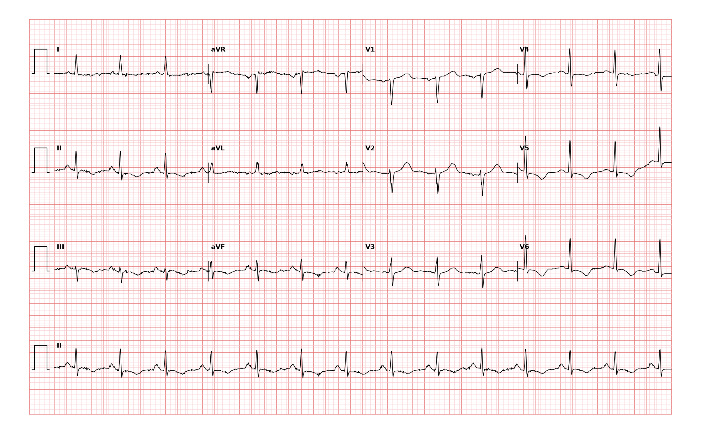

## 문제
72세 여자가 2시간 전 집안일을 하다 생긴 가슴 압박감으로 응급실에 왔다. 통증은 왼팔로 퍼졌고 설하 니트로글리세린을 먹은 뒤 가라앉아 지금은 없다. 고혈압과 이상지질혈증으로 약을 먹고 있다. 혈압 138/82 mmHg, 맥박 76회/분이고 폐에서 수포음은 들리지 않는다. 고감도 트로포닌 I 는 처음 측정에서 기준치의 6배이고 1시간 뒤 더 올랐다. 12유도 심전도는 그림과 같다. 다음 처치로 가장 적절한 것은?

- A. 베타차단제만 투여하고 외래 추적
- B. 흉부 CT 혈관조영술로 대동맥박리를 확인한 뒤 결정
- C. 아스피린·P2Y12 억제제·헤파린 투여 후 24시간 안에 관상동맥조영술
- D. 알테플라제 정맥 투여
- E. 운동부하 심전도를 하고 이상이 없으면 귀가

_12유도 심전도, 25 mm/s · 10 mm/mV, 3×4 + II 리듬 스트립 (PTB-XL ECG dataset, PhysioNet, CC BY 4.0 — 원신호 그대로 작도)_

## 정답 및 해설
> 정답: C

- **정답 핵심**: V5·V6 에 하향경사 ST 하강과 T파 역전이 있고 II·III·aVF 에도 경한 ST 하강이 있으나 ST 상승은 없다. 전형적 흉통과 트로포닌 상승·증가를 합치면 비ST분절상승 심근경색(NSTEMI)이다. 통증이 가라앉았고 혈역학적으로 안정하므로 아스피린·P2Y12 억제제·항응고제를 시작하고 트로포닌 상승이라는 고위험 소견에 따라 24시간 안에 관상동맥조영술을 한다. 혈전용해제는 이득이 없다.
- **원리**: <b>왜 ST 가 내려가는가</b>: 관상동맥이 완전히 막히지 않고 부분 폐쇄되면 혈류가 가장 먼저 부족해지는 곳은 압력이 높은 심내막하층이다. 손상 전류가 심내막 쪽을 향하므로 그 위의 표면 전극에서는 ST 가 내려간다. ST 하강의 위치는 막힌 혈관을 정확히 가리키지 않는다 — ST 상승과 달리 부위 진단 가치가 낮다.  <b>왜 혈전용해제를 쓰지 않나</b>: NSTEMI 의 원인 혈전은 혈소판이 풍부한 「흰 혈전」으로 동맥을 완전히 막지 않는다. 섬유소를 녹이는 혈전용해제는 막힌 혈관을 다시 열어 주는 STEMI 에서만 이득이 있고, NSTE-ACS 에서는 오히려 출혈과 사망을 늘렸다. 대신 혈소판을 막는 이중 항혈소판제와 트롬빈을 막는 항응고제가 기본이다.  <b>침습 시점</b>: 지속되는 흉통·혈역학 불안정·심부전·악성 부정맥이 있으면 2시간 안에, 트로포닌으로 확인된 NSTEMI 처럼 고위험이면 24시간 안에 관상동맥조영술을 한다.
- **비교**: <table><thead><tr><th style="width:24%">구분</th><th style="width:38%">NSTEMI(정답)</th><th>STEMI(가장 가까운 오답의 적응)</th></tr></thead><tbody> <tr><td>심전도</td><td><b>ST 하강</b>·T파 역전, 또는 정상</td><td>인접 두 유도의 ST 상승, 새 좌각차단</td></tr> <tr><td>혈전</td><td>부분 폐쇄, 혈소판 풍부</td><td>완전 폐쇄, 섬유소 풍부</td></tr> <tr><td>재관류</td><td>항혈소판·항응고 후 2~24시간 안 조영술</td><td>일차 중재술(불가하면 혈전용해제)</td></tr> </tbody></table> 같은 트로포닌 상승이라도 ST 가 올라갔는지 내려갔는지가 혈전용해제 적응을 가른다.
- **오답 이유**:
  - ① 베타차단제 단독과 외래 추적은 트로포닌이 정상인 안정 협심증에서 정답이 될 수 있지만 급성 심근경색에는 부족하다.
  - ② 흉부 CT 혈관조영술은 찢어지는 등 통증·양팔 혈압 차이·종격동 확장으로 대동맥박리가 의심될 때 정답이 된다.
  - ④ 알테플라제는 ST 상승 심근경색에서 120분 안에 일차 중재술을 할 수 없을 때 정답이 되며 ST 하강에서는 이득이 없다.
  - ⑤ 운동부하 심전도는 트로포닌과 심전도가 정상인 저위험 흉통에서 정답이 되며 심근경색 급성기에는 금기다.
- **함정**: 트로포닌이 오른 심근경색이면 혈전용해제를 쓰는 것 — 혈전용해제는 ST 상승일 때만 이득이 있다.
- **학습목표**: ST 상승 없이 측벽·하벽 유도의 ST 하강과 트로포닌 상승을 비ST분절상승 심근경색으로 판단하고 혈전용해제가 아닌 항혈소판·항응고 치료와 조기 관상동맥조영술을 고른다
- **근거·출처**: Loscalzo J, Fauci AS, Kasper DL, et al., eds. Harrison's Principles of Internal Medicine, 22nd ed. McGraw Hill; 2025. Chapter 285: Non-ST-Segment Elevation Acute Coronary Syndrome (Non-ST-Segment Elevation Myocardial Infarction and Unstable Angina) · Loscalzo J, Fauci AS, Kasper DL, et al., eds. Harrison's Principles of Internal Medicine, 22nd ed. McGraw Hill; 2025. Chapter 247: Electrocardiography

## 출처
- PTB-XL ECG dataset v1.0.3 (PhysioNet, CC BY 4.0) · record 12615 · Creative Commons Attribution 4.0 International · https://physionet.org/content/ptb-xl/1.0.3/LICENSE.txt
