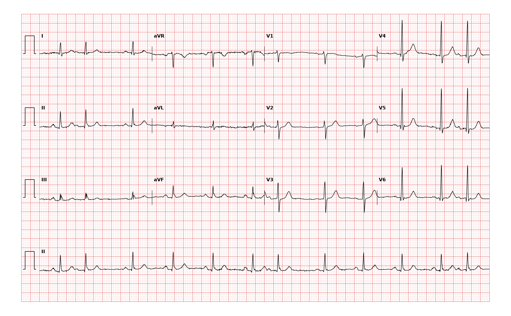

## 문제
A 71-year-old man comes to the physician because of an occasional sensation that his heart skips a beat for the past 3 weeks. He has no chest pain, dyspnea, dizziness, or syncope. He drinks two cups of coffee daily and does not smoke. Blood pressure is 128/80 mm Hg and pulse is 70/min and slightly irregular. Cardiac examination shows no murmurs. Serum electrolytes and thyroid-stimulating hormone are within normal limits. A 12-lead ECG is shown. Which of the following is the most likely diagnosis?

- A. Premature atrial contractions
- B. Premature ventricular contractions
- C. Second-degree atrioventricular block, Mobitz type I
- D. Atrial fibrillation
- E. Sinus arrhythmia

_12-lead ECG, 25 mm/s, 10 mm/mV, 3×4 + lead II rhythm strip (PTB-XL, PhysioNet, CC BY 4.0; raw signal, no filtering)_

## 정답 및 해설
> 정답: A

- **정답 핵심**: The lead II rhythm strip shows sinus rhythm at about 70/min interrupted three times by an early beat with a narrow QRS identical to the sinus beats. Each early beat is preceded by a P wave of different shape, and the pause after it is noncompensatory — the two intervals around it add up to less than two sinus cycles. Early, narrow beats with an abnormal P wave and a reset sinus node are premature atrial contractions.
- **원리**: <b>Why the QRS stays narrow</b>: An atrial premature beat starts in atrial tissue outside the sinus node, so its P wave has a different shape or axis. The impulse then reaches the AV node and travels down the normal His-Purkinje system, producing a QRS identical to the sinus beats — unless it arrives so early that one bundle branch is still refractory (aberrant conduction).  <b>Why the pause is noncompensatory</b>: The premature atrial impulse also enters and depolarizes the sinus node, resetting its timing. The next sinus beat comes one cycle after the premature beat, so the interval spanning it is shorter than two normal cycles. A ventricular premature beat usually does not reach the sinus node, so the sinus rhythm continues undisturbed and the pause is fully compensatory.  <b>Clinical meaning</b>: Isolated premature atrial contractions are common and benign in older adults. Caffeine, alcohol, and stress increase them; frequent ones may be a marker of later atrial fibrillation, but they themselves need treatment only when symptoms are troublesome.
- **비교**: <table><thead><tr><th style="width:24%">Feature</th><th style="width:38%">Premature atrial contraction (answer)</th><th>Mobitz type I block (closest distractor)</th></tr></thead><tbody> <tr><td>Pause cause</td><td>An <b>early</b> beat followed by reset</td><td>A P wave that is <b>not conducted</b> (no QRS after it)</td></tr> <tr><td>PR interval</td><td>Constant in sinus beats</td><td>Progressively lengthens before the dropped beat</td></tr> <tr><td>P wave before pause</td><td>Early, different shape, followed by QRS</td><td>On time, normal shape, not followed by QRS</td></tr> </tbody></table> Both produce grouped beating; look for whether the beat before the pause came early (atrial premature) or a P wave was dropped (block).
- **오답 이유**:
  - (B) Premature ventricular contractions would be correct if the early beats had a wide, bizarre QRS without a preceding P wave and a compensatory pause.
  - (C) Mobitz type I block would be correct if the PR interval lengthened progressively until a sinus P wave appeared on time without a following QRS.
  - (D) Atrial fibrillation would be correct if there were no organized P waves and the RR intervals were irregularly irregular throughout the tracing.
  - (E) Sinus arrhythmia would be correct if the RR intervals varied gradually with respiration and every P wave had the same sinus shape.
- **함정**: Calling grouped beating Mobitz I without checking the PR interval — here the beat before each pause comes early with a different P wave.
- **학습목표**: 좁은 QRS 의 조기 박동 앞에 모양이 다른 P파가 있고 휴지가 비보상성이면 심방조기수축으로 읽고 모비츠 1형 방실차단·심실조기수축과 가른다
- **근거·출처**: Loscalzo J, Fauci AS, Kasper DL, et al., eds. Harrison's Principles of Internal Medicine, 22nd ed. McGraw Hill; 2025. Chapter 253: Approach to Supraventricular Arrhythmias · Loscalzo J, Fauci AS, Kasper DL, et al., eds. Harrison's Principles of Internal Medicine, 22nd ed. McGraw Hill; 2025. Chapter 247: Electrocardiography

## 출처
- PTB-XL ECG dataset v1.0.3 (PhysioNet, CC BY 4.0) · record 896 · Creative Commons Attribution 4.0 International · https://physionet.org/content/ptb-xl/1.0.3/LICENSE.txt
