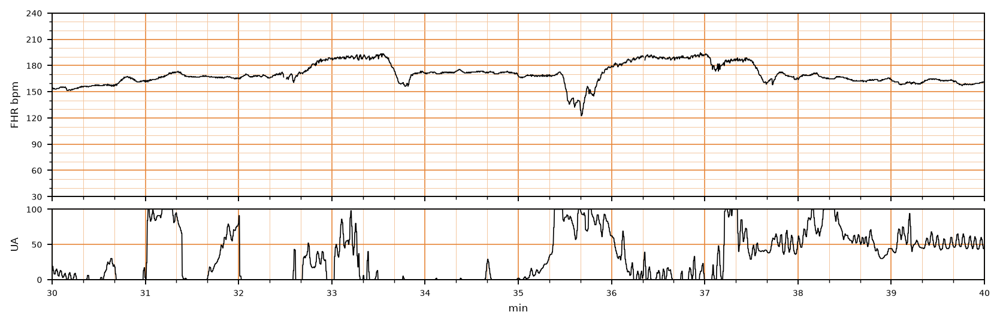

## 문제
29세 경산부(1회 분만)가 임신 39주에 규칙적인 진통으로 입원하였다. 양막은 16시간 전에 터졌다. 분만 1기 활동기이며 자궁경부는 6 cm 열려 있다. 체온 38.3 °C, 혈압 116/72 mmHg, 맥박 108회/분이다. 자궁 압통은 뚜렷하지 않고 양수는 맑다. 경막외 진통은 하지 않았다. 입원 후 30분부터 기록한 태아심박동·자궁수축 기록은 그림과 같다. 태아심박동 기록의 판독으로 가장 적절한 것은?

- A. 범주 II — 반복되는 후기감속
- B. 범주 III — 사인곡선 양상
- C. 범주 II — 태아빈맥과 변동성 감속
- D. 범주 I — 정상 기저심박동과 가속
- E. 범주 III — 변이도 소실과 반복 후기감속

_분만 중 태아심박동(위)과 자궁활동(아래), 기록 시작 후 30~40분 구간, 굵은 세로선 = 1분 (PhysioNet CTU-UHB, ODC-BY 1.0 — 4 Hz 원자료, 평활화 없음)_

## 정답 및 해설
> 정답: C

- **정답 핵심**: 기저 태아심박동은 가속과 감속을 뺀 구간에서 약 165회/분으로 160회/분을 넘는 태아빈맥이다. 변이도는 진폭 6~10회/분으로 중등도이고, 190회/분까지 오르는 가속이 두 번 있으며, 35분 무렵 자궁수축과 함께 급격히 약 125회/분까지 떨어졌다 빠르게 회복하는 변동성 감속이 한 번 있다. 후기·지연 감속은 없다. 변이도와 가속이 안심 소견이지만 기저심박동이 정상 범위를 벗어났으므로 범주 I 이 아니라 범주 II 다. 산모 발열과 오래된 양막 파열은 태아빈맥의 원인(자궁내 감염)을 시사한다.
- **원리**: <b>왜 기저심박동을 먼저 정하나</b>: 범주는 기저심박동 · 변이도 · 가속 · 감속 네 요소를 차례로 읽어 정한다. 기저심박동은 10분 동안 가속·감속·현저한 변이 구간을 빼고 2분 이상 지속되는 평균값을 5회/분 단위로 읽는다. 이 기록처럼 가속이 길게 이어지면 그 높이를 기저로 착각하기 쉬운데, 1분 남짓 올라갔다가 돌아오는 구간은 가속이다.  <b>왜 태아빈맥이 생기나</b>: 태아 심박수는 교감·부교감 균형으로 정해지며, 산모 발열은 태아의 체온과 대사율을 올려 교감 신호를 강하게 만든다. 융모양막염 · 산모 탈수 · 베타 작용제 · 태아 빈혈 · 태아 빈맥성 부정맥도 원인이다. 그래서 160회/분 초과는 그 자체로 「정상 아님」이고, 원인을 찾아 교정하면서 감시를 이어 간다.  <b>범주 II 의 의미</b>: 범주 II 는 범주 I(정상)도 범주 III(비정상)도 아닌 모든 기록이다. 중등도 변이도나 가속이 있으면 그 순간 태아 산증 가능성은 낮지만, 원인(여기서는 산모 발열)을 평가하고 항생제·해열제 같은 교정 조치를 하며 재평가한다.
- **비교**: <table><thead><tr><th style="width:24%">요소</th><th style="width:38%">이 기록(범주 II)</th><th>범주 I(가장 가까운 오답)</th></tr></thead><tbody> <tr><td>기저심박동</td><td><b>약 165회/분</b> — 160 초과</td><td>110~160회/분</td></tr> <tr><td>변이도</td><td>중등도(6~25회/분)</td><td>중등도</td></tr> <tr><td>감속</td><td>변동성 감속 1회</td><td>후기·변동성 감속 없음(조기감속은 허용)</td></tr> </tbody></table> 변이도·가속이 좋아도 기저심박동 하나가 범위를 벗어나면 범주 I 이 될 수 없다 — 네 요소 가운데 하나라도 어긋나면 범주 II 부터 생각한다.
- **오답 이유**:
  - ① 반복 후기감속은 수축 정점 뒤에 서서히 시작해 수축이 끝난 뒤에야 회복하는 대칭 감속이 수축의 절반 이상에서 보일 때 정답이다.
  - ② 사인곡선 양상은 분당 3~5주기의 매끈한 물결이 20분 이상 이어지고 가속이 없을 때 정답이며 태아 빈혈을 시사한다.
  - ④ 범주 I 은 기저심박동이 110~160회/분 안에 있고 중등도 변이도에 후기·변동성 감속이 없을 때 정답이 된다.
  - ⑤ 범주 III 는 변이도가 사라진(진폭 검출 안 됨) 상태에서 후기감속이나 변동성 감속이 반복되거나 서맥이 있을 때 정답이다.
- **함정**: 가속과 중등도 변이도를 보고 바로 범주 I 로 판정하는 것 — 기저심박동이 160회/분을 넘는지 먼저 재야 한다.
- **학습목표**: 분만 중 태아심박동에서 가속과 중등도 변이도가 있어도 기저심박동이 160회/분을 넘으면 범주 II 로 판정하고 범주 I 과 가른다
- **근거·출처**: American College of Obstetricians and Gynecologists. Practice Bulletin No. 106: Intrapartum fetal heart rate monitoring: nomenclature, interpretation, and general management principles. Obstet Gynecol. 2009;114(1):192-202

## 출처
- CTU-UHB Intrapartum Cardiotocography Database (PhysioNet, ODC-BY 1.0) · record 1085 · Open Data Commons Attribution License v1.0 · https://opendatacommons.org/licenses/by/1-0/
