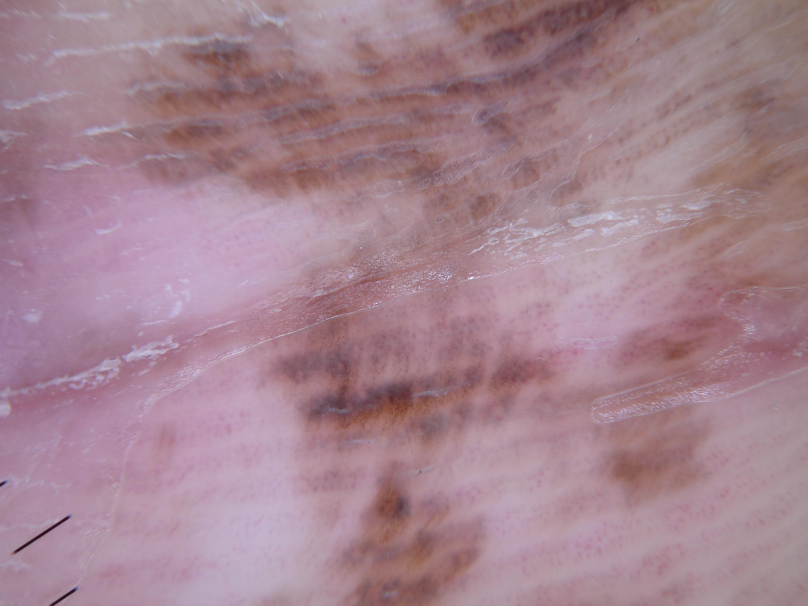

## 문제
An 80-year-old woman comes to the physician because of a brown patch on the sole of her left foot that her daughter noticed a year ago and that seems to have become larger. It does not itch, bleed, or hurt, and she does not recall any injury. She has no personal or family history of skin cancer. Examination shows a flat, irregularly pigmented brown patch measuring 14 x 9 mm on the plantar surface of the foot, with uneven borders and no palpable nodule. There is no inguinal or popliteal lymphadenopathy. A dermoscopic photograph of the lesion is shown. Which of the following is the most appropriate next step in management?

- A. Wide local excision with 2-cm margins and sentinel lymph node biopsy
- B. Excisional biopsy with narrow (1-3 mm) margins
- C. Clinical and dermoscopic follow-up in 6 months
- D. Cryotherapy with liquid nitrogen
- E. Topical antifungal therapy for 4 weeks

_Dermoscopic photograph of the skin lesion, downscaled only (ISIC Archive, CC0; no cropping or color adjustment)_

## 정답 및 해설
> 정답: B

- **정답 핵심**: Dermoscopy of the acral skin shows brown pigment arranged in broad bands parallel to the skin markings, with uneven width, color, and intensity, and an irregular overall distribution. A growing, irregular acral pigmented lesion larger than 7 mm in an older adult must be assumed to be acral lentiginous melanoma until histology says otherwise. The next step is a complete excisional biopsy with narrow margins so that the pathologist can measure thickness, which then determines definitive margins and the need for sentinel node biopsy. Histology showed melanoma in situ.
- **원리**: <b>Why acral skin looks different</b>: The palms and soles have thick skin arranged in parallel ridges and furrows (dermatoglyphics), and eccrine ducts open on the ridges. Melanocytic lesions therefore show linear, parallel patterns rather than the reticular network seen elsewhere. Benign acral nevi typically place thin, regular lines of pigment in the furrows, whereas melanoma tends to produce broader, irregular bands with uneven color and asymmetric distribution.  <b>Why biopsy and not watch</b>: Acral lentiginous melanoma is the most common melanoma subtype in Asian and Black patients and is often diagnosed late because the sole is not looked at. A lesion that is enlarging, larger than 7 mm, irregular in color, or new in an older adult should be removed for histology rather than followed.  <b>Why narrow margins first</b>: Treatment margins depend on Breslow thickness, which only histology can provide. An excisional biopsy with 1-3 mm margins removes the whole lesion for accurate staging without disrupting lymphatic drainage, so that a later wide excision (0.5-1 cm for in situ, 1-2 cm for invasive tumors) and sentinel node mapping remain accurate.
- **비교**: <table><thead><tr><th style="width:24%">Feature</th><th style="width:38%">Acral melanoma (answer)</th><th>Acral nevus (closest distractor)</th></tr></thead><tbody> <tr><td>Pigment pattern</td><td><b>Broad, irregular bands</b>, uneven color and width</td><td>Thin, regular parallel lines of uniform color</td></tr> <tr><td>Size and course</td><td>Often over 7 mm, enlarging</td><td>Usually small and stable</td></tr> <tr><td>Typical patient</td><td>Older adult</td><td>Child or young adult</td></tr> </tbody></table> Regularity and change are the deciding features — a small, stable, regular lesion can be followed, but a growing irregular one is excised.
- **오답 이유**:
  - (A) Wide excision with 2-cm margins and sentinel node biopsy would be correct after a biopsy has shown invasive melanoma thicker than 2 mm, not before the thickness is known.
  - (C) Follow-up in 6 months would be correct for a small, stable acral lesion with thin, regular, uniformly colored parallel lines in a young patient.
  - (D) Cryotherapy would be correct for a benign lesion such as a plantar wart or seborrheic keratosis, but it destroys melanocytic tissue without allowing histology.
  - (E) Topical antifungal therapy would be correct for tinea nigra, a superficial brown macule on the palm with hyphae on potassium hydroxide preparation and no pigment network.
- **함정**: Following a pigmented lesion of the sole because it is flat and painless — growth, size, and irregular color call for excision.
- **학습목표**: 발바닥 색소 병변의 피부확대경에서 폭과 색이 고르지 않은 넓은 갈색 띠를 읽고 커지는 병변이면 경과 관찰이 아니라 절제 생검을 고른다
- **근거·출처**: Loscalzo J, Fauci AS, Kasper DL, et al., eds. Harrison's Principles of Internal Medicine, 22nd ed. McGraw Hill; 2025. Chapter 81: Cancer of the Skin

## 출처
- ISIC Archive ISIC_0021382 (CC-0) · CC0 1.0 Universal · https://creativecommons.org/publicdomain/zero/1.0/
